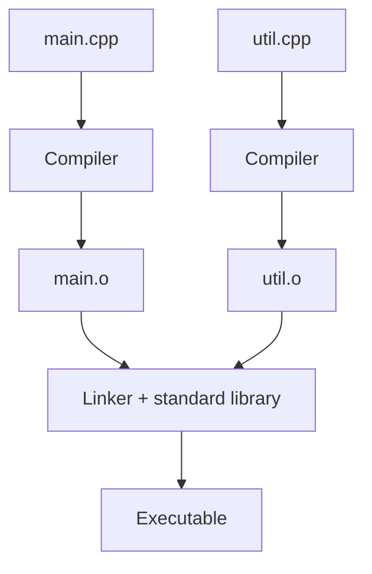

# 0.5 Introduction to the compiler, linker, and libraries

Your source files are text, and a computer cannot run text. Two tools turn your files into a program, a compiler and a linker, and a third ingredient, libraries, supplies code you did not have to write. This lesson explains what each one does and how to tell their error messages apart.

## Compiling

A **compiler** translates source code into machine code. It works on one source file at a time, and it does not look at the other files in your program. For each `.cpp` file, it produces an **object file**, which contains machine code for that file's contents. Object files usually end in `.o` on Linux and macOS, and in `.obj` on Windows.

While it translates, the compiler checks that your code follows the rules of C++, and it reports **errors** for code it cannot translate and **warnings** for code that is legal but suspicious. Before the translation starts, the compiler also runs a preprocessing step that handles lines beginning with `#`, such as `#include`.

With GCC or Clang, the `-c` option tells the compiler to compile a file and stop there:

```bash
g++ -std=c++20 -c main.cpp
```

This command writes the object file `main.o`. With Microsoft's compiler, `cl`, the same option is `/c`, and it writes `main.obj`.

> [!KEY-INSIGHT]
> Because each source file is compiled on its own, a change to one file only requires recompiling that file. Build tools use this to keep large projects quick to rebuild.

## Linking

An object file is not yet a program. It may refer to code in other object files, for instance when one file calls a function that another file defines, and it does not know where that code is.

The **linker** puts the pieces together. It combines your object files, matches every reference to the code it refers to, adds the libraries your program uses, and writes a single **executable**. On Windows an executable file ends in `.exe`, while on Linux and macOS it usually has no extension.

With GCC or Clang, you can give the object files to the compiler command, which then runs the linker for you:

```bash
g++ main.o util.o -o program
```

The `-o` option names the output file, so this command writes an executable called `program`.

## Libraries

A **library** is a collection of code that someone else already wrote and compiled, so you can reuse it. You tell the linker which libraries your program needs, and it takes the pieces you use.

The most important library is the **C++ Standard Library**. It comes with your compiler, and it provides ready-made tools for common jobs, such as printing text and storing collections of values. You will meet its parts one by one, starting in Chapter 1, and compilers add the Standard Library to your program automatically.

Libraries written by other people are called third-party libraries. You will not need any of them for a long while.

## The whole picture

The diagram below shows the path for a program with two source files. Each source file goes through the compiler and becomes an object file, and the linker combines both object files with the Standard Library to produce the executable.



## Compile errors and link errors

Errors can come from either tool, and knowing which one reported the problem tells you where to look.

A **compile error** means a source file breaks the rules of the language, for example because of a misspelled name or a missing semicolon. The compiler reports the file and the line, and it produces no object file for that file.

A **link error** means that every file compiled, but the pieces do not fit together. The most common cause is a function that is declared and used but never defined.

A **declaration** tells the compiler that a function exists, and a **definition** supplies the code that the function runs. A declaration is enough for the compiler to accept a call, but the linker needs a definition to connect the call to. This program shows the problem:

```cpp title="missing-definition.cpp"
{{#include ../../examples/ch00/05-missing-definition.fail.cpp}}
```

The first line is a comment that records why the program fails, and the book's automated checks read it. The program declares `greet` and calls it from `main`, but no file defines it.

If you compile this file with `-c`, it succeeds, because the compiler is satisfied with the declaration. If you build the whole program, the linker fails, because it cannot find a definition of `greet` anywhere. Most linkers describe this as an undefined or unresolved symbol, and they name the missing function. Microsoft's linker reports it as error LNK2019.

The wording of the final message changes between toolchains. With GCC it ends by saying that `ld` returned an exit status, and with Clang it says that the linker command failed. A mention of the linker, or an error code starting with `LNK`, tells you that the problem is a link error, so you should look for a missing definition instead of a typo.

## Automating the build

Typing a compile command for every file gets tiresome as a project grows. **Build tools** run the right commands for you, and they rebuild only the files that changed. Make and Ninja are two such tools. **Build-system generators**, such as CMake, go a step further: they write the input files that tools like Make and Ninja use, so one project description can work on many platforms.

An IDE does all of this behind its build button. You will use one in lesson 0.7, and you will not need Make or CMake for a long time.

## Testing and debugging

The last steps of the development loop come after the executable exists. You run the program with different inputs, and you check that it does what you meant. When it does not, you debug: you use a debugger, a tool that lets you pause the program and inspect it, together with careful reading, to find the cause of the problem.

## Summary

- The compiler translates each source file on its own into an object file, and it checks the rules of the language.
- The linker combines object files and libraries and resolves the references between them to produce an executable.
- A library is reusable, precompiled code, and the C++ Standard Library comes with your compiler.
- A compile error means a file breaks the language rules, and a link error means the pieces do not fit together, for example because a definition is missing.
- Build tools such as Make and Ninja, and generators such as CMake, automate compiling and linking, and an IDE does it for you.
- Testing and debugging are the last steps of the development loop.

## Further reading

- [GCC documentation: the -c and -o options](https://gcc.gnu.org/onlinedocs/gcc/Overall-Options.html)
- [Microsoft documentation: /c (compile without linking)](https://learn.microsoft.com/en-us/cpp/build/reference/c-compile-without-linking)
- [Microsoft documentation: linker error LNK2019](https://learn.microsoft.com/en-us/cpp/error-messages/tool-errors/linker-tools-error-lnk2019)
- [GNU Make](https://www.gnu.org/software/make/)
- [Ninja](https://ninja-build.org/)
- [CMake generators](https://cmake.org/cmake/help/latest/manual/cmake-generators.7.html)
