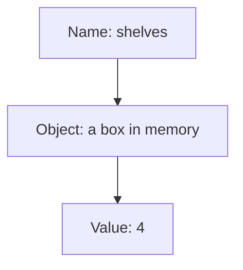

# 1.3 Introduction to objects and variables

Programs do more than print fixed text. They work with information that changes from one run to the next: a score, a price, the number of seats left. This lesson introduces the place where a program keeps such information while it runs. You will learn what an object and a variable are, how to create one, and how to print its value.

## Data and values

Everything a program works with is **data**: numbers, text, and every other kind of information. A single piece of data, such as the number 4 or the word `hello`, is called a **value**.

Lesson 0.2 explained that a running program keeps the data it is working on in memory. You can picture memory as a very long row of boxes, each with its own number and each able to hold a small piece of data. To keep a value for later, a program needs a box to put it in. It also needs a way to find the box again, because nobody wants to remember box numbers.

## Objects and variables

An **object** is a piece of memory that the program sets aside to hold a value. The language standard describes it a little more carefully: an object occupies a region of storage for as long as it exists, and a definition creates it.

Objects usually have names, because names are how you find them again. An object that has a name is called a **variable**, and the name is how the rest of the program refers to the value inside. The word comes from the fact that the value can vary: the program can put a different value into the same variable later.

The diagram shows how the three ideas fit together: the name leads to the object, and the object holds the value.



> [!ADVANCED]
> The standard's definition of a variable is a little wider than the one in this lesson: it also covers a kind of name called a reference, which does not create a new object. References come much later in this book, so for now a variable is an object with a name.

## Defining a variable

You create a variable with a **definition**. It names the type of the variable and then its name:

```cpp
int width;
```

The word `int` is the **type**. A type tells the compiler how much memory the object needs and how to interpret the bits stored in it. The type `int` holds whole numbers, such as 4, 0 or -17, and it is the only type you need for now. Chapter 4 introduces the other fundamental types and explains them in detail.

The word `width` is the name. Lesson 1.7 explains what names you may use and how to choose good ones.

The definition does not run when you build the program. The compiler records it, and the object is created when the program runs and reaches the definition. From that line on, you can use the name.

## Using variables

This program defines two variables, and then prints what is in them:

```cpp title="define-variables.cpp"
{{#include ../../examples/ch01/03-define-variables.cpp}}
```

The part in braces, as in `shelves{4}`, gives the variable its first value. Lesson 1.4 explains the braces. Every program in this book gives its variables a value in this way, and lesson 1.6 explains why that is so important.

The statements that start with `std::cout` print text and the value of a variable, one after the other. Lesson 1.5 explains how the `<<` works. The program prints:

```text title="Output"
{{#include ../../examples/ch01/03-define-variables.out}}
```

Notice that the name `shelves` appears twice in the program, once in the definition and once in the output statement. The first creates the variable and the second uses its value. The text between the quotation marks, such as `"shelves: "`, is printed exactly as written, and the name without quotation marks is replaced by the value.

## Defining several variables

You can define more than one variable of the same type in a single statement, by separating the names with commas:

```cpp
int low{1}, high{9};
```

This is legal. What is not legal is repeating the type after the comma, which beginners often try:

```cpp
int low, int high;
```

The comma continues the same definition, so the compiler expects another name after it and finds the word `int` instead. The compiler reports an error.

> [!BEST-PRACTICE]
> Define one variable per statement, each on its own line. The code is more readable, you can comment each variable separately, and you avoid the mistake above.

<details>
<summary>Check your understanding</summary>

**Question 1.** What is the difference between an object and a variable?

<details>
<summary>Answer</summary>

An object is a piece of memory that holds a value. A variable is an object that has a name, which lets the program refer to it.

</details>

**Question 2.** The compiler reports an error for this line. What is wrong, and what would you write instead?

```cpp
int width, int height;
```

<details>
<summary>Answer</summary>

The type is repeated after the comma, so the compiler expects a name and finds `int`. Write `int width{5}, height{3};` or, better, one definition per statement, each on its own line: `int width{5};` and `int height{3};`.

</details>

**Question 3.** What does the program above print if you change the 4 in the first definition to 6?

<details>
<summary>Answer</summary>

It prints `shelves: 6`, and the second line stays the same. The variable `shelves` now starts with the value 6.

</details>

</details>

## Summary

- Data is the information a program works with, and a value is one piece of it.
- An object is a piece of memory that holds a value, and a variable is an object with a name.
- A definition such as `int width;` creates a variable: `int` is its type and `width` is its name.
- The type `int` holds whole numbers, and Chapter 4 covers the other types.
- Define one variable per statement, and give every variable a value, as the next lessons show.

## Further reading

- [Objects and variables in the C++ standard (basic.pre)](https://eel.is/c++draft/basic.pre)
- [Object (cppreference)](https://en.cppreference.com/w/cpp/language/object)
