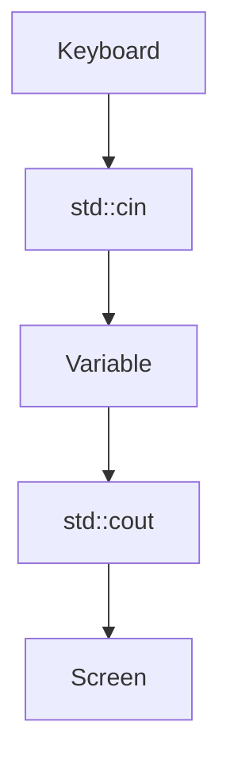

# 1.5 Introduction to iostream: cout, cin, and endl

So far your programs could only talk. They printed text and numbers, but they never listened. In this lesson you learn how a program prints several things in one statement and how it reads what you type, and you meet `std::endl`, a close relative of the `"\n"` that you have used since lesson 0.7.

## The iostream library

Printing and reading are not part of the core of the language. They belong to the Standard Library, in a part called **iostream**, which gets its name from "input and output streams". A **stream** is a flow of characters that moves in one direction, either from your program to somewhere, or from somewhere to your program.

The line `#include <iostream>` at the top of a program makes the library available. It provides two names that matter in this lesson:

- `std::cout` is the stream that goes to the console, the window where your program's text appears.
- `std::cin` is the stream that comes from the keyboard.

The `std::` in front of each name says that the name belongs to the Standard Library, whose names all live in a group called `std`. Lesson 2.9 explains why.

## Printing with std::cout

You send something to `std::cout` with the **insertion operator**, written `<<`. Think of the two arrows as pointing in the direction in which the value travels: from the right, into the stream on the left.

An output statement can insert several things in a row, which is called chaining. Each `<<` hands the next item to the stream. The pieces can be text in quotation marks, numbers, or the names of variables, and they can be mixed in any order:

```cpp title="print-several.cpp"
{{#include ../../examples/ch01/05-print-several.cpp}}
```

```text title="Output"
{{#include ../../examples/ch01/05-print-several.out}}
```

The first output statement chains five pieces: some text, the value of `cups`, more text, the value of `saucers`, and a newline. The second one shows that splitting a sentence into several pieces gives the same result as writing it in one piece. The third prints two numbers that are written directly in the statement. Lesson 1.9 explains these numbers, which are called literals.

Notice that nothing is added between the pieces. The program decides where spaces and line breaks go, and that is why the text above contains `", saucers: "` with a space after the comma.

## "\n" or std::endl

You end a line of output with `"\n"`, which is one character that means "start a new line". C++ offers a second way, `std::endl`:

```cpp
std::cout << "Hello" << std::endl;
```

The name comes from "end line". It does two things: it ends the line, and it also **flushes** the stream. To see what that means, you need to know that output does not always go to the screen the moment you insert it. A stream keeps the text it has received in a **buffer**, a small area of memory, and sends the whole buffer onward when it is convenient. Flushing forces the buffer to be sent right away.

Most programs never need that. The buffer is emptied anyway when the program ends, and also before the program waits for input, because `std::cin` and `std::cout` are tied together: any input operation on `std::cin` flushes `std::cout` first. Forcing a flush after every line only makes a program that prints a lot do extra work.

> [!BEST-PRACTICE]
> Write `"\n"` to end a line, and use `std::endl` only when you really need the text to appear immediately. The book uses `"\n"` in every example.

## Reading with std::cin

Reading goes the other way. You take a value out of `std::cin` with the **extraction operator**, written `>>`, and put it into a variable. The arrows now point from the stream into the variable.

```cpp title="read-number.cpp"
{{#include ../../examples/ch01/05-read-number.cpp}}
```

This program waits for you, so what you see depends on what you type. The block below shows the console as you would see it, with the line that you type included. Type 42 and press <kbd>Enter</kbd>:

```text title="Example session"
{{#include ../../examples/ch01/05-read-number.session}}
```

The program prints its question and waits. Nothing is sent to the program while you type. The keyboard input is collected until you press <kbd>Enter</kbd>, and only then does `std::cin >> bookCount;` take the number out of it and store it in the variable.

The question appears before the program starts waiting because of the tie that you read about above: reading from `std::cin` flushes the text in `std::cout` first. The diagram shows the path of the data through the program.



Every value you read needs a variable that is ready to receive it. This is one of the best places to use empty braces, as in `int bookCount{};`: the variable gets a harmless 0 now, and the real value arrives a moment later.

## Reading several values

You can chain extractions in the same way as insertions. When the program reads whole numbers, they are separated by whitespace, which is any mix of spaces, tabs and line breaks:

```cpp title="read-two-numbers.cpp"
{{#include ../../examples/ch01/05-read-two-numbers.cpp}}
```

Type 3, a space, 8, and press <kbd>Enter</kbd>:

```text title="Example session"
{{#include ../../examples/ch01/05-read-two-numbers.session}}
```

The first `>>` takes `3` and stops at the space. The second one skips the space and takes `8`. You could also type the first number, press <kbd>Enter</kbd>, and then type the second number on the next line, and the program would behave in the same way. If you type more numbers than the program reads, the extra input stays unread.

## When the input is not a number

What happens if the reader types something that is not a number? The program below reads two values, and the reader types `abc` instead:

```cpp title="bad-input.cpp"
{{#include ../../examples/ch01/05-bad-input.cpp}}
```

```text title="Example session"
{{#include ../../examples/ch01/05-bad-input.session}}
```

The letters cannot be read as a number, so the extraction fails. The standard says that a failed extraction writes 0 into the variable and puts the stream into a failed state, and a stream in that state refuses every later read. That is why `first` holds 0 and `second` keeps the 9 it started with.

The program does not stop, and the compiler cannot warn you, because the mistake is in what the reader typed. A later chapter shows how to notice a failed read and recover from it. For now, keep in mind that a program which reads input should be tried with input that is wrong, as well as input that is right.

<details>
<summary>Check your understanding</summary>

**Question 1.** What does this fragment print?

```cpp
std::cout << "a" << 1 << "b\n" << 2 << "\n";
```

<details>
<summary>Answer</summary>

It prints `a1b` on the first line and `2` on the second line. Nothing is added between the pieces, so the `a`, the `1` and the `b` touch each other.

</details>

**Question 2.** Suppose you run the `read-number.cpp` program and type `7 8` before you press <kbd>Enter</kbd>. What does it print, and what happens to the `8`?

<details>
<summary>Answer</summary>

It prints `You own 7 books.` The program reads only one number, so the `8` stays in the stream, unread.

</details>

**Question 3.** What is the difference between `"\n"` and `std::endl`?

<details>
<summary>Answer</summary>

Both end the line. `std::endl` also flushes the output buffer, which forces the text to be sent on immediately, and that is rarely needed. This is why the book writes `"\n"`.

</details>

</details>

## Summary

- `std::cout` prints to the console with the insertion operator `<<`, and several items can be chained in one statement.
- `std::cin` reads from the keyboard with the extraction operator `>>`, and the program receives the input after the reader presses <kbd>Enter</kbd>.
- Values that are read are separated by whitespace, and input that is not read stays in the stream.
- `std::endl` ends a line and flushes the buffer, while `"\n"` only ends the line, so the book uses `"\n"`.
- When an extraction fails, the variable becomes 0 and later reads do nothing, so programs must not trust their input.

## Further reading

- [Standard library header iostream (cppreference)](https://en.cppreference.com/w/cpp/header/iostream)
- [std::cin and std::wcin (cppreference)](https://en.cppreference.com/w/cpp/io/cin)
- [std::endl (cppreference)](https://en.cppreference.com/w/cpp/io/manip/endl)
- [std::basic_istream::operator>> (cppreference)](https://en.cppreference.com/w/cpp/io/basic_istream/operator_gtgt)
