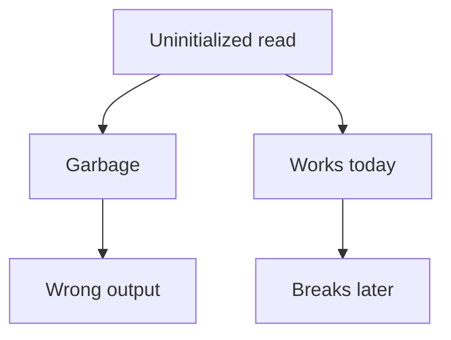

# 1.6 Uninitialized variables and undefined behavior

Lesson 1.4 listed a way of creating a variable that gives it no value at all. This lesson shows what that does to a program and why the book never uses it. It also explains the idea behind the danger, undefined behavior, which lesson 0.3 mentioned, and two milder cousins of it.

## What an uninitialized variable holds

When you define a variable inside a function without an initializer, as in `int visitors;`, the program sets aside a piece of memory for it and does nothing else. The memory is not cleared. It holds whatever earlier use left in that spot. The standard calls this an **indeterminate value**, which is a polite way of saying that there is no telling what the number is.

Reading such a variable is a mistake. The program below does exactly that:

```cpp title="uninitialized.cpp"
{{#include ../../examples/ch01/06-uninitialized.fail.cpp}}
```

The options from lesson 0.11 make GCC and Clang refuse to build this program. Both compilers notice that `visitors` is used before it receives a value, and they report it as a warning, which `-Werror` turns into an error. Without `-Werror` the program builds with a warning, but it is still wrong, and no output can be promised for it. It might print 0, or another number that changes from one run to the next, or behave in a way that has nothing to do with the code you wrote.

Do not rely on the compiler to catch every case. The compiler can only see the simple ones, such as the one above. In a longer program, a variable might be defined in one place, assigned in some situations only, and read in another, and the compiler is not required to follow all of that.

## Undefined behavior

Lesson 0.3 introduced undefined behavior as the place where the standard places no requirements on what a program does. Reading an uninitialized variable is one of the most common ways to get there. Dividing a number by zero is another, and so is adding 1 to the largest value that an `int` can hold.

It may seem strange that a language has such a thing. The reason is speed and simplicity. If the compiler had to check for every possible mistake and handle it in a defined way, every program would carry that cost, whether or not it ever made the mistake. The language makes a bargain instead: you promise never to break certain rules, and the compiler builds the fastest program it can on the assumption that you keep the promise.

The price of the bargain is that nothing is guaranteed when you break a rule. The program might crash, print nonsense, give exactly the answer you hoped for, or do something that makes no sense when you read the code. The diagram shows two typical stories for an uninitialized variable.



The second story is the most dangerous. A program with undefined behavior can work for months, and then fail after a new compiler version, a different optimization setting, or a change in some unrelated part of the code. The program was never correct, only lucky.

> [!ADVANCED]
> C++26 changes the rules for this particular mistake. Reading an uninitialized variable that has automatic storage, such as an ordinary local variable, becomes **erroneous behavior**: the program is still wrong, but its behavior is no longer undefined. A compiler may report the problem, stop the program with an error, or substitute some value. This book builds with C++20, where such a read is still undefined behavior.

## Implementation-defined and unspecified behavior

Two other kinds of behavior are often mixed up with undefined behavior, and they are much milder. In both of them the program is correct, but the standard allows the result to vary between compilers.

**Implementation-defined behavior** varies between implementations, and every implementation must document what it does. For example, the number of bits in a byte is implementation-defined. A compiler's manual tells you its choice.

**Unspecified behavior** also varies between implementations, but the implementation does not have to document its choice. The order in which a compiler evaluates the parts of an expression is often unspecified. If an expression calls two functions that each print something, the standard does not say which one prints first.

A portable program does not depend on either one for its answer, and a good habit is to write code whose result is the same no matter how the compiler chooses.

## The fix: initialize every variable

The cure for an uninitialized variable is to never create one. Give every variable a value at the moment you define it, as lesson 1.4 recommends:

```cpp title="initialized.cpp"
{{#include ../../examples/ch01/06-initialized.cpp}}
```

```text title="Output"
{{#include ../../examples/ch01/06-initialized.out}}
```

The output is the same on every compiler and every run, because every value in the program is defined. Notice the assignment of 25 near the end: a variable that was initialized and later assigned is fine. What you must avoid is reading a variable that never had a value.

> [!BEST-PRACTICE]
> Initialize every variable when you define it. Use a real value when you have one, and empty braces when you do not.

Every complete program in this book is also built with AddressSanitizer and UBSan, two tools that catch some kinds of undefined behavior while a program runs, such as signed overflow and memory errors. They do not catch every kind, and they do not report an uninitialized read. The examples in this book avoid that mistake because every variable has a value and the compiler's warnings are errors.

<details>
<summary>Check your understanding</summary>

**Question 1.** What is wrong with this fragment?

```cpp
int total;
std::cout << total;
```

<details>
<summary>Answer</summary>

The variable `total` is never given a value, so the output statement reads an indeterminate value. That is undefined behavior. Defining the variable as `int total{};` fixes it.

</details>

**Question 2.** A program reads an uninitialized variable, and on your computer it always prints 0. Is the program correct?

<details>
<summary>Answer</summary>

No. Undefined behavior includes the case where everything seems to work. Another compiler, another setting or another day can give a different result, so the program has to be fixed even though it appears to run well.

</details>

**Question 3.** What is the difference between undefined behavior and implementation-defined behavior?

<details>
<summary>Answer</summary>

With implementation-defined behavior, the program is correct and each compiler documents what it does. With undefined behavior, the program breaks a rule of the language, and the standard puts no requirements on the result at all.

</details>

</details>

## Summary

- A variable without an initializer holds an indeterminate value, and reading it is undefined behavior in C++20.
- Undefined behavior means that the standard places no requirements on the program, so it may crash, print nonsense, or look correct until a later day.
- The compiler can warn about simple cases, and the book's options turn that warning into an error, but you must not rely on that.
- Implementation-defined behavior is documented by each compiler, and unspecified behavior is not, and a portable program does not depend on either.
- The fix is to give every variable a value when you define it.

## Further reading

- [Undefined behavior (cppreference)](https://en.cppreference.com/w/cpp/language/ub)
- [Default initialization (cppreference)](https://en.cppreference.com/w/cpp/language/default_initialization)
- [Indeterminate and erroneous values (the C++ working draft)](https://eel.is/c++draft/basic.indet)
