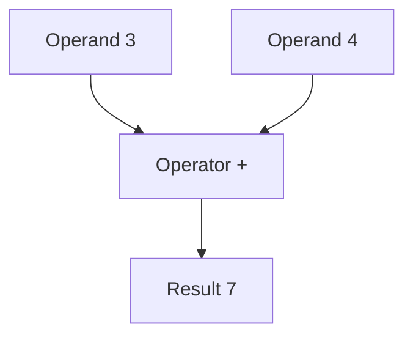

# 1.9 Introduction to literals and operators

A program that only stores and prints values cannot do much. To be useful, it has to calculate: add two numbers, compare them, combine them into something new. This lesson introduces the two ingredients of every calculation, the values that you write directly in the code and the symbols that work on them, and it shows the arithmetic that C++ offers for whole numbers.

## Literals

A **literal** is a value that you write directly in the code. In the statement `int seats{40};`, the number `40` is a literal. In `std::cout << "Hello";`, the text `"Hello"` is a literal too.

A literal is different from a variable in one important way: it is fixed. The value of `seats` can change when the program runs, but the number 40 will always be 40. You can think of a literal as a value that is part of the text of the program itself, and of a variable as a box that holds a value that the program may change.

This book has used two kinds of literals so far. A number without a fraction, such as `40` or `250`, is an **integer literal**. Text between quotation marks, such as `"Hello"`, is a **string literal**. Every literal has a type, in the same way that a variable has one, and Chapter 4 explains the types in detail.

## Operators and operands

An **operator** is a symbol that makes the program do something with values, and the values that it works on are called its **operands**. In `3 + 4`, the `+` is the operator, and `3` and `4` are its operands. The result of the operation is a value, which here is 7.



Operators are grouped by how many operands they take:

- A **unary** operator takes one operand. The minus sign in `-reserved` is a unary operator that gives the opposite of a number.
- A **binary** operator takes two operands, as `+` does in `3 + 4`. Most operators are binary.
- A **ternary** operator takes three operands. C++ has only one, the conditional operator, which Chapter 6 covers.

The minus sign shows that the same symbol can be a different operator in different places: in `-reserved` it is unary, and in `seats - reserved` it is binary. That is also why `-3` is not a literal: it is the unary minus applied to the literal `3`.

## The arithmetic operators

For whole numbers, C++ has the operators that you know from school:

| Operator | Meaning | Example and result |
| --- | --- | --- |
| `+` | Addition | `7 + 2` is 9 |
| `-` | Subtraction | `7 - 2` is 5 |
| `*` | Multiplication | `7 * 2` is 14 |
| `/` | Division | `7 / 2` is 3 |

The last row needs an explanation. When both operands of `/` are whole numbers, the division is done on whole numbers, and the fraction is thrown away:

`7 / 2` is 3, not 3.5. The result is cut off toward zero, so `-7 / 2` is -3. Chapter 6 comes back to division and to what to do when you need the fraction. Dividing a whole number by zero is undefined behavior, which lesson 1.6 described, so never do it.

This program uses all of the operators, and prints the results:

```cpp title="operators.cpp"
{{#include ../../examples/ch01/09-operators.cpp}}
```

```text title="Output"
{{#include ../../examples/ch01/09-operators.out}}
```

Read the output statements one at a time. The first subtracts the reserved seats from the seats, the second multiplies, the third applies the unary minus, and the fourth divides 40 by 3. The result of the division is 13, because 3 goes into 40 thirteen times, and the remainder is dropped. In each statement, the arithmetic is worked out before its result is inserted into the output.

## Operators produce values and side effects

Every operator in this lesson produces a value, but some also do something else. The effect of an operator that goes beyond its result is called a **side effect**. The addition `3 + 4` has none: it only produces 7. The assignment `seats = 41`, from lesson 1.4, has one: it changes the variable.

The `<<` that you use to print is an operator as well, and it has a side effect too, because it sends text to the screen. It also produces a value, which is the output stream itself. That is why you can chain several insertions: in `std::cout << "a" << "b"`, the first `<<` prints `a` and produces `std::cout`, and the second `<<` takes that result as its left operand and prints `b`.

## Precedence

When an expression has several operators, the compiler has to decide which one to apply first. The rule is called **operator precedence**, and it is the same as in arithmetic: multiplication and division come before addition and subtraction. So `2 + 3 * 4` is 14, because `3 * 4` is calculated first.

To change the order, use parentheses. The expression `(2 + 3) * 4` is 20, because the parentheses make the addition happen first. The last two lines of the program above show both cases.

> [!BEST-PRACTICE]
> Use parentheses whenever the order of operations is not obvious to a reader, even if the precedence rules would give the right answer. They cost nothing, and they save the next reader from looking the rules up.

Chapter 6 lists the precedence of all the operators. For now, the rule for arithmetic is enough.

<details>
<summary>Check your understanding</summary>

**Question 1.** What does this statement print?

```cpp
std::cout << 10 - 4 / 2;
```

<details>
<summary>Answer</summary>

It prints `8`. The division is done first, `4 / 2` is 2, and then 2 is subtracted from 10.

</details>

**Question 2.** What is the value of `7 / 2`, and why is it not 3.5?

<details>
<summary>Answer</summary>

It is 3. Both operands are whole numbers, so the division is a whole-number division, and the fraction is dropped.

</details>

**Question 3.** What is the difference between a literal and a variable?

<details>
<summary>Answer</summary>

A literal is a fixed value that is written in the code, such as `40`. A variable is a named object that holds a value, and the program can change that value while it runs.

</details>

</details>

## Summary

- A literal is a value written directly in the code, such as the integer literal `40` or the string literal `"Hello"`.
- An operator works on operands, and it is unary, binary or ternary depending on how many it takes.
- The arithmetic operators for whole numbers are `+`, `-`, `*` and `/`, and `-` is also a unary operator.
- Dividing whole numbers drops the fraction, and dividing by zero is undefined behavior.
- Some operators have side effects, such as `=` and `<<`, and precedence decides which operator is applied first, which parentheses can change.

## Further reading

- [Arithmetic operators (cppreference)](https://en.cppreference.com/w/cpp/language/operator_arithmetic)
- [Operator precedence (cppreference)](https://en.cppreference.com/w/cpp/language/operator_precedence)
