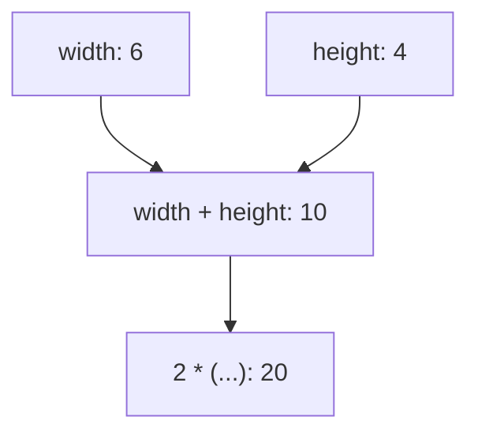

# 1.10 Introduction to expressions

Everything a program calculates, it calculates in expressions. You have been writing them since the last lesson, and the output statements of lesson 1.5 are full of them. This lesson gives them a name, shows how the compiler takes them apart, and explains an everyday warning that tells you when an expression has been written for nothing.

## What an expression is

An **expression** is a combination of literals, variables and operators that the program can work out to a single value. Later you will add function calls to that list. All of these are expressions:

```cpp
5
width
width * height
2 * (width + height)
```

The first is a literal, the second is a variable, and the other two combine them with operators. Even a lone `5` counts, because working it out gives the value 5.

Working out an expression is called **evaluation**. The value that evaluation produces is the **result** of the expression. Evaluating `width * height` with a width of 6 and a height of 4 gives the result 24. Evaluation can also have a side effect, as lesson 1.9 explained: evaluating `width = 7` changes the variable `width`, and evaluating `std::cout << "hi"` prints text.

> [!KEY-INSIGHT]
> A statement is a step that the program carries out. An expression is something that the program works out. Many statements are an expression followed by a semicolon.

## Expressions inside expressions

A long expression is built from shorter ones. Each part of an expression that is an expression itself is called a **subexpression**. In `2 * (width + height)`, the parts `2`, `width`, `height` and `width + height` are all subexpressions. An expression that is not part of a larger expression is a **full expression**, and the whole of `2 * (width + height)` is one.

The compiler evaluates the subexpressions first, from the inside out, and uses their results as the operands of the next operator. The diagram follows the evaluation of `2 * (width + height)` for a width of 6 and a height of 4.



For most operators, the standard does not say in which order the two operands are evaluated. It makes no difference when both are plain variables, but it can when they have side effects, as lesson 1.6 mentioned for unspecified behavior. A good habit is to write each expression so that it gives the same result in whichever order its parts are evaluated.

## Expression statements

When you put a semicolon after an expression, you get an **expression statement**. You have written many of them already:

```cpp
width = 7;
std::cout << "hi\n";
```

Both are useful because of their side effects: the first changes a variable, and the second prints. Their results, the stored value and the stream, are not used again, and that is fine.

The problem starts when an expression statement has no side effect. Then the program does the work of evaluating it and throws the result away:

```cpp title="unused-result.cpp"
{{#include ../../examples/ch01/10-unused-result.fail.cpp}}
```

The statement `width * 2;` multiplies and does nothing with the answer. It is almost always a mistake, perhaps for a statement that was meant to store or print the result. GCC and Clang both warn about it, GCC that the statement has no effect and Clang that the result of the expression is unused, and because the options from lesson 0.11 turn warnings into errors, the build fails. Without `-Werror` the program builds, and prints 5.

The fix is to use the result, for example by storing it in a variable:

```cpp
int doubled{width * 2};
```

## Initializing from an expression

An initializer does not have to be a literal. It can be any expression, and the expression is evaluated before the variable is created. The same is true on the right side of an assignment, where the old value of the variable can take part in the calculation:

```cpp title="expressions.cpp"
{{#include ../../examples/ch01/10-expressions.cpp}}
```

```text title="Output"
{{#include ../../examples/ch01/10-expressions.out}}
```

The variable `area` starts with the result of `width * height`, and `perimeter` with the result of a longer expression. The output statement for the half of the area evaluates `area / 2` and inserts the result. In the statement `width = width + 1;`, the right side is worked out first, with the old width of 6, and the result, 7, is stored back into `width`. That is why the area after widening is 28.

<details>
<summary>Check your understanding</summary>

**Question 1.** Which of these are expressions: `7`, `seats`, `seats - 2`, `int seats{3};`?

<details>
<summary>Answer</summary>

`7`, `seats` and `seats - 2` are expressions. `int seats{3};` is a declaration statement. It contains the expression `3`, but the whole line is not an expression.

</details>

**Question 2.** Why do GCC and Clang warn about the statement `width * 2;`?

<details>
<summary>Answer</summary>

The statement evaluates a multiplication and throws the result away. It has no side effect, so it does nothing useful, which usually means that the programmer forgot to use the result.

</details>

**Question 3.** What does this fragment print?

```cpp
int a{4};
a = a * 2 + 1;
std::cout << a;
```

<details>
<summary>Answer</summary>

It prints `9`. The right side is evaluated first: `4 * 2` is 8, and adding 1 gives 9. The result is then stored in `a`.

</details>

</details>

## Summary

- An expression combines literals, variables and operators, and evaluating it produces a result and sometimes a side effect.
- A subexpression is a part of an expression that is an expression itself, and the compiler evaluates the inner parts first.
- An expression followed by a semicolon is an expression statement, which is useful for its side effects.
- An expression statement whose result is thrown away has no effect, and the compilers warn about it.
- An initializer or the right side of an assignment can be any expression, and it is evaluated before the value is stored.

## Further reading

- [Expressions (cppreference)](https://en.cppreference.com/w/cpp/language/expressions)
- [Order of evaluation (cppreference)](https://en.cppreference.com/w/cpp/language/eval_order)
