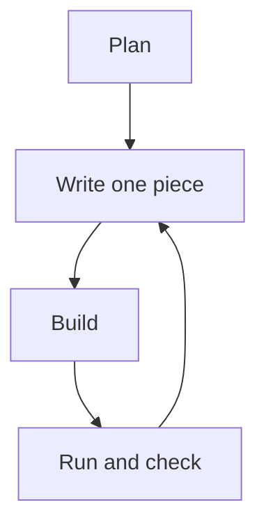

# 1.11 Developing your first program

You now know enough C++ to write a small program of your own, and this lesson walks through doing it in small steps. The task is modest on purpose. What matters is the way of working: make a plan, build one piece at a time, and test after every piece. The same habits will carry you through programs that are a hundred times larger.

## The task

The program asks for a number of hours, and then prints how many minutes and how many seconds that is. The problem is short to state, and you can check the answers by hand, which makes it a good first project.

## Start with a plan

Before you write any code, write down what the program has to do, in the order in which it has to do it. The best place for the plan is a comment at the top of the file, where it stays next to the code that it describes:

```cpp
// Plan:
// 1. Ask for a number of hours.
// 2. Read the number.
// 3. Calculate the minutes and the seconds.
// 4. Print the results.
```

The plan is not the program, and you can change it as you learn more. Its job is to break one big task into steps that are each small enough to get right.

## Step 1: the skeleton

Start with a program that does almost nothing. It has the plan, the `main` function, and a fixed value for the hours instead of a number that is typed in. A fixed value means that nothing has to be typed while you test:

```cpp title="hours-step1.cpp"
{{#include ../../examples/ch01/11-hours-step1.cpp}}
```

Build it and run it. Do this before you add anything else, so that you know the tools, the file and the program are all in order.

```text title="Output"
{{#include ../../examples/ch01/11-hours-step1.out}}
```

## Step 2: the calculation

Now add the calculation, still with the fixed value. There are 60 minutes in an hour and 60 seconds in a minute, so the minutes are the hours times 60, and the seconds are the minutes times 60:

```cpp title="hours-step2.cpp"
{{#include ../../examples/ch01/11-hours-step2.cpp}}
```

```text title="Output"
{{#include ../../examples/ch01/11-hours-step2.out}}
```

Check the output by hand. Three hours are 180 minutes, and 180 minutes are 10800 seconds. If a number is wrong now, you know that the mistake is in the lines that you added in this step, because everything before them already worked.

## Step 3: reading the number

The last piece replaces the fixed value with input. The variable starts at 0, the program asks the question, and `std::cin` fills the variable:

```cpp title="hours.cpp"
{{#include ../../examples/ch01/11-hours.cpp}}
```

Run it, type 5, and press <kbd>Enter</kbd>:

```text title="Example session"
{{#include ../../examples/ch01/11-hours.session}}
```

The diagram shows the way of working that you followed. After each small piece, you build the program and run it, and you only move on when it does what you expect.



## Choices along the way

A beginner meets small decisions at every step. This program shows a few of them.

**An extra variable, or a longer expression?** The seconds could be written as `hours * 3600` in a single step, without the variable `minutes`. Both versions work. The version with two steps reads like the explanation that you gave above, and the variable `minutes` is a value that you may want to print anyway. A good rule is to add a variable when it gives a calculation a name.

**Names.** The variables are called `hours`, `minutes` and `seconds`, so each name says what it holds and in which unit. Names such as `h` or `result` would force the reader to look at the calculation to find out.

**The numbers 60 and 3600.** A number that appears in the code without a name is sometimes called a magic number, because the reader has to guess where it comes from. Here the meaning is clear from the names around it, which is acceptable. A later chapter introduces constants, the proper way to give such a number a name.

**When to stop.** A program is never finished in the sense that it cannot be improved. A good stopping point is when it does what it should for the inputs it will meet, and you can explain every line. This program is a good example of the limit. For a very large number of hours, the result of `hours * 60 * 60` no longer fits in an `int`, and the program has undefined behavior, as lesson 1.6 described. For a first program that is fine, and a later chapter shows how to guard against it.

## Habits to keep

- **Build often.** Build after every few lines. A new error then has to be in the lines you wrote last.
- **Fix the first error first.** The rest of the list is often a consequence of it, as lesson 1.1 explained.
- **Keep programs small.** A short program is simple to test, simple to read and simple to throw away.
- **Test with answers you know.** Choose inputs for which you can work out the result by hand, so that a wrong number stands out.

<details>
<summary>Check your understanding</summary>

**Question 1.** Why does step 1 use a fixed value, `int hours{3};`, instead of reading the number right away?

<details>
<summary>Answer</summary>

With a fixed value, nothing has to be typed, and the same result appears on every run, so you can test the calculation on its own. The reading is added when the calculation is known to work.

</details>

**Question 2.** After a change, the program prints "5 hours are 300 minutes and 300 seconds." Which line has the mistake?

<details>
<summary>Answer</summary>

The seconds are wrong, so look at the line that calculates them and at the output statement that prints them. The correct calculation is `int seconds{minutes * 60};`, because 300 minutes are 18000 seconds. The printed 300 suggests that the program calculated `seconds` wrongly, or printed `minutes` where it should print `seconds`.

</details>

</details>

## Summary

- Write a plan first, as comments at the top of the file, and break the task into small steps.
- Build the program one piece at a time, and build and run after every piece.
- Start with fixed values, so that you can test a calculation before you add input.
- Add a variable when it gives a calculation a name, and choose names that say what each variable holds and in which unit.
- A program is finished when it does what it should for the inputs it will meet, and a large input can overflow an `int`.
