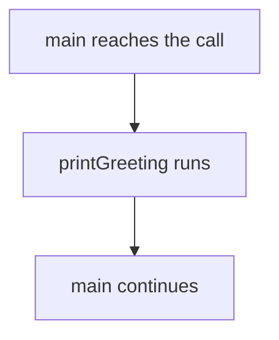

# 2.1 Introduction to functions

Every program so far has been a single function, `main`, with all of its statements in one list. That works for a few lines, but a program of a few hundred lines becomes hard to read, and a task that the program needs several times has to be written out again each time. Functions solve both problems. In this lesson you learn how to write your own, how to run them, and what the computer does when it does.

## Why programs are split into functions

Think of a cookbook. A recipe for lasagna does not repeat the steps for the sauce every time it needs sauce. It says "make the sauce" and refers to a page where the sauce is explained once. The author writes the steps once, the cook can find them by name, and a change to the sauce is a change in a single place.

A function works the same way, as lesson 1.1 described it: a named group of statements. You write the group once and give it a name. Wherever the program needs that work, it uses the name instead of the statements. This keeps `main` short, gives every piece of work a name that says what it does, and means that a mistake has to be fixed in one place only.

## Calling a function

Using a function is called a **function call**. A call is the name of the function followed by parentheses, and in a statement it ends with a semicolon:

```cpp
printGreeting();
```

The function that contains the call is the **caller**, and the function that is being run is the **called function**. When the computer reaches a call, it leaves the caller, runs the statements of the called function from the first to the last, and then comes back to the caller. It continues with the statement that follows the call.

The diagram shows the path for a program in which `main` calls `printGreeting`.



## Defining a function

Before you can call a function, you have to define it. A function definition has four parts: a return type, a name, a list of parameters in parentheses, and a body in braces. This program defines one function of its own and calls it from `main`:

```cpp title="first-function.cpp"
{{#include ../../examples/ch02/01-first-function.cpp}}
```

```text title="Output"
{{#include ../../examples/ch02/01-first-function.out}}
```

Look at the definition of `printGreeting` one part at a time:

- `void` is the **return type**. It says what kind of value the function hands back to its caller, and `void` means that it hands back nothing. Lesson 2.2 explains return values, and lesson 2.3 explains `void`.
- `printGreeting` is the name. You choose it, following the rules of lesson 1.7.
- The empty parentheses are the **parameter list**. A function can take values from its caller through its parameters, and this one takes none. Lesson 2.4 explains parameters.
- The statements between the braces are the **body**. They are what runs when the function is called.

Notice that `main` is built in exactly the same way: a return type, a name, a parameter list and a body. It is an ordinary function, with the single difference that the program starts in it.

Notice also that the definition of `printGreeting` comes before `main`. The compiler reads a file from top to bottom, and it has to know about a function before the first call. Lesson 2.7 explains this rule and what to do when you cannot follow it.

## Calling a function several times

The same function can be called as often as you like, and a function can call other functions. This program has two functions that print, and one of them uses the other:

```cpp title="calls-in-order.cpp"
{{#include ../../examples/ch02/01-calls-in-order.cpp}}
```

```text title="Output"
{{#include ../../examples/ch02/01-calls-in-order.out}}
```

The output shows the order in which the program ran. It starts with the first statement of `main`, prints "start of main", and then calls `printTitle`. That function calls `printLine`, which prints a row of dashes.

When `printLine` ends, the program returns into `printTitle`, which prints the title and calls `printLine` again. When `printTitle` ends, the program returns into `main`, which prints "middle of main" and calls `printTitle` a second time.

> [!KEY-INSIGHT]
> A function call is a detour. The computer leaves the current statement, runs the whole called function, and then returns to exactly the place it left. A function that calls other functions makes longer detours, but every detour ends where it began.

## Functions cannot be defined inside functions

All the functions in the examples are defined next to each other, one after the other, and `main` is one of them. C++ does not allow you to define a function inside the body of another function.

```cpp title="nested-definition.cpp"
{{#include ../../examples/ch02/01-nested-definition.fail.cpp}}
```

The compiler refuses to build this program. It reports that a function definition is not allowed at that place, because the body of `main` is not a place where functions can be defined. A function belongs next to the other functions, outside every pair of braces that belongs to another function. Moving `sayHi` above `main` fixes the program.

<details>
<summary>Check your understanding</summary>

**Question 1.** In the `calls-in-order.cpp` program, how many times does a row of dashes get printed, and why?

<details>
<summary>Answer</summary>

Four times. `main` calls `printTitle` twice, and each call to `printTitle` calls `printLine` twice, once before the title and once after it.

</details>

**Question 2.** In the statement `printTitle();` inside `main`, which function is the caller and which is the called function?

<details>
<summary>Answer</summary>

`main` is the caller, because the statement is in its body. `printTitle` is the called function.

</details>

**Question 3.** Suppose you delete the second call to `printTitle` from `calls-in-order.cpp`. What does the program print then?

<details>
<summary>Answer</summary>

It prints `start of main`, then the title between two rows of dashes, then `middle of main` and `end of main`, each on its own line. The second title and its dashes are gone.

</details>

</details>

## Summary

- A function is a named group of statements, and calling it runs those statements and then returns to the caller.
- A function definition has a return type, a name, a parameter list and a body.
- `void` as a return type means that the function hands back nothing, and `main` is an ordinary function that happens to be where the program starts.
- A function can be called many times, and it can call other functions.
- The definition of a function must come before its first call, and functions cannot be defined inside other functions.

## Further reading

- [Functions (cppreference)](https://en.cppreference.com/w/cpp/language/functions)
- [Function declaration (cppreference)](https://en.cppreference.com/w/cpp/language/function)
