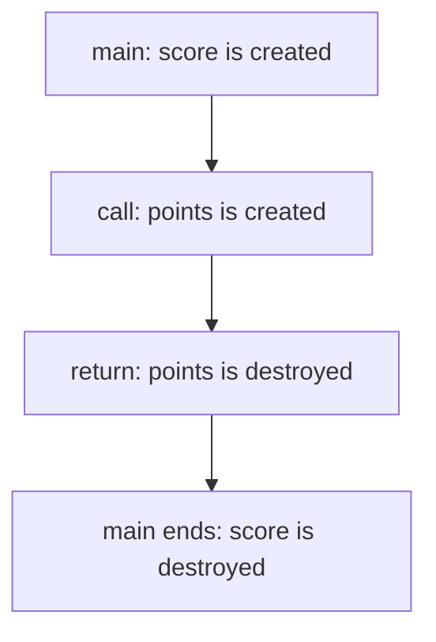

# 2.5 Introduction to local scope

Two functions that were written by different people, or by you on different days, should not have to agree on the names of their variables. C++ makes sure of that: a variable that you define inside a function belongs to that function and to nothing else. This lesson explains what that means, how long such a variable lives, and where in a program its name can be used.

## Local variables

A variable that is defined inside a function is called a **local variable**. The parameters of a function count as local variables too, because they are variables that belong to the function and nothing else. Every variable that you have defined in `main` so far has been a local variable.

A local variable is created when the computer runs its definition, and it is destroyed when the computer leaves the block of braces in which it was defined. For a variable in a function body, that happens when the function ends. The next call of the function creates its variables again, from scratch.

## Scope and lifetime

Two ideas describe a local variable, and it helps to keep them apart.

The **scope** of a name is the part of the program in which the name can be used. For a local variable, it begins at the definition and ends at the closing brace of the block that contains the definition. Scope is a property of the program text, and the compiler decides it while it reads your code, before anything runs.

The **lifetime** of a variable is the time during which it exists while the program runs. A local variable exists from the moment its definition is reached until the end of its block. Lifetime belongs to the running program, not to its text.

For a local variable, the two ideas nearly coincide, but they are not the same thing. The diagram shows the lifetime of two variables while `main` calls a function that has a parameter, as in the program of lesson 2.4.



The variable `score` lives for the whole run of `main`. The parameter `points` lives only for the duration of the call, and it is gone before `main` carries on.

## Names in different functions are independent

Because a name only exists inside the function that defines it, two functions can use the same name for two different variables without any conflict:

```cpp title="independent-names.cpp"
{{#include ../../examples/ch02/05-independent-names.cpp}}
```

```text title="Output"
{{#include ../../examples/ch02/05-independent-names.out}}
```

Both functions have a variable called `level`. In `main` it holds 1, and in `printInside` it holds 2. The program prints both, and `main` still sees its own value after the call. Each function has its own variable, and neither function can see the other's.

This independence is what lets a team write functions separately. You can name your variables what you like, and you never have to check the rest of the program first.

## Using a name outside its scope

The reverse of independence is that a function cannot reach the variables of another function. When a name is used outside its scope, the compiler does not know it:

```cpp title="out-of-scope.cpp"
{{#include ../../examples/ch02/05-out-of-scope.fail.cpp}}
```

The variable `readyCount` belongs to `prepare`, and `main` tries to print it. The compiler refuses to build the program. It reports that the name is not declared, because inside `main` there is no `readyCount`. The variable in `prepare` was destroyed when that function ended, and its name was never visible outside it.

If `main` needs a value from `prepare`, the function has to hand it back, with a return value as in lesson 2.2, or `main` has to pass a value in, with an argument as in lesson 2.4. Passing values through returns and arguments is the way that functions communicate.

## Define variables close to where you use them

Since a local variable can be defined at any point in a function, you have a choice about where to put it. Some programmers define every variable at the top of the function, a habit that some older languages required. It is better to define a variable right before its first use:

```cpp
int minutes{hours * 60};
std::cout << minutes << " minutes\n";
```

The definition and the use are then next to each other, so a reader sees at once where the value comes from, what it is for and how it was calculated. A variable that is defined late also has a shorter scope, which leaves fewer lines in which it could be used by mistake.

> [!BEST-PRACTICE]
> Define each local variable as close as possible to its first use, and give it its value in the same statement.

A related problem is giving a variable the same name as another variable that is already visible at that point. That is called shadowing, and it is a common source of confusing bugs. The options of lesson 0.11 reject it, and Chapter 7 explains it in detail. The examples in this book avoid it, and so should your programs.

<details>
<summary>Check your understanding</summary>

**Question 1.** What is the difference between the scope and the lifetime of a local variable?

<details>
<summary>Answer</summary>

Scope is the part of the program text where the name can be used, from the definition to the end of the block, and the compiler decides it. Lifetime is the time during which the variable exists while the program runs, from the moment its definition is reached until its block ends.

</details>

**Question 2.** What does this program print?

```cpp
void show()
{
    int amount{7};
    std::cout << amount << "\n";
}
```

Assume that `main` defines its own `int amount{3};`, calls `show();`, and then prints `amount`.

<details>
<summary>Answer</summary>

It prints `7` and then `3`. The two variables have the same name, but they belong to different functions, so they are independent.

</details>

**Question 3.** Why does the compiler reject a function that uses a local variable of another function?

<details>
<summary>Answer</summary>

The variable's scope ends at the closing brace of the function that defines it, so the name is not known anywhere else. The compiler reports it as an undeclared name.

</details>

</details>

## Summary

- A variable defined inside a function, and each parameter, is a local variable that belongs to that function.
- The scope of a local variable runs from its definition to the end of its block, and its lifetime is the time that it exists while the program runs.
- Local variables are created when their definition runs and destroyed at the end of their block.
- Two functions can use the same name for different variables, and neither can see the other's.
- A function that needs another's value gets it through a return value or an argument.
- Define each variable close to its first use, with its value.

## Further reading

- [Scope (cppreference)](https://en.cppreference.com/w/cpp/language/scope)
- [Storage duration and linkage (cppreference)](https://en.cppreference.com/w/cpp/language/storage_duration)
