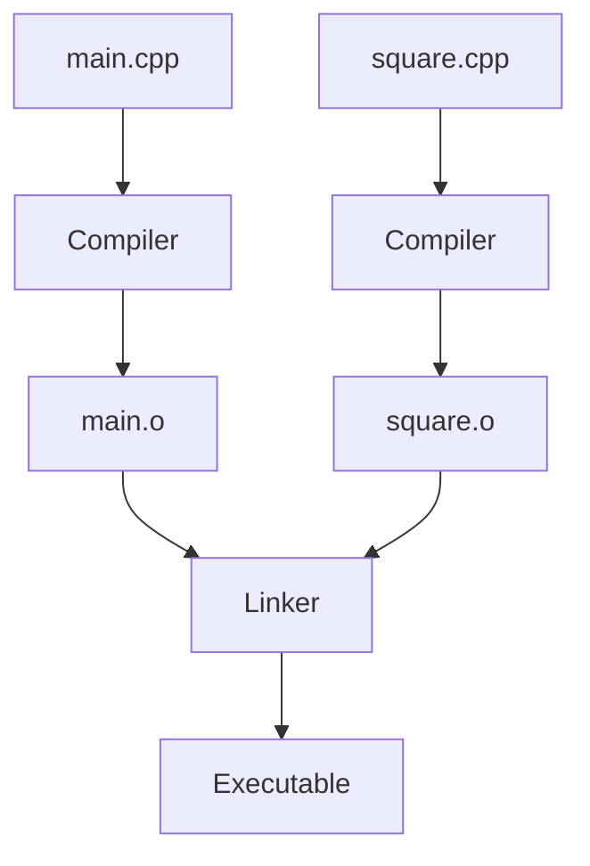

# 2.8 Programs with multiple code files

Every program in this book so far has fit into a single file. Real programs rarely do. A program with thousands of lines in one file would be slow to open, hard to search and impossible to share among several people, so programmers spread it over many files. In this lesson you add a second file to a program, learn how the pieces get built into one program, and see the two mistakes that beginners make most often when they do it.

## The second file

A program made of several files is still one program, with one `main`. The extra files hold functions that `main` calls. Each file ends in `.cpp`, and it is called a source file or a code file. In this lesson the second file defines a function that squares a number, and `main.cpp` calls it.

Here are the two files:

```cpp title="square.cpp"
{{#include ../../examples/ch02/08-two-files/square.cpp}}
```

```cpp title="main.cpp"
{{#include ../../examples/ch02/08-two-files/main.cpp}}
```

```text title="Output"
{{#include ../../examples/ch02/08-two-files.out}}
```

Look at the declaration near the top of `main.cpp`: it is a forward declaration of `square`, exactly as in lesson 2.7. It is there for a reason that the next section explains.

## Building the program

The steps to create the files and to build the whole program depend on your tools. Whichever you use, start with a new, empty project or folder for this program, so that nothing else in it can interfere, and create `main.cpp` and `square.cpp` with the contents above.

{{#tabs}}
{{#tab Visual Studio}}

**Add the files:** Create a new **Console App** project, as in lesson 0.7. Rename the source file that Visual Studio generated to `main.cpp`, by right-clicking it in **Solution Explorer** and choosing **Rename**, and replace its contents with the listing above. Then add the second file: in **Solution Explorer**, right-click your project and choose **Add**, then **New Item**. In the **Add New Item** dialog, select **C++ File (.cpp)**, enter the name `square.cpp`, choose **Add**, and give it the contents of `square.cpp`.

**Build and run:** Choose **Build Solution**, as in lesson 0.7. Visual Studio compiles every source file of the project and links the results into one program, and **Start Without Debugging** runs it.

{{#endtab}}
{{#tab VS Code}}

**Add the files:** Create `main.cpp` and `square.cpp` in a new, empty folder, and open that folder in Visual Studio Code.

**Build and run:** The build task that the C/C++ extension creates compiles only the file that is open. The extension's documentation explains how to change the task in `tasks.json`: use an argument such as `${workspaceFolder}/*.cpp` instead of `${file}`, and the task builds every `.cpp` file in your folder, which is why the folder must hold only this program. The task names the program after the file that is open, so open `main.cpp` before you build, and the program is called `main`. You can also use the commands of the **Command line** tab in the integrated terminal.

{{#endtab}}
{{#tab Command line}}

**Add the files:** Create `main.cpp` and `square.cpp` in a new, empty folder, with any text editor.

**Build and run:** Name every source file in a single command. The compiler builds each one and the linker joins them into one executable:

```bash
g++ -std=c++20 -o two-files main.cpp square.cpp
clang++ -std=c++20 -o two-files main.cpp square.cpp
```

With Microsoft's compiler, in a **Developer Command Prompt for Visual Studio**, list the files in the same way:

```powershell
cl /std:c++20 /EHsc /Fe:two-files.exe main.cpp square.cpp
```

Run the program as in lesson 0.7: `./two-files` on Linux and macOS, and `two-files` on Windows.

{{#endtab}}
{{#endtabs}}

## Each file is compiled on its own

The compiler handles one source file at a time. While it compiles `main.cpp`, it never looks into `square.cpp`, and while it compiles `square.cpp`, it knows nothing of `main.cpp`. Each compilation produces an object file, as lesson 0.5 described (`.o` on Linux and macOS, `.obj` on Windows), and the linker then joins the object files, together with the Standard Library, into the executable.



This explains why `main.cpp` needs the forward declaration. When the compiler reads the call `square(7)`, the definition is in another file that it cannot see. The declaration tells it how to check the call, and the linker later connects the call to the code in `square.o`.

> [!KEY-INSIGHT]
> The compiler checks each file on its own, and the linker joins the results. A file may only use a name that it declares itself, and the declaration only promises that a definition will exist somewhere in the program.

## Two common mistakes

When a program of several files does not build, one of two things is usually wrong. The first is that the file with the call has no declaration:

```cpp title="main.cpp"
{{#include ../../examples/ch02/08-no-declaration.fail/main.cpp}}
```

This `main.cpp` calls `square` without declaring it. The compiler reports that the name is not declared. It makes no difference that another file of the program defines the function, because the compiler does not look into the other file. The cure is to add the forward declaration to this file.

The second mistake is that the declaration is there, but the file with the definition is not part of the build:

```cpp title="main.cpp"
{{#include ../../examples/ch02/08-one-file-only.fail/main.cpp}}
```

This version has the forward declaration, so the compiler accepts it.

But if you build it without `square.cpp`, the linker looks for the definition of `square` and finds none, and it reports that the function is undefined. In Visual Studio, this happens when you forget to add the file to the project. On the command line, it happens when you forget to name the file. The cure is to add the file to the build.

You can tell the two mistakes apart by the tool that complains, as lesson 0.5 explained. A complaint from the compiler about an unknown name means a missing declaration. A complaint from the linker about an undefined function means a missing definition, or a file that is not in the build.

<details>
<summary>Check your understanding</summary>

**Question 1.** Why does `main.cpp` contain a forward declaration of `square`, when the definition is in the same program?

<details>
<summary>Answer</summary>

The compiler compiles each file on its own and cannot see the definition in `square.cpp`. The forward declaration tells it how to check the call, and the linker connects the call to the definition later.

</details>

**Question 2.** You build a program from `main.cpp` and `square.cpp`, and the linker reports that `square` is undefined. The declaration is in `main.cpp`. What do you check first?

<details>
<summary>Answer</summary>

Check that `square.cpp` is part of the build: that it was added to the project in an IDE, or that it is named in the command. A file that is not built contributes no code, so the linker cannot find the definition.

</details>

</details>

## Summary

- A program can be spread over several source files, and exactly one of them contains `main`.
- To build such a program, you compile every file and link the results, by building the whole project in an IDE or by naming every file on the command line.
- Each source file is compiled on its own, so a file that calls a function from another file needs a forward declaration of it.
- A compiler error about an unknown name means a missing declaration, and a linker error about an undefined function means a missing definition or a file that is not part of the build.

## Further reading

- [Walkthrough: create and use a static library, which adds source files in Visual Studio (Microsoft Learn)](https://learn.microsoft.com/en-us/cpp/build/walkthrough-creating-and-using-a-static-library-cpp)
- [Compiler command-line syntax for cl (Microsoft Learn)](https://learn.microsoft.com/en-us/cpp/build/reference/compiler-command-line-syntax)
- [Configuring VS Code for C++ on Linux](https://code.visualstudio.com/docs/cpp/config-linux)
