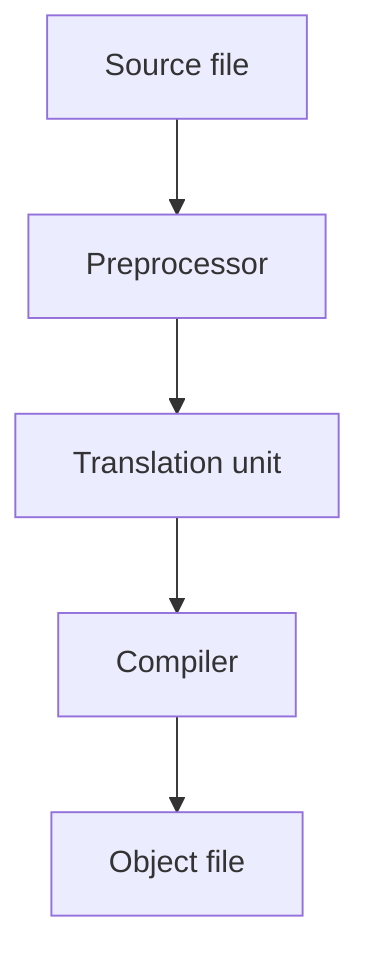

# 2.10 Introduction to the preprocessor

Your source code does not go straight to the compiler. Before the compiler reads a single statement, another tool goes through the file and carries out the lines that start with `#`. You have been using it since your first program, in `#include <iostream>`. This lesson explains what that tool does, introduces two of its features, macros and conditional compilation, and prepares the ground for header files in the next lesson.

## What the preprocessor does

The **preprocessor** is the first step of the build. It reads a source file and handles the lines that begin with a `#`, the preprocessor directives that lesson 1.1 mentioned. It does not understand C++ statements. It only follows the directives, and it works with text: it copies text into the file, replaces text by other text, and removes text that should not be compiled.

The diagram shows where the preprocessor sits.



The compiler never sees the directives. It receives the output of the preprocessor, a source file together with all the files that it includes, minus the lines that were skipped. The standard calls this result a **translation unit**, and the compiler translates one translation unit at a time. This is the reason why, in lesson 2.8, each source file was compiled on its own.

A directive has to stand on its own line, as lesson 1.8 mentioned, and it ends at the end of the line, with no semicolon. The directive that you know best is `#include`, which copies the contents of another file into the place where the directive stands. Lesson 2.11 shows how to use it for your own files.

## Macros

A **macro** is a name that the preprocessor replaces by other text. You create one with the directive `#define`. There are two forms. The first gives the name a replacement:

```cpp
#define PRICE 12
```

From this line on, the preprocessor replaces every `PRICE` that it finds in the rest of the file with `12`, before the compiler sees the code. The second form gives the name no replacement text at all:

```cpp
#define SHOW_EXTRA
```

This only records that the name is defined, which is enough for the conditional directives that you will see in a moment. Macro names are written in capital letters by convention, so that they stand out from the names of variables and functions.

The replacement is plain text, and the preprocessor does not know about numbers, types or the precedence of operators. The next program shows what that can do:

```cpp title="macro-replacement.cpp"
{{#include ../../examples/ch02/10-macro-replacement.cpp}}
```

```text title="Output"
{{#include ../../examples/ch02/10-macro-replacement.out}}
```

A reader of `WIDTH * 4` would expect 20, the product of 5 and 4. But the preprocessor turns the statement into `2 + 3 * 4`, and the multiplication binds tighter than the addition, as lesson 1.9 explained, so the result is 14.

This is one of several reasons why modern C++ avoids macros for values. A macro has no type, it has no scope, so it affects every line after its definition, and it ignores the rules of the language. A later chapter introduces constants, which do the same job without these problems. Macros are still the right tool for a few jobs, and conditional compilation is the most important one.

## Conditional compilation

Conditional directives let the preprocessor keep or drop a part of the file. A block that begins with `#ifdef` and ends with `#endif` is kept only if the name after `#ifdef` is defined. `#ifndef` is the opposite: it keeps the block when the name is not defined. And `#if 0` removes a block unconditionally:

```cpp title="conditional.cpp"
{{#include ../../examples/ch02/10-conditional.cpp}}
```

```text title="Output"
{{#include ../../examples/ch02/10-conditional.out}}
```

The name `SHOW_EXTRA` is defined near the top, so the `#ifdef` block is kept and the `#ifndef` block is dropped. The `#if 0` block is dropped whatever happens, which makes it a good way to switch off a stretch of code. Unlike a block comment, it also works for code that already contains block comments, as lesson 1.2 explained. The dropped lines are removed before compilation, so the compiler never sees them.

You have met this idea before. The program in lesson 0.13 contains `#if defined(_MSVC_LANG)` and `#else`. The directive `#if defined(NAME)` means the same as `#ifdef NAME`, and `#else` starts the alternative part of the block. Programs use these directives to keep one source file that builds with several compilers, as that program does.

## A define only affects its own file

The preprocessor, like the compiler, treats each source file on its own. A `#define` takes effect from its line to the end of that file, and it has no effect on any other file of the program.

The next project shows it. The file `first.cpp` defines the macro `SHOW_MARKER`, and `second.cpp` does not. Each file contains a function that reports whether it sees the macro:

```cpp title="first.cpp"
{{#include ../../examples/ch02/10-define-scope/first.cpp}}
```

```cpp title="second.cpp"
{{#include ../../examples/ch02/10-define-scope/second.cpp}}
```

```cpp title="main.cpp"
{{#include ../../examples/ch02/10-define-scope/main.cpp}}
```

```text title="Output"
{{#include ../../examples/ch02/10-define-scope.out}}
```

The output shows that the definition in `first.cpp` was not seen by `second.cpp`. A define reaches other files only when they include the same header that contains it, and that is one more reason to be careful with macros in headers.

<details>
<summary>Check your understanding</summary>

**Question 1.** With `#define PRICE 10 + 2`, what does the statement `std::cout << PRICE * 2;` print?

<details>
<summary>Answer</summary>

It prints 14. The preprocessor replaces `PRICE` by the text `10 + 2`, so the statement is `std::cout << 10 + 2 * 2;`, and the multiplication is done first.

</details>

**Question 2.** What is the difference between `#ifdef NAME` and `#ifndef NAME`?

<details>
<summary>Answer</summary>

`#ifdef NAME` keeps the code up to the matching `#endif` when `NAME` is defined, and `#ifndef NAME` keeps it when `NAME` is not defined.

</details>

**Question 3.** Does a `#define` in `first.cpp` affect the code in `second.cpp`?

<details>
<summary>Answer</summary>

No. The preprocessor handles each file on its own, so a macro is visible only from its definition to the end of its file, and in any file that includes that file.

</details>

</details>

## Summary

- The preprocessor runs before the compiler, carries out the lines that start with `#`, and works on text.
- The output of the preprocessor for one source file is a translation unit, and the compiler translates one translation unit at a time.
- `#include` copies the contents of a file into the place of the directive.
- `#define` creates a macro, with or without replacement text, and the replacement is plain text, which ignores types and operator precedence.
- `#ifdef`, `#ifndef` and `#endif` keep or drop a block depending on whether a name is defined, and `#if 0` drops a block.
- A `#define` only affects the rest of its own file, and the files that include it.

## Further reading

- [The preprocessor (cppreference)](https://en.cppreference.com/w/cpp/preprocessor)
- [Replacing text macros (cppreference)](https://en.cppreference.com/w/cpp/preprocessor/replace)
- [Conditional inclusion (cppreference)](https://en.cppreference.com/w/cpp/preprocessor/conditional)
