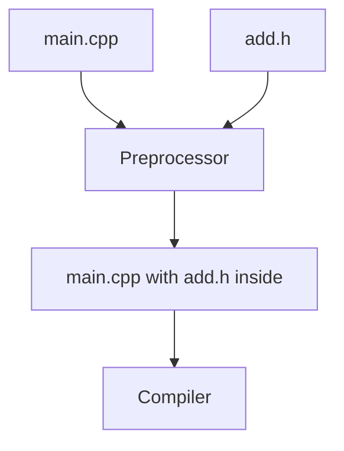

# 2.11 Header files

In lesson 2.8, the file that called a function from another file had to repeat the function's forward declaration. With one function and one caller, that is a small price. With a hundred functions and a dozen files that call them, it becomes a burden and a source of mistakes. C++ has a standard answer, which you have been using without noticing every time you wrote `#include <iostream>`: the header file.

## The problem with repeated declarations

Suppose that a program has a function `add`, defined in `add.cpp`, and that three other files call it. Each of the three files needs a forward declaration of `add`. If you later change the function, for example by adding a parameter, you have to find and change every declaration.

A declaration that you miss makes its file call a function that no longer exists in that form, and the program usually fails to link, with an error that is hard to read. In some cases, such as a changed return type, the program may even link and then behave in unpredictable ways.

It would be better to write the declaration once, in one place, and let every file that needs it pick it up from there.

## Header files

A header file, as lesson 0.4 mentioned, is a file that holds declarations, so that many source files can share them. By tradition its name ends in `.h`, and this book follows that tradition. You write the declarations of a function in the header once. Every file that wants to call the function includes the header with the directive `#include`, which, as lesson 2.10 explained, copies the content of the header into the file.

This project has a header, `add.h`, a source file that defines the function, and a `main.cpp` that calls it:

```cpp title="add.h"
{{#include ../../examples/ch02/11-header/add.h}}
```

```cpp title="add.cpp"
{{#include ../../examples/ch02/11-header/add.cpp}}
```

```cpp title="main.cpp"
{{#include ../../examples/ch02/11-header/main.cpp}}
```

```text title="Output"
{{#include ../../examples/ch02/11-header.out}}
```

The header holds the forward declaration of `add`. The file `main.cpp` no longer repeats it. It includes the header instead, and when the preprocessor does its work, the declaration appears in `main.cpp` as if you had typed it there.

The header has no header guard yet, which is a deliberate simplification. Lesson 2.12 explains why a guard is needed, and adds one to every header from then on.

The diagram shows what `#include` does to `main.cpp`.



## Adding a header to a project

A header is a new file in your project, and it is not compiled by itself. The steps depend on your tools.

{{#tabs}}
{{#tab Visual Studio}}

**Add the file:** In **Solution Explorer**, right-click your project and choose **Add**, then **New Item**. In the **Add New Item** dialog, select **Header File (.h)**, enter the name `add.h`, and choose **Add**.

**Build:** Choose **Build Solution** as before. The headers are found by the `#include` lines, so nothing else has to be added to the build.

{{#endtab}}
{{#tab VS Code}}

**Add the file:** Create `add.h` in the same folder as the source files.

**Build:** Build the source files as in lesson 2.8. Do not add the header to the list of files to compile, because the `#include` lines in the source files already find it.

{{#endtab}}
{{#tab Command line}}

**Add the file:** Create `add.h` next to the source files, with any text editor.

**Build:** Name only the source files in the command, as in lesson 2.8, and leave the header out. The compiler finds the header through the `#include` line.

```bash
g++ -std=c++20 -o header main.cpp add.cpp
```

The commands for `clang++` and Microsoft's compiler have the same shape, as in lesson 2.8.

{{#endtab}}
{{#endtabs}}

## Rules for using headers

**A source file includes its own header.** Notice that `add.cpp` includes `add.h`, although it defines the function and does not need a declaration. When the definition and the declaration are seen together, the compiler can check that they agree, and some mismatches, such as a different return type, are reported at once instead of surfacing later in a confusing way.

**Angle brackets for the Standard Library, quotation marks for your own files.** The directive `#include <iostream>` asks the compiler to look for the header in the places where the system keeps the standard headers. The directive `#include "add.h"` asks it to look for your file first, and a typical compiler starts in the folder of the file that contains the directive. The exact search rules are up to the compiler.

**The names of the standard headers have no `.h`.** The Standard Library's own headers are called `<iostream>` and not `<iostream.h>`. Headers that C++ inherited from C come with a `c` in front of the name, as in `<cstdlib>` from lesson 2.2.

**Include what you use.** Each file should include the headers for everything that it uses, and not rely on another header to include them. A file that works only because a header happens to include another header breaks when that header changes.

**Never include a `.cpp` file.** It may seem to work for a small program, but the definitions of that file are copied into every file that includes it. When two files do that, the same function is defined twice, and the linker reports an error, as lesson 2.9 showed. A `.cpp` file is compiled on its own, and a header is included.

> [!ADVANCED]
> C++20 added a second way to share code between files, called modules, and C++23 adds `import std;` as a way to use the Standard Library without including headers. Compilers and build tools support modules in different degrees, and the support keeps growing, so check the compiler support tables of cppreference for the state of your own tools. This book uses headers, because most existing code does.

<details>
<summary>Check your understanding</summary>

**Question 1.** The header `add.h` declares `int add(int left, int right);`, but `add.cpp`, which includes the header, defines `long add(int left, int right)`. What happens when you build the program, and what does this show about including your own header?

<details>
<summary>Answer</summary>

The compiler reports an error when it compiles `add.cpp`, because the declaration and the definition disagree about the return type. This is the reason why a source file includes its own header: the compiler sees the declaration and the definition together and checks that they agree.

</details>

**Question 2.** Which form do you use for `iostream`, and which for `add.h`: `#include <...>` or `#include "..."`?

<details>
<summary>Answer</summary>

Use `#include <iostream>` for the Standard Library header, and `#include "add.h"` for your own header.

</details>

**Question 3.** Why should you never write `#include "add.cpp"` in `main.cpp`?

<details>
<summary>Answer</summary>

The definition of `add` would be copied into `main.cpp`. If `add.cpp` is also compiled on its own, the function is defined twice, and the linker reports an error. Source files are compiled, and headers are included.

</details>

</details>

## Summary

- A header file holds declarations that several source files share, so that each declaration is written once.
- A source file includes a header with `#include`, which copies the header's content into the file.
- A header is not compiled on its own, so only the source files are named in the build.
- A source file includes its own header, so that the compiler can check the definition against the declaration.
- Use angle brackets for the Standard Library and quotation marks for your own headers, and the Standard Library's headers have no `.h`.
- Each file includes what it uses, and no file includes a `.cpp` file.

## Further reading

- [Source file inclusion (cppreference)](https://en.cppreference.com/w/cpp/preprocessor/include)
- [Standard library headers (cppreference)](https://en.cppreference.com/w/cpp/header)
- [Modules (cppreference)](https://en.cppreference.com/w/cpp/language/modules)
