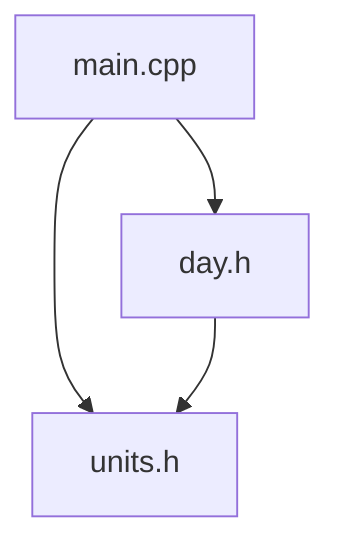

# 2.12 Header guards

Headers can include other headers, and that is where a trap is hidden. When several files include several headers, the same header can end up in one source file twice, without anyone having asked for it. This lesson shows what goes wrong, and it introduces the standard cure, the header guard. It also shows a problem that the guard does not solve, which explains why the headers in this book hold only declarations.

## The same header twice

Imagine a header `units.h` that defines the function `minutesPerHour`. A second header, `day.h`, needs that function and so it includes `units.h`. Then a source file includes `day.h`, because it uses `minutesPerDay`, and also includes `units.h`, because it uses `minutesPerHour` directly. Each include is reasonable on its own, and together they put `units.h` into the file twice:



Here are the three files, without any protection:

```cpp title="units.h"
{{#include ../../examples/ch02/12-included-twice.fail/units.h}}
```

```cpp title="day.h"
{{#include ../../examples/ch02/12-included-twice.fail/day.h}}
```

```cpp title="main.cpp"
{{#include ../../examples/ch02/12-included-twice.fail/main.cpp}}
```

The compiler refuses to build `main.cpp`. By the time the preprocessor has finished, the file contains the definition of `minutesPerHour` twice, once through `day.h` and once from the direct include, and the compiler reports a redefinition. This is the one-definition rule from lesson 2.7 at work.

A header that only declares functions would survive being included twice, because a declaration may be repeated. But real headers soon hold things that cannot be repeated, such as the definitions of types that later chapters introduce. Every header needs protection against being included twice, and it is better to add it from the start.

## Header guards

A **header guard** is a set of preprocessor directives around the content of a header, so that the content is only used the first time. It uses the conditional directives from lesson 2.10:

```cpp
#ifndef UNITS_H
#define UNITS_H
// the content of the header
#endif
```

The first time that the preprocessor reaches the header, the name `UNITS_H` is not defined. The `#ifndef` condition is true, so the preprocessor keeps the content, and the `#define` line defines the name. The second time, the name is already defined, the condition is false, and the preprocessor skips everything up to the `#endif`. The content is used exactly once.

The name of the guard is a macro, and by convention it is written in capital letters with underscores, derived from the name of the file: `UNITS_H` for `units.h`, and `DAY_H` for `day.h`. Each header needs a name of its own, because two headers that share a guard name would hide each other. In a large project, names often add a prefix of the project's name for the same reason.

This is the same project with a guard in each header:

```cpp title="units.h"
{{#include ../../examples/ch02/12-guarded/units.h}}
```

```cpp title="day.h"
{{#include ../../examples/ch02/12-guarded/day.h}}
```

```cpp title="main.cpp"
{{#include ../../examples/ch02/12-guarded/main.cpp}}
```

```text title="Output"
{{#include ../../examples/ch02/12-guarded.out}}
```

The program builds, because `main.cpp` receives the definition of `minutesPerHour` only once. From this lesson on, every header in this book has a guard.

## What guards do not solve

A guard works inside one translation unit, which is one source file together with everything it includes. Each source file is processed on its own, and the guard starts from scratch for each of them. So the guard cannot prevent this problem:

```cpp title="units.h"
{{#include ../../examples/ch02/12-two-units.fail/units.h}}
```

```cpp title="first.cpp"
{{#include ../../examples/ch02/12-two-units.fail/first.cpp}}
```

```cpp title="second.cpp"
{{#include ../../examples/ch02/12-two-units.fail/second.cpp}}
```

```cpp title="main.cpp"
{{#include ../../examples/ch02/12-two-units.fail/main.cpp}}
```

The header has a guard, and each source file includes it only once. But both `first.cpp` and `second.cpp` include it, and each one receives its own copy of the definition of `minutesPerHour`. Every file compiles without complaint. The linker then finds the function defined in two files, and it reports the error from lesson 2.9.

The lesson is that a header should hold declarations, and the definitions of functions belong in a source file. Then a header can be included in any number of files, and there is still exactly one definition of each function. The programs in this lesson put definitions in headers only in order to show the problems, and the programs from here on follow the rule.

## Another way: pragma once

Many compilers support a second way to protect a header. You write one line at the top of the file:

```cpp
#pragma once
```

It has the same effect as a guard, with less to type and no name to invent. It is not part of the standard, although the vast majority of modern compilers support it. A header guard is part of the language itself, and it works with every compiler, so this book uses guards.

<details>
<summary>Check your understanding</summary>

**Question 1.** What does the guard in `units.h` do when the preprocessor reaches the header a second time in the same source file?

<details>
<summary>Answer</summary>

The name `UNITS_H` is already defined, so the `#ifndef` condition is false, and the preprocessor skips everything up to the `#endif`. The content of the header is not used a second time.

</details>

**Question 2.** A header with a guard defines a function and is included by two source files. Why does the program still fail to build?

<details>
<summary>Answer</summary>

The guard works within one source file. Each of the two source files receives its own copy of the definition, so the linker finds the function defined twice. A header should declare functions, and the definitions belong in one source file.

</details>

**Question 3.** What would a suitable guard name be for a header called `shapes.h`?

<details>
<summary>Answer</summary>

`SHAPES_H`. The name is written in capital letters, derived from the name of the file, with an underscore for the dot.

</details>

</details>

## Summary

- A header can reach a source file twice, through other headers, and a definition that appears twice is an error.
- A header guard, made of `#ifndef`, `#define` and `#endif`, makes the preprocessor use the content of a header only once per source file.
- The name of a guard is written in capital letters and derived from the file name, as in `UNITS_H`, and every guard name must be unique.
- A guard does not stop two different source files from each receiving a definition, which the linker reports as an error.
- Headers should hold declarations, with the definitions of functions in source files.
- `#pragma once` is widely supported but not part of the standard, so the book uses header guards, and from here on every header has one.

## Further reading

- [Implementation-defined behavior control: #pragma once (cppreference)](https://en.cppreference.com/w/cpp/preprocessor/impl)
- [Conditional inclusion (cppreference)](https://en.cppreference.com/w/cpp/preprocessor/conditional)
