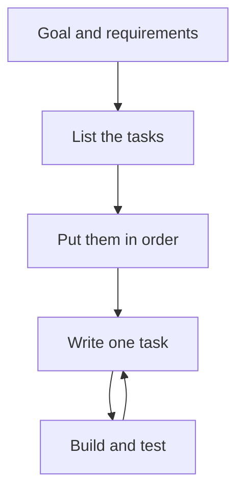

# 2.13 How to design your first programs

Knowing the parts of a language is not the same as knowing how to build a program from them. A beginner who has learned variables, functions and input often stares at an empty file and does not know where to start. This lesson gives you a way to begin: a short routine to follow before you write any code, and another to follow while you write it. Then it applies both to a small program from start to finish.

## Before you write code

The most common mistake in a first program is to start typing before you know what the program should do. A few minutes of thinking save much more time later.

**State the goal.** Write one or two sentences that say what the program does, in the words of the person who will use it. A goal that you cannot write down is not clear enough to program yet.

**List the requirements.** Requirements are the facts that the program has to satisfy: what it reads, what it prints, and what it may assume. They also include limits that you accept for now, such as working only with whole numbers.

**Check your tools.** Look at what you know. This book calls this your **toolbox**: the features of C++ that you have met so far. If the program seems to need a feature that you do not have, such as a decision or a repetition, change the requirements to fit your toolbox, and keep the missing feature for a later version.

**Break the problem into tasks.** A task is a small step that you can describe in a sentence and test on its own. Write the tasks down as a list.

**Put the tasks in order.** Some tasks need the results of others. Reading the numbers comes before calculating with them, and calculating comes before printing. Put the tasks in the order in which they have to happen.

The diagram shows the whole routine, including the loop that you follow when you write the code.



## While you write code

**Write one piece at a time.** Pick the next task from the list, write only that, and build. When the program builds and does what you expect, go on to the next task.

**Build and test often.** A problem is simple to find when it can only be in the last few lines. Test with values for which you know the answer, so that a wrong result stands out.

**Keep it simple.** Write the simplest code that does the task, and give the pieces clear names. Do not add flexibility that nobody has asked for.

**Add features later.** When you think of an improvement, write it down for later instead of squeezing it in. A working small program is a better base for the next feature than a half-working large one.

## A worked example

Here is the routine applied to a small problem.

**Goal.** The program asks for the length and the width of a room, in whole meters. It prints the area of the floor and the length of the skirting board that goes along the walls.

**Requirements.** The program reads two whole numbers and prints two whole numbers. It ignores the doors, so the skirting board runs along all four walls. Numbers that are not sensible, such as negative lengths, are not handled yet, because that needs decisions that the toolbox does not have.

**Tasks, in order.**

1. Read the length.
2. Read the width.
3. Calculate the floor area.
4. Calculate the length of the skirting board.
5. Print both results.

The tasks suggest the functions. Reading a number is a job of its own that happens twice, so it becomes the function `readNumber`. The two calculations become `floorArea` and `skirtingLength`, each with the length and the width as parameters. The function `main` ties the pieces together and prints.

## The first version: the calculations

The calculations are the part with the most arithmetic, so the first version builds and tests them with fixed values. There is no input yet:

```cpp title="room-step1.cpp"
{{#include ../../examples/ch02/13-room-step1.cpp}}
```

```text title="Output"
{{#include ../../examples/ch02/13-room-step1.out}}
```

Check the numbers by hand. A room of 5 by 4 meters has a floor of 20 square meters, and the walls have a total length of 2 times 5 plus 4, which is 18 meters. Both results are right, so the two functions are ready, and a mistake in the next step cannot be in them.

## The final version: reading the numbers

The last step adds the function that reads a number, and `main` now asks for the two lengths:

```cpp title="room.cpp"
{{#include ../../examples/ch02/13-room.cpp}}
```

Type 5 and press <kbd>Enter</kbd>, then type 4 and press <kbd>Enter</kbd>:

```text title="Example session"
{{#include ../../examples/ch02/13-room.session}}
```

The results are the same as in the first version, because the input is the same. Look at how little changed between the two versions: the calculations were not touched. That is the benefit of building the program in pieces and of keeping each function to one job.

## What comes next

The program is finished for the requirements that you set, and it is worth testing with other values. A room of 1 by 1 meter must give an area of 1 and a skirting board of 4. A mistake such as forgetting the factor of 2 shows up immediately with numbers like these.

It is also worth writing down what the program does not do. It does not check that the lengths are positive, and it cannot subtract the width of a door from the skirting board. Those are features for later versions, once you have the statements that make decisions. Keeping the first version small is what made it possible to finish it.

<details>
<summary>Check your understanding</summary>

**Question 1.** Why does the task list come with an order, and what order does it have in the worked example?

<details>
<summary>Answer</summary>

Some tasks need the results of others. In the example, the two numbers are read first, then the area and the skirting board are calculated from them, and the results are printed last.

</details>

**Question 2.** What should the program print for a room that is 6 meters long and 3 meters wide?

<details>
<summary>Answer</summary>

The floor area is 18 square meters, and the skirting board is 18 meters, because 2 times 6 plus 3 is 18.

</details>

**Question 3.** Why does the first version use fixed values instead of reading numbers?

<details>
<summary>Answer</summary>

It lets you test the calculations on their own, with values for which you know the answer, and without typing anything. The reading is added in the next step, when the calculations are known to work.

</details>

</details>

## Summary

- Before you write code, state the goal, list the requirements, check them against your toolbox, break the problem into tasks, and put the tasks in order.
- While you write code, add one task at a time, build and test after each one, keep the code simple, and add features later.
- Tasks that repeat or that stand alone usually become functions, and each function should have one job.
- Test with values for which you know the answer, and write down what the program does not handle yet.
- A small program that works is a better foundation than a large program that almost works.
