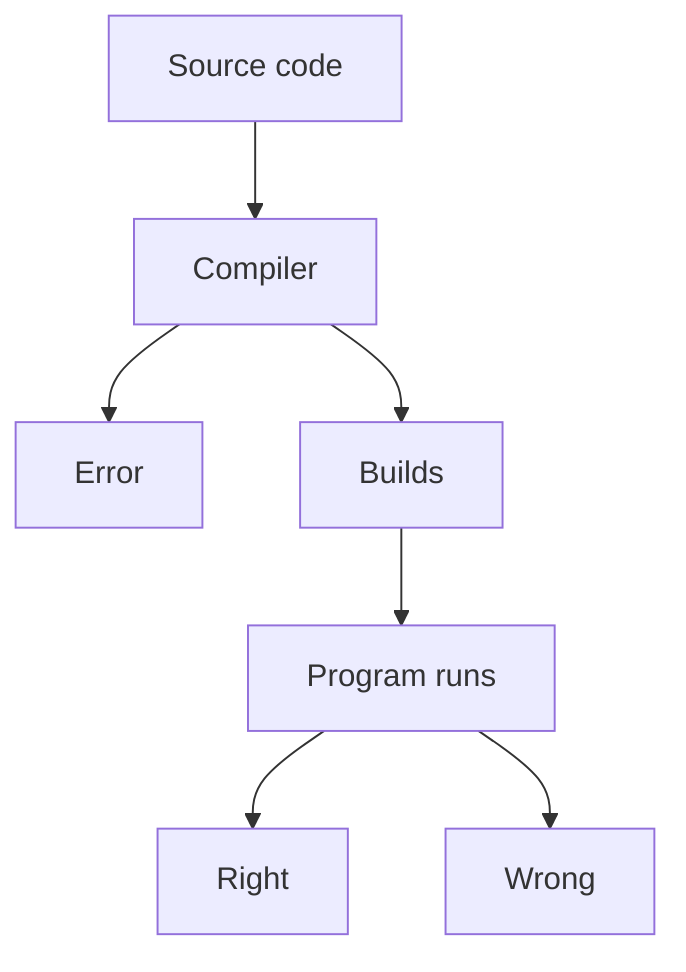

# 3.1 Syntax and semantic errors

Every program you have written so far either built or it did not, and when it did not, the compiler told you why. That is the friendly kind of mistake. This lesson sorts mistakes by who can notice them: the compiler, the running program, or nobody at all. Knowing which kind you are facing tells you where to look first.

## Four kinds of mistakes

The table lists the kinds in the order in which a program meets them. The first two never reach the user, because the compiler stops them: the semantic errors in the table are the ones the compiler can see. The last two are the reason this whole chapter exists.

| Kind | Who finds it, and when |
| --- | --- |
| Syntax error | The compiler, while building |
| Semantic error | The compiler, while building |
| Logic error | You, while running |
| Undefined behavior | Maybe nobody, maybe never |

The diagram follows a mistake from your source code to the screen. The compiler stops the first two kinds, so no program is built. The other two pass through a clean build and travel on into the running program, where they can produce a wrong result.



## Syntax errors

A **syntax error** breaks the grammar of C++. The classic example is a missing semicolon, which [lesson 1.1](../ch01-cpp-basics/01-statements-and-the-structure-of-a-program.md) showed: the compiler cannot tell where one statement ends and the next begins, so it reports an error and produces no program. Other examples are a brace that is never closed or a keyword that is misspelled.

The compiler usually names the line, but the line it names is where it *noticed* the problem, which can be one line after the mistake. When a message points at a line that looks perfectly fine, read the line above it. Fix the first error in the list before you look at the others, because a single missing character can cause a whole cascade of messages.

## Semantic errors the compiler can see

A **semantic error** is code with a valid grammar and an invalid meaning. The sentence "the toaster sang yesterday's tomorrow" is grammatical English, but it means nothing. In C++, the closest thing is a name that was never declared:

```cpp title="undeclared-name.cpp"
{{#include ../../examples/ch03/01-undeclared-name.fail.cpp}}
```

The program defines `total` but asks for `totl`. Every statement is well formed, yet the second one refers to something that does not exist, so the compiler refuses to build. GCC and Clang word the message differently, and both name `totl` and the line. Calling a function with the wrong number of arguments, as in [lesson 2.4](../ch02-functions-and-files/04-introduction-to-function-parameters-and-arguments.md), is another semantic error that the compiler finds.

The compiler finds these two kinds for you. The compiler is a tireless proofreader, and it points at the place. Your job is only to read what it says.

## Logic errors

A **logic error** is code that is valid, builds without a complaint and does the wrong thing. The compiler cannot find it, because it does not know what you meant, only what you wrote. Here is a kitchen timer that converts minutes to seconds:

```cpp title="wrong-factor.cpp"
{{#include ../../examples/ch03/01-wrong-factor.cpp}}
```

```text title="Output"
{{#include ../../examples/ch03/01-wrong-factor.out}}
```

The program ran, printed a number, and the number is wrong: 7 minutes are 420 seconds, not 42. The function multiplies by 6 instead of 60. Nothing in the code is illegal, so no tool can object.

A second example shows a mistake at the call instead of in the function:

```cpp title="swapped-arguments.cpp"
{{#include ../../examples/ch03/01-swapped-arguments.cpp}}
```

```text title="Output"
{{#include ../../examples/ch03/01-swapped-arguments.out}}
```

The ticket costs 40 and the voucher is worth 5, so the right output is `You pay 35`. The call passes the voucher as the price and the price as the discount, and the function dutifully computes 5 minus 40. Both arguments are `int`, so the compiler has no reason to suspect that they are in the wrong order.

> [!KEY-INSIGHT]
> The compiler checks that your program is valid C++, never that it does what you meant. A clean build is the start of testing, not the end.

## Undefined behavior: the hardest kind

[Lesson 1.6](../ch01-cpp-basics/06-uninitialized-variables-and-undefined-behavior.md) introduced undefined behavior, where the standard places no requirements on what a program does. It is the hardest kind of mistake to find, because the program may behave differently from one run to the next, or work for months and then fail after you change something unrelated. A bug that comes and goes is a hint, though not a proof, that undefined behavior is involved.

You cannot catch it by reading the output, since the output may look right. [Lesson 3.10](10-finding-issues-before-they-become-problems.md) shows tools that detect some of it while a program runs, and [lesson 4.4](../ch04-fundamental-data-types/04-signed-integers.md) shows a program that triggers it on purpose. For now, remember the habit from [lesson 0.11](../ch00-getting-started/11-warning-and-error-levels.md): turn on the compiler's warnings and treat them as errors, because the compiler can spot many of the simple cases before they ever run.

<details>
<summary>Check your understanding</summary>

**Question 1.** Name the kind of mistake in each case: (a) a `}` is missing at the end of `main`; (b) a program prints the average of two numbers but divides by 3; (c) a variable named `count` is used in a function that never defined it.

<details>
<summary>Answer</summary>

(a) is a syntax error, because the grammar is broken. (b) is a logic error: the program is valid and runs, but it computes the wrong thing. (c) is a semantic error that the compiler finds, because the name has no declaration.

</details>

**Question 2.** What does this fragment print, and is the author's intention clear from the code alone?

```cpp
int half(int total) { return total / 3; }
std::cout << half(12);
```

<details>
<summary>Answer</summary>

It prints 4. The code is valid, so the compiler is silent, but the function is called `half`, and half of 12 is 6. Only a person who knows the intention can see that `3` should be `2`, which makes this a logic error.

</details>

**Question 3.** Why can a compiler find a call with the wrong number of arguments but not a call with the arguments in the wrong order?

<details>
<summary>Answer</summary>

The number of arguments is part of what the function declares, so the compiler can compare it with the call. When two parameters have the same type, an argument in the wrong place is still a valid argument for that parameter. Whether it is the right *value* depends on what you meant.

</details>

</details>

## Summary

- A syntax error breaks the grammar of C++, and the compiler reports it and builds nothing.
- A semantic error that the compiler can see is well-formed code with an invalid meaning, such as a name that was never declared.
- A logic error is valid code that does the wrong thing, and only a person who knows the intention can find it.
- Undefined behavior is the hardest kind: the program may look right, so it needs tools and habits to catch it.
- Read the compiler's first message first, and remember that a clean build does not prove that a program is right.

## Further reading

- [Undefined behavior (cppreference)](https://en.cppreference.com/w/cpp/language/ub)
- [Options to request or suppress warnings (GCC manual)](https://gcc.gnu.org/onlinedocs/gcc/Warning-Options.html)
