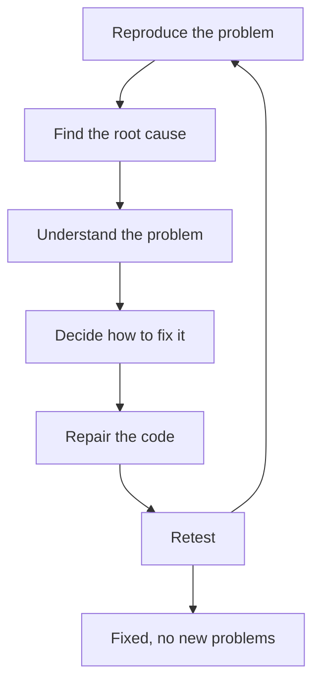

# 3.2 The debugging process

Lesson 3.1 showed that the compiler cannot find a logic error, so finding one falls to you. Beginners often treat that as a talent: some people have a nose for bugs, and others do not. In practice, finding a bug is a procedure with a few steps, and following it is faster than staring at the code and hoping.

## The six steps

**Debugging** is the work of finding why a program misbehaves and fixing it. The work has six steps, and the diagram shows them as a loop, because a repair can cause a new problem that sends you back to the first step.



1. **Reproduce the problem.** Find the exact steps and inputs that make the bug appear, every time. A bug you cannot repeat is a bug you cannot test a fix for.
2. **Find the root cause.** Locate the statement or function that is actually wrong, not just where the wrong value shows up. Most of the effort goes into this step, and lesson 3.3 gives you a strategy for it.
3. **Understand the problem.** Explain, in words, why that code produces the wrong result. If you cannot, you have not found the cause yet.
4. **Decide how to fix it.** There is often more than one way, and the quickest one is not always the best one.
5. **Repair the code.** Make the change you decided on, and nothing else.
6. **Retest.** Run the failing case again, then run the cases that worked before, because a repair can break something that was fine.

## Symptom versus root cause

The **symptom** is what you see: a wrong number on the screen. The **root cause** is the mistake in the code that produces it. They are often far apart.

Think of a stain on a ceiling. You can paint over the stain, and it looks fixed for a week. The cause is a cracked tile on the roof, and until you replace it the stain returns. A change that hides a symptom, such as subtracting a correction from a wrong total, leaves the cracked tile where it is.

## A worked example

A program should print the average of three test scores: 90, 85 and 80.

```cpp title="average-bug.cpp"
{{#include ../../examples/ch03/02-average-bug.cpp}}
```

```text title="Output"
{{#include ../../examples/ch03/02-average-bug.out}}
```

**Reproduce.** The program takes no input, so the bug appears on every run. That is the easy case.

**Root cause.** The symptom is an average of 201, which is larger than every score, so no correct average can look like that. The expression `first + second + third / 3` is the suspect. Division binds tighter than addition, so only `third` is divided by 3, and the other two scores are added to the result: 90 + 85 + 26 is 201, using whole-number division for the 26.

**Understand and decide.** The author meant to add the scores first. Parentheses around the sum make the addition happen before the division. Adding a correction to the output would hide the symptom without touching the cause, so that is not an option.

**Repair and retest.** The repaired program changes one expression:

```cpp title="average-fixed.cpp"
{{#include ../../examples/ch03/02-average-fixed.cpp}}
```

```text title="Output"
{{#include ../../examples/ch03/02-average-fixed.out}}
```

The scores add up to 255, and 255 divided by 3 is 85. Retesting does not stop there. Try scores that do not divide evenly, such as 90, 85 and 81: the sum is 256, and 256 divided by 3 prints 85, because whole-number division drops the fraction. That is not a new bug in the repair, but it is a behavior the repair makes visible, and a careful tester notices it.

> [!KEY-INSIGHT]
> If you cannot explain why a change fixes the problem, you have not found the root cause. A change that makes the symptom disappear without an explanation is a guess that happened to work.

## When the steps feel slow

Beginners are tempted to skip the first step and start changing code. That works for tiny programs and fails for bigger ones, because every change you make without understanding the problem can add a second bug on top of the first. Writing down the symptom, the suspect and the reason takes a minute, and it often reveals the answer before you finish writing.

<details>
<summary>Check your understanding</summary>

**Question 1.** Someone "repairs" the average program by printing `average - 116` instead of `average`. For 90, 85 and 80 it prints 85. Why is this not a repair?

<details>
<summary>Answer</summary>

The correction, 116, was chosen to turn 201 into 85 for one set of scores, so the next set of scores gives a wrong answer again. The root cause, the missing parentheses, is still in the code. A repair has to change the cause, not the symptom.

</details>

**Question 2.** A program prints 12 where you expected 7. Put these in the order of the debugging process: retest, find the root cause, reproduce the problem, repair the code, decide how to fix it.

<details>
<summary>Answer</summary>

Reproduce the problem, find the root cause, decide how to fix it, repair the code, retest. A step to understand why the code is wrong belongs between finding the cause and deciding on the fix.

</details>

</details>

## Summary

- Debugging is a procedure: reproduce, find the root cause, understand it, decide on a fix, repair, and retest.
- The symptom is what you see, and the root cause is the mistake in the code, and they are often far apart.
- Retesting includes the cases that worked before, because a repair can break something else.
- A change that you cannot explain is a guess, even when it makes the symptom go away.
- Writing down the symptom, the suspect and the reason is often enough to see the answer.
