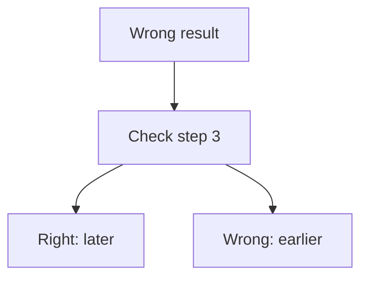

# 3.3 A strategy for debugging

Lesson 3.2 listed the steps of debugging and said that finding the root cause takes most of the effort. This lesson is about that step. A good strategy turns a program of fifty functions into a search that takes a handful of questions, instead of a hunt through every line.

## Read first, then run

The cheapest tool you have is your own reading. **Inspection** means reading the code slowly and checking each statement against what it should do, and it finds more bugs than most beginners expect. It is free, and it works without running anything.

Inspection has a limit: you read what you *meant*, not what you *wrote*. The eye fills in the missing parentheses and the swapped arguments, because the brain already knows the intention. For this reason, inspection works best on a small piece of code, and the next tool takes over when the piece is still too big.

That tool is running the program to gather evidence. Run it with different inputs, and write down which ones work and which fail. Before you try to fix anything, make the failure reproducible, as lesson 3.2 says, because every later step depends on being able to see the bug on demand.

## Narrow it down by halves

Imagine a parcel that travels through five stations on its way to the customer, and it arrives damaged. You could inspect every station, but a faster way is to open the parcel after the third station.

If it is damaged there, the cause is in stations one to three. If it is intact, the cause is in four or five. One look removes half of the possibilities, and a few looks leave a single station.

A program is a chain in the same way: values flow through steps, and the wrong value appears at the end. The diagram shows one check in the middle of a chain of five steps. If the value after step 3 is right, the cause is in a later step, and if it is already wrong, the cause is in an earlier one.



Here is a program that passes a value through four functions. It should print the price of five tickets at 20 each, with a service fee of one tenth added on top.

```cpp title="receipt-bug.cpp"
{{#include ../../examples/ch03/03-receipt-bug.cpp}}
```

```text title="Output"
{{#include ../../examples/ch03/03-receipt-bug.out}}
```

Five tickets at 20 cost 100, a tenth of that is 10, and the total should be 110. The program prints 90, so the symptom is clear.

Searching by halves works like this. First, work out by hand what each step must hand over: `ticketCount` should give 5, `baseCost` should give 100, `serviceFee` should give 10. Then check the value in the middle of the chain, the cost after `baseCost`. It is 100, as it should be, so the first half is fine.

The second half has two functions left. The fee from `serviceFee` is 10, which is correct, so the last function, `totalCost`, receives two correct values and returns the wrong one. That function is the root cause: it subtracts the fee where it should add it.

Two checks found it, and the other functions never needed a closer look. Lesson 3.4 shows how to make the program report these values itself, instead of working them out on paper.

The repaired function adds the fee:

```cpp title="receipt-fixed.cpp"
{{#include ../../examples/ch03/03-receipt-fixed.cpp}}
```

```text title="Output"
{{#include ../../examples/ch03/03-receipt-fixed.out}}
```

## One hypothesis, one change

Searching by halves tells you where to look. Once you are looking at a function, form a **hypothesis**: a specific guess that you can test, such as "`totalCost` subtracts the fee". Then test the guess, and change one thing at a time. If you change three things and the bug disappears, you do not know which change mattered, and you may have hidden the bug without fixing it.

> [!BEST-PRACTICE]
> Change one thing, then run the program again. If the change did not help, put it back before you try the next idea, so that you never debug the leftovers of an old guess.

## Keep notes, and take a break

A short note for each experiment saves time: what you changed, what you expected and what happened. After an hour of random trials, a list of five failed ideas shows you the pattern that your memory has lost. The same list stops you from trying the same idea twice.

When you are stuck, step away. A walk, a meal or a night of sleep resets how you see the code, and many bugs that survive an hour of staring fall to a five-minute look afterwards. It sounds like advice for a different kind of work, but a tired reader reads what they expect, which is the limit of inspection from the start of this lesson.

<details>
<summary>Check your understanding</summary>

**Question 1.** A program calls six functions in a row and prints a wrong final value. You check the value after the third function and find that it is already wrong. Which functions do you inspect next?

<details>
<summary>Answer</summary>

The first three. The wrong value existed after the third function, so the cause is in functions one to three, and you can ignore the last three for now. Check the value after the second function to split the three again.

</details>

**Question 2.** You suspect two lines of a function. You change both at once, and the output is correct. What is wrong with that approach?

<details>
<summary>Answer</summary>

You do not know which change fixed the problem, and one of them may be an unnecessary change that introduces a new bug. Change one line, run the program, and keep or undo the change before you try the other.

</details>

**Question 3.** A bill of 90 is split between 3 people, and the call `perPerson(90, 3)` prints 0 instead of 30. Find the error.

```cpp
int perPerson(int total, int people)
{
    return people / total;
}
```

<details>
<summary>Answer</summary>

The operands of the division are in the wrong order. The function computes 3 divided by 90, and whole-number division drops the fraction, which leaves 0. Writing `total / people` returns 30.

</details>

</details>

## Summary

- Inspection means reading code against its intention, and it is cheap, but it fails because you read what you meant, not what you wrote.
- Run the program with different inputs to gather evidence, and make the failure reproducible first.
- Narrow the search by halves: check a value in the middle of the chain, and look only at the half that contains the first wrong value.
- Form one hypothesis, change one thing, and run the program again.
- Keep notes of each experiment, and take a break when you are stuck.
