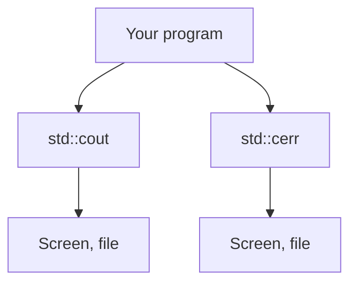

# 3.4 Basic debugging tactics

[Lesson 3.3](03-a-strategy-for-debugging.md) told you to check values in the middle of a chain and to look at the half that is wrong. This lesson gives you three ways to do that with nothing but the language you already know: switching code off, announcing where the program is, and printing what it holds. They are simple, they work on every computer, and professionals still use them every week.

## Switch code off to isolate a problem

If a bug disappears when you remove a part of the program, the cause lives in that part. Comment the suspect out, and put a known value in its place so the rest of the program still has something to work with:

```cpp
// int fee{serviceFee(cost)};
int fee{10};
```

If the total from [lesson 3.3](03-a-strategy-for-debugging.md) is now right, the cause is inside `serviceFee`. If it is still wrong, `serviceFee` is innocent, and you have removed one function from the search.

Write `//` in front of each line you switch off. A block comment cannot hold another block comment, as [lesson 1.2](../ch01-cpp-basics/02-comments.md#block-comments-do-not-nest) showed, so `/* ... */` around code that already contains one ends too early. The preprocessor's `#if 0` and `#endif`, from [lesson 2.10](../ch02-functions-and-files/10-introduction-to-the-preprocessor.md), switch off a larger stretch and do not have that problem.

## Announce where the program is

Suppose a receipt should include shipping and tax, and it prints a total that is too small. Before you read any arithmetic, ask a simpler question: did the functions run at all? The cheapest answer is a message at the start of each function you suspect. A program that reports its own steps is giving you a **trace**.

```cpp title="trace-calls.cpp"
{{#include ../../examples/ch03/04-trace-calls.cpp}}
```

Each function prints a line to `std::cerr` as soon as it starts. Here is what the console shows:

```text title="Output"
{{#include ../../examples/ch03/04-trace-calls.out}}
```

The two lines that start with `[debug]` came from `std::cerr`, and the last line came from `std::cout`. The trace answers the question at once: `addShipping` and `printReceipt` ran, and `addTax` never did. The root cause is a call that `main` forgot to write. Adding the line `price = addTax(price);` after the call to `addShipping` repairs the program, and the receipt then shows 60.

## Two output streams

`std::cerr` is a second way to print, next to `std::cout`. A **stream** is a channel that text flows through. `std::cout` writes to the **standard output** stream, and `std::cerr` writes to the **standard error** stream. In a terminal you see both, so they look the same, but they travel on separate channels, and the diagram shows where each one can end up.



Three properties make `std::cerr` the right tool for debug messages:

- **It is separate.** A program's real output and its debug output do not mix in a file or in another program's input. You can send them to different places and read the real output without the noise.
- **It is unbuffered.** Text written to `std::cout` may wait in memory for a while before it is shown, and if the program crashes, that text can be lost. `std::cerr` writes every message at once, so the last line you see is the last thing the program did.
- **It is tied to `std::cout`.** Before `std::cerr` writes, the pending text of `std::cout` is written first. That is why a terminal shows both streams in the order in which the program produced them.

To send only the error stream to a file, put `2>` and a file name after the command. The text of `std::cerr` goes into the file, and the text of `std::cout` still appears on the screen:

{{#tabs}}
{{#tab Windows}}

**Redirect:** in PowerShell, run the program with `2>` and a file name.

```powershell
.\trace-calls.exe 2> debug.txt
```

{{#endtab}}
{{#tab macOS}}

**Redirect:** in the terminal, run the program with `2>` and a file name.

```bash
./trace-calls 2> debug.txt
```

{{#endtab}}
{{#tab Linux}}

**Redirect:** in the terminal, run the program with `2>` and a file name.

```bash
./trace-calls 2> debug.txt
```

{{#endtab}}
{{#endtabs}}

The command assumes that you built the program as `trace-calls`. A single `>` redirects the standard output instead, which is the text of `std::cout`.

## Print the values

A trace tells you which code ran. To find out what the code worked with, print the values: the parameters at the start of a function, and the results where they are produced. The next program should print the volume of a box that is 4 long, 3 wide and 2 high, which is 24:

```cpp title="print-values.cpp"
{{#include ../../examples/ch03/04-print-values.cpp}}
```

```text title="Output"
{{#include ../../examples/ch03/04-print-values.out}}
```

The first line is the debug message from `std::cerr`, and it settles the first question. The arguments arrive as 4, 3 and 2, so the call is right, and the mistake must be inside the function. The result, 36, is 4 times 3 times 3, which points at the last factor: the function multiplies by `width` twice and never uses `height`.

> [!WARNING]
> Store a result in a variable before you print it. In `std::cout << "Volume: " << boxVolume(4, 3, 2)`, the text `Volume: ` is written before the function runs, so the debug line would land in the middle of the output line.

## What printing costs

These tactics have a price. Debug lines clutter the code, and a line that you forget to remove ends up in the finished program, where it confuses the people who use it. Every experiment also needs a rebuild and a new run, and a wrong guess about what to print means starting again.

A consistent prefix takes most of the sting out of the clutter.

> [!BEST-PRACTICE]
> Start every debug message with the same prefix, such as `[debug]`. One search for the prefix then finds every line you have to remove, and the prefix tells a reader at a glance which lines are not real output.

[Lesson 3.5](05-more-debugging-tactics.md) shows how to leave the debug lines in the code and switch them on and off.

<details>
<summary>Check your understanding</summary>

**Question 1.** A program runs this fragment, and you start it with `2> debug.txt`. What does the screen show, and what does `debug.txt` contain?

```cpp
std::cerr << "A\n";
std::cout << "B\n";
std::cerr << "C\n";
```

<details>
<summary>Answer</summary>

The screen shows only `B`, because the redirect moved the error stream into the file. The file `debug.txt` contains the lines `A` and `C`. Without the redirect, the screen would show `A`, `B` and `C` in that order.

</details>

**Question 2.** Why is `std::cerr` a better choice for debug messages than `std::cout`?

<details>
<summary>Answer</summary>

The debug messages stay out of the program's real output, so you can redirect them or leave them out without touching the real text. `std::cerr` is also unbuffered, so a message appears even if the program crashes right after it.

</details>

**Question 3.** You comment out three lines with `/* ... */`, and the compiler reports errors in code far below. One of the three lines already contains a block comment. What happened?

<details>
<summary>Answer</summary>

Block comments do not nest, so the first `*/` ends the whole comment, including your new one. The rest of your switched-off code is compiled again, together with a stray `*/`. Use `//` on each line, or `#if 0` and `#endif`.

</details>

</details>

## Summary

- Switching a suspect off, with a known value in its place, shows whether the cause is inside it.
- A message at the start of each function gives a trace, which shows which code ran and in which order.
- `std::cerr` is a separate, unbuffered stream that is tied to `std::cout`, so it is the right stream for debug messages.
- `2>` redirects only the error stream to a file, and `>` redirects only the standard output.
- Printing parameters and results shows what the code worked with, and a common prefix such as `[debug]` makes the lines simple to find and remove.

## Further reading

- [std::cerr (cppreference)](https://en.cppreference.com/w/cpp/io/cerr)
- [About redirection (PowerShell documentation)](https://learn.microsoft.com/en-us/powershell/module/microsoft.powershell.core/about/about_redirection)
- [Comments (cppreference)](https://en.cppreference.com/w/cpp/comment)
