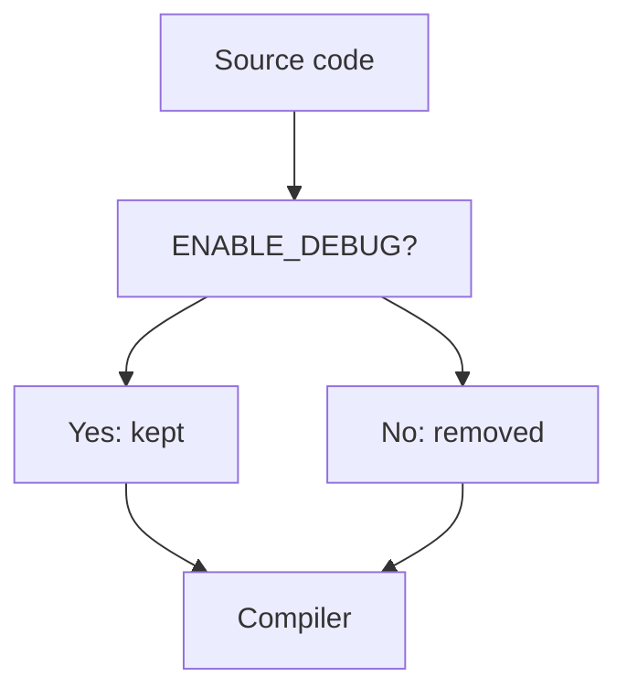

# 3.5 More debugging tactics

Debug lines are useful while you hunt a bug and a nuisance afterwards. Deleting them when the bug is gone is tedious, and you will want them back the next time something misbehaves. This lesson shows how to leave them in the code and switch them on and off, how real programs keep a longer record of what they do, and why all of these tactics eventually hit a limit.

## Switch debug output on and off

The preprocessor from [lesson 2.10](../ch02-functions-and-files/10-introduction-to-the-preprocessor.md) can keep or drop a block of code before the compiler ever sees it. That is exactly what debug output needs: put the debug lines between `#ifdef` and `#endif`, and let one name decide whether they exist. The name is a macro with no value, and a common choice is `ENABLE_DEBUG`.

The diagram shows the decision. The preprocessor looks at the name before it passes the file on to the compiler.



The first program defines the name at the top, so its debug line is part of the program:

```cpp title="debug-on.cpp"
{{#include ../../examples/ch03/05-debug-on.cpp}}
```

```text title="Output"
{{#include ../../examples/ch03/05-debug-on.out}}
```

The first line of the output came from `std::cerr`, and the second came from `std::cout`. The second program is the same file without the line `#define ENABLE_DEBUG`:

```cpp title="debug-off.cpp"
{{#include ../../examples/ch03/05-debug-off.cpp}}
```

```text title="Output"
{{#include ../../examples/ch03/05-debug-off.out}}
```

The debug line is gone from the output, and it is gone from the program too. The preprocessor removed the block, so the compiler never saw it, and nothing in the finished program prints a debug message or pays for one. A single line decides between the two versions.

## Define the macro without editing the file

Editing the source to switch debugging on is a change that is simple to forget to undo. A better way is to leave the `#define` out of the file and ask the build to define the name. The option has the same effect as a `#define` at the top of the file, and `debug-off.cpp` built this way behaves like `debug-on.cpp`.

{{#tabs}}
{{#tab Visual Studio}}

**Define it:** open the project's **Property Pages**, go to **Configuration Properties > C/C++ > Preprocessor**, and add `ENABLE_DEBUG` to **Preprocessor Definitions**. Separate several names with semicolons, and choose the configuration (Debug or Release) that you are editing at the top of the dialog.

{{#endtab}}
{{#tab VS Code}}

**Define it:** add `-DENABLE_DEBUG` as one more entry in the `args` list of your build task in `tasks.json`, next to the other compiler options.

{{#endtab}}
{{#tab Command line}}

**Define it:** with GCC or Clang, add `-DENABLE_DEBUG` to the compiler command. With Microsoft's compiler, add `/DENABLE_DEBUG`.

```bash
g++ -std=c++20 -DENABLE_DEBUG debug-off.cpp -o debug-off
```

```powershell
cl /std:c++20 /DENABLE_DEBUG debug-off.cpp
```

{{#endtab}}
{{#endtabs}}

Without a value, the name counts as defined, which is all that `#ifdef` asks. The book's strict options from [lesson 0.11](../ch00-getting-started/11-warning-and-error-levels.md) still apply, so keep them on the command line as well.

> [!BEST-PRACTICE]
> Keep debug code behind a macro such as `ENABLE_DEBUG`, and switch it on from the build. The code stays in the file for the next bug, and the finished program does not contain it.

## Logging

A debug message that stays in the program for good is a **log** message, and recording them is called **logging**. Real programs log more than a bare text: each message usually carries a time stamp, so that you can tell when it happened, and a severity such as information, warning or error, so that you can filter them. They often go to a file, because nobody is watching the screen when a program runs on a server at three in the morning.

The C++ standard library has no logging framework, with severity levels, time stamps and file handling. The nearest thing is `std::clog`, a buffered stream that goes to the error stream. A program either writes its own small logger, which is mostly `std::cerr` or a file with a time stamp added, or it uses a library from outside the standard library. This book does not recommend one, because the right choice depends on the project. When you evaluate one, look at how it handles severity levels, where it can write, and how much it slows the program down.

Two cautions apply to every log. A log grows for as long as the program runs, so a real logger needs a plan for old files. A log also keeps what you put into it, so never write passwords or other private data into one.

## Where these tactics stop

Printing and logging share three weaknesses. Every experiment means editing the code, rebuilding and running again, and the cycle gets slow in a large program. You have to guess in advance what to print, and a wrong guess sends you around the loop again. And the debug code is code: it can contain bugs of its own, and in a rare case it can change how the program behaves.

What you want instead is to stop the program in the middle of its run and look at everything it holds, without changing a single line. That is what a debugger does, and [lesson 3.6](06-using-an-integrated-debugger-stepping.md) starts with it.

<details>
<summary>Check your understanding</summary>

**Question 1.** Nothing in the program defines `ENABLE_DEBUG`, and the build does not define it either. What does this fragment print to the screen?

```cpp
#ifdef ENABLE_DEBUG
std::cerr << "[debug] hello\n";
#endif
std::cout << "done\n";
```

<details>
<summary>Answer</summary>

It prints only `done`. The name is not defined, so the preprocessor removes the lines between `#ifdef` and `#endif`, and the debug message does not exist in the program.

</details>

**Question 2.** How can you turn the debug output on without editing the source file?

<details>
<summary>Answer</summary>

Define the macro in the build: `-DENABLE_DEBUG` with GCC or Clang, `/DENABLE_DEBUG` with Microsoft's compiler, or the **Preprocessor Definitions** property in Visual Studio. The build then does what a `#define` at the top of the file would do.

</details>

**Question 3.** Why is a debug macro better than deleting the debug lines once the bug is fixed?

<details>
<summary>Answer</summary>

The next bug will need the same kind of messages, and writing them again costs time and invites new mistakes. With a macro, the lines stay in the file, switched off, and one option brings them back.

</details>

</details>

## Summary

- Debug output placed between `#ifdef` and `#endif` exists only when a macro such as `ENABLE_DEBUG` is defined, so one name switches all of it on or off.
- The macro can be defined in the build instead of the source file, with `-D` for GCC and Clang, `/D` for Microsoft's compiler, or the project's preprocessor definitions.
- Logging keeps messages for good, usually with a time stamp and a severity, and the C++ standard library has no logging framework of its own.
- Printing and logging need an edit, a rebuild and a run for every question, and you must guess what to print.
- A debugger lets you stop the program and inspect it without changing the code, which [lesson 3.6](06-using-an-integrated-debugger-stepping.md) introduces.

## Further reading

- [Preprocessor options (GCC manual)](https://gcc.gnu.org/onlinedocs/gcc/Preprocessor-Options.html)
- [/D (Preprocessor definitions) in Microsoft's compiler](https://learn.microsoft.com/en-us/cpp/build/reference/d-preprocessor-definitions)
- [Conditional inclusion (cppreference)](https://en.cppreference.com/w/cpp/preprocessor/conditional)
