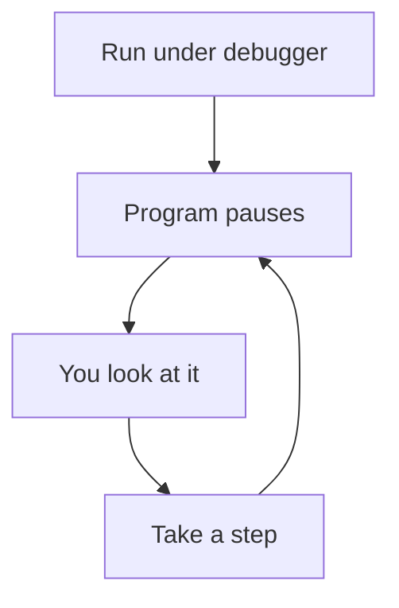
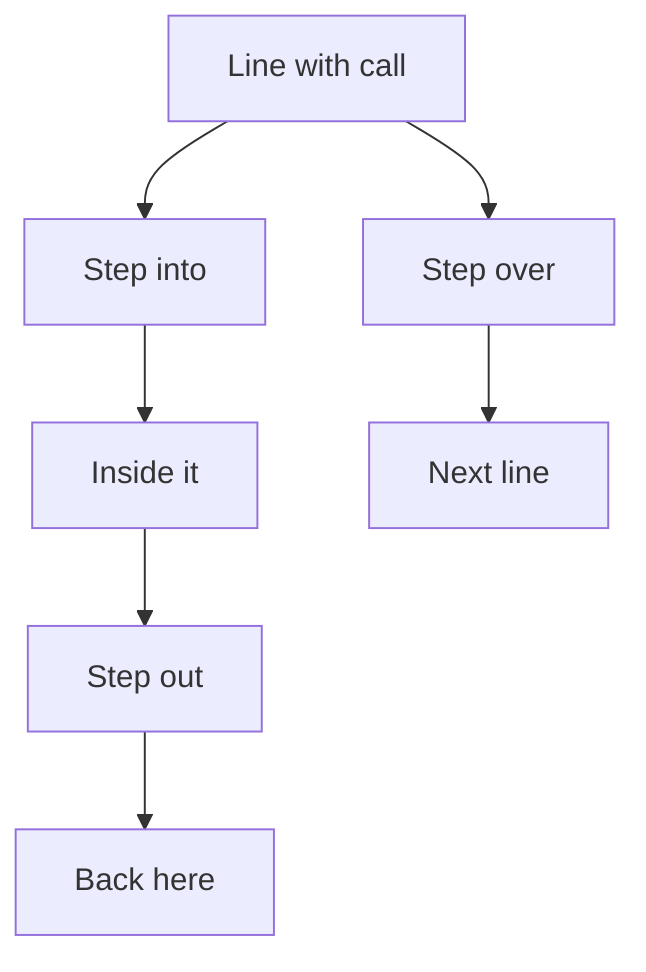

# 3.6 Using an integrated debugger: Stepping

Lesson 3.5 ended with a wish: stop a program in the middle of its run and look at everything it holds, without adding a single line. A debugger grants it. You will use one in the next four lessons, and this lesson covers the part you need first, which is moving through a program one statement at a time.

## What a debugger does

A **debugger** is a program that runs another program under its control. It can pause the program wherever you choose, show you the values it holds, and let it continue a little at a time. Think of watching a film with a remote control instead of in one sitting: you can pause on any frame, look at it closely, and advance a single frame when you are ready.

The diagram shows the cycle that you will repeat. You pause the program, look, and then either move on one step or let it run.



While the program is paused, the debugger marks the **current line**: the next statement that will run. It has not run yet. Everything above it has happened, and everything below it has not.

## Build for debugging

A debugger can only show your source lines if the build kept the link between the machine code and the lines. That link is **debug information**. The optimizer also rearranges and removes code, as lesson 0.9 explained, so the lines would jump around or vanish. A **debug build** therefore keeps the debug information and turns the optimizer off.

In Visual Studio, select the **Debug** configuration, which lesson 0.9 described. On the command line, add two options: `-g` keeps the debug information, and `-O0` (a capital letter O and a zero) switches optimization off.

```bash
g++ -std=c++20 -g -O0 stepping.cpp -o stepping
```

If you step through a release build, you may see the current line skip around, and some variables will not be readable. When a debugger seems to behave strangely, check the build first.

## Get a debugger

You need one debugger, matching your tools. Pick your toolchain:

{{#tabs}}
{{#tab Visual Studio}}

**Get it:** nothing to install. The debugger is part of Visual Studio, and the installation from [lesson 0.6](../ch00-getting-started/06-installing-an-ide.md) includes it.

**Build for it:** select the **Debug** configuration in the toolbar.

{{#endtab}}
{{#tab VS Code}}

**Get it:** install Microsoft's **C/C++** extension. It drives GDB on Linux and on Windows with MinGW-w64, and LLDB on macOS. Microsoft's setup pages for [Linux](https://code.visualstudio.com/docs/cpp/config-linux), [macOS](https://code.visualstudio.com/docs/cpp/config-clang-mac) and [Windows with MinGW-w64](https://code.visualstudio.com/docs/cpp/config-mingw) list the steps, and a [page for Microsoft's own compiler](https://code.visualstudio.com/docs/cpp/config-msvc) exists too.

**Build for it:** put `-g` in the `args` of your build task, and leave out any optimization option.

{{#endtab}}
{{#tab Command line}}

**Get it:** on Linux, install GDB with your package manager, for example `sudo apt install gdb` on Ubuntu and Debian, `sudo dnf install gdb` on Fedora or `sudo pacman -S gdb` on Arch. On Windows with MSYS2, run `pacman -S mingw-w64-ucrt-x86_64-gdb` in a UCRT64 terminal. On macOS, LLDB comes with the Xcode Command Line Tools, which `xcode-select --install` installs.

**Build for it:** compile with `-g -O0`, as shown above.

{{#endtab}}
{{#endtabs}}

## Start and stop

The simplest way to begin is to stop at the first statement of `main`. A **breakpoint** is a marker that tells the debugger to pause when the program reaches a line. Lesson 3.7 covers breakpoints properly, and here you only need one to get started.

Here is the program that you will step through. It has three functions that call each other, and only the last line of `main` prints.

```cpp title="stepping.cpp"
{{#include ../../examples/ch03/06-stepping.cpp}}
```

Run on its own, it prints one line, which is the result to keep in mind while you step:

```text title="Output"
{{#include ../../examples/ch03/06-stepping.out}}
```

{{#tabs}}
{{#tab Visual Studio}}

**Start:** click the line `int score{40};`, press <kbd>F9</kbd> to set a breakpoint, and choose **Debug > Start Debugging** (<kbd>F5</kbd>).

**Step into:** **Debug > Step Into** (<kbd>F11</kbd>).

**Step over:** **Debug > Step Over** (<kbd>F10</kbd>).

**Step out:** **Debug > Step Out** (<kbd>Shift</kbd>+<kbd>F11</kbd>).

**Stop:** **Debug > Stop Debugging** (<kbd>Shift</kbd>+<kbd>F5</kbd>).

{{#endtab}}
{{#tab VS Code}}

**Start:** click in the margin next to `int score{40};` (or put the cursor there and press <kbd>F9</kbd>) to set a breakpoint, then press <kbd>F5</kbd> and choose your C++ debug configuration.

**Step into:** <kbd>F11</kbd>.

**Step over:** <kbd>F10</kbd>.

**Step out:** <kbd>Shift</kbd>+<kbd>F11</kbd>.

**Stop:** <kbd>Shift</kbd>+<kbd>F5</kbd>.

{{#endtab}}
{{#tab Command line}}

**Start:** with GDB, run `gdb ./stepping` and type `start`. With LLDB, run `lldb ./stepping`, then type `b main` and `run`.

**Step into:** `step`.

**Step over:** `next`.

**Step out:** `finish`.

**Stop:** `quit`.

{{#endtab}}
{{#endtabs}}

On some Mac keyboards the function keys control the screen brightness and the volume unless you hold <kbd>fn</kbd> as well. The documentation lists the keys for Windows and Linux, and the debugger's menus show the key for your system, so use a menu when a key does nothing.

## Into, over and out

Three moves cover almost everything. They differ only when the current line contains a **function call**, because then you must decide whether to follow it. The diagram shows the three choices.



- **Step into** follows the call: the current line moves to the first statement inside the function. On a line without a call, it simply moves to the next line.
- **Step over** runs the whole call at once, including everything the function calls, and stops at the next line of the *same* function. You see the effect, and you skip the details.
- **Step out** runs the rest of the current function and stops back in its caller, right after the call returns.

Try them on `stepping.cpp`. Starting at the first line of `main`, step over once, and the current line is the one that calls `addBonus`. 

Step into it, and the current line is inside `addBonus`, at the call to `doubleIt`. Step into again, and you are in `doubleIt`, looking at `return value * 2;`. Step out, and you are back in `addBonus`, where the returned 6 is about to be stored.

> [!KEY-INSIGHT]
> Step over when you trust a function and step into when you suspect it. That is lesson 3.3's search by halves in motion: step over the calls that are fine, and step into the one where the first wrong value appears.

## Lines that only print

A statement such as `std::cout << ...` is a call too, and stepping into it would take you into the standard library, through code that you did not write and cannot read in a debug build. Always step *over* lines that only print.

The program's own output appears where your tool shows a program's console. Visual Studio usually shows it in a console window, VS Code in its integrated terminal or its debug console depending on your launch configuration, and GDB and LLDB print it in the terminal that you started them in. The line `Result: 46` appears when the statement that prints it has run, not before.

## The same moves in GDB and LLDB

On the command line, GDB (Linux, and Windows through MSYS2) and LLDB (macOS) use nearly the same words. The checked GDB commands below walk through `stepping.cpp`: start, step over, step into twice, step out, step over, step out again, and step over once more.

```text title="Commands for GDB"
{{#include ../../examples/ch03/06-stepping.gdb}}
```

The book's checks run these commands against the program with GCC and GDB. They confirm, among other things, that the first step out of `doubleIt` returns the value `$1 = 6`, and that the second step out returns `$2 = 46`: after `finish`, GDB tells you what the function returned.

| Action | GDB | LLDB |
| --- | --- | --- |
| Start | `start` | `b main` `run` |
| Into | `step` | `step` |
| Over | `next` | `next` |
| Out | `finish` | `finish` |
| Quit | `quit` | `quit` |

Both debuggers accept the first letter of `step` and `next`, so `s` and `n` save typing. LLDB also has long forms for the moves, `thread step-in`, `thread step-over` and `thread step-out`, and they work too.

<details>
<summary>Check your understanding</summary>

**Question 1.** The current line in `main` is `int result{addBonus(score, 3)};`. You want to know whether `addBonus` returns the right value, but you do not care how it works. Which move do you use, and where does the current line end up?

<details>
<summary>Answer</summary>

Step over. The whole call to `addBonus` runs, and the current line moves to the next line of `main`, which is the line that prints. You can then look at `result` to see what the function returned.

</details>

**Question 2.** You stepped into `doubleIt` by mistake and want to get back to where you were. Which move do you use?

<details>
<summary>Answer</summary>

Step out. It runs the rest of `doubleIt` and stops in the caller, `addBonus`, just after the call returned. The program runs on from there only when you tell it to.

</details>

**Question 3.** Why should you step over a line that prints with `std::cout`?

<details>
<summary>Answer</summary>

Stepping into it leads into the standard library, whose code you did not write and which is not part of your debug build. Stepping over runs the line, prints the text, and keeps you in your own code.

</details>

</details>

## Summary

- A debugger runs a program under your control, pauses it, shows its state, and lets it run a little at a time.
- A debug build (`-g -O0`, or the Debug configuration) keeps the link between machine code and source lines, so the current line makes sense.
- The current line is the next statement to run, and it has not run yet.
- Step into follows a function call, step over runs it in one go, and step out finishes the current function and returns to its caller.
- Step over lines that only print, so that you stay in your own code.

## Further reading

- [Navigate code in the debugger (Visual Studio)](https://learn.microsoft.com/en-us/visualstudio/debugger/navigating-through-code-with-the-debugger)
- [Debugging in Visual Studio Code](https://code.visualstudio.com/docs/debugtest/debugging)
- [Continuing and stepping (GDB manual)](https://sourceware.org/gdb/current/onlinedocs/gdb.html/Continuing-and-Stepping.html)
- [The LLDB tutorial](https://lldb.llvm.org/use/tutorial.html)
