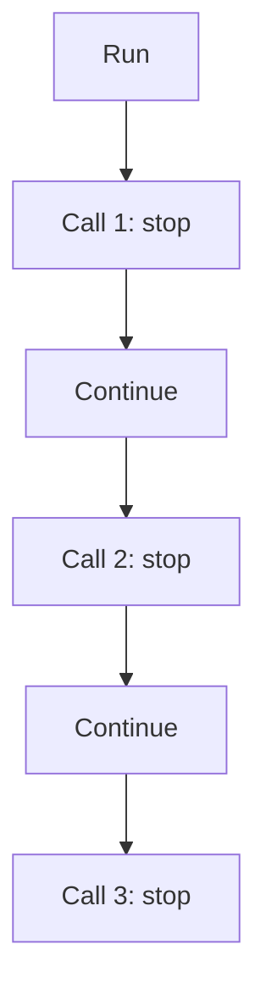

# 3.7 Using an integrated debugger: Running and breakpoints

Stepping works well when you already know where the trouble is. In a program with hundreds of lines, you need a faster way to get there: let the program run, and have it stop at the place you care about. This lesson covers the moves that do that, and one tempting move that you should treat with care.

## Run to a place

Often you want to skip a stretch of code and stop at one particular spot. The usual name for this is **run to cursor**: you point at a line, and the program runs until it reaches that line, then pauses.

Here is a program with two functions. You want to stop at the start of `shipping`, without stepping through `subtotal` first.

```cpp title="run-to-here.cpp"
{{#include ../../examples/ch03/07-run-to-here.cpp}}
```

```text title="Output"
{{#include ../../examples/ch03/07-run-to-here.out}}
```

{{#tabs}}
{{#tab Visual Studio}}

**Run to a place:** right-click the line and choose **Run To Cursor**, or put the cursor on it and press <kbd>Ctrl</kbd>+<kbd>F10</kbd>.

**Continue:** **Debug > Continue** (<kbd>F5</kbd>).

**Set a breakpoint:** click the line and press <kbd>F9</kbd>.

**List breakpoints:** **Debug > Windows > Breakpoints** (<kbd>Ctrl</kbd>+<kbd>Alt</kbd>+<kbd>B</kbd>).

**Remove a breakpoint:** press <kbd>F9</kbd> on the line again, or delete it in the **Breakpoints** window.

{{#endtab}}
{{#tab VS Code}}

**Run to a place:** the VS Code documentation does not describe a run-to-cursor command, so set a breakpoint on the line and continue.

**Continue:** <kbd>F5</kbd>.

**Set a breakpoint:** click in the margin next to the line, or put the cursor on it and press <kbd>F9</kbd>.

**List breakpoints:** the **BREAKPOINTS** section of the **Run and Debug** view.

**Remove a breakpoint:** press <kbd>F9</kbd> on the line again, or remove it in the **BREAKPOINTS** section.

{{#endtab}}
{{#tab Command line}}

**Run to a place:** in GDB, `advance shipping` runs until the function `shipping` is reached. LLDB has no direct equivalent: set a breakpoint on the function and continue.

**Continue:** `continue`.

**Set a breakpoint:** `break shipping` in GDB, and `b shipping` in LLDB.

**List breakpoints:** `info breakpoints` in GDB, and `breakpoint list` (short form `br l`) in LLDB.

**Remove a breakpoint:** `delete 1` in GDB, where 1 is the number that the list shows, and `breakpoint delete 1` in LLDB.

{{#endtab}}
{{#endtabs}}

The checked GDB commands start the program, advance to `shipping`, show its argument, and finish the function:

```text title="Commands for GDB"
{{#include ../../examples/ch03/07-run-to-here.gdb}}
```

The checks confirm that `shipping (goods=48)` is where the program stops, that `info args` shows `goods = 48`, and that `finish` reports `$1 = 8` as the returned value.

GDB also has `until`, which looks similar and behaves differently. It stops only at a place in the function that you are in, or when that function returns. From `main`, `until shipping` would not stop in `shipping`: it would run `main` to its end. For a different function, use `advance`.

## Breakpoints

A **breakpoint** is a marker on a line. When the program is about to run that line, it pauses instead. This is how you let a program run at full speed and still catch it at the exact place that matters.

The difference to run to cursor is that a breakpoint stays. If the line runs again, the program stops again. The program below calls `applyDiscount` three times with three different arguments, and a single breakpoint in the function catches all three.

```cpp title="breakpoints.cpp"
{{#include ../../examples/ch03/07-breakpoints.cpp}}
```

```text title="Output"
{{#include ../../examples/ch03/07-breakpoints.out}}
```

The diagram shows what happens. The program pauses at the breakpoint, you look, and you continue, and the next call pauses it again.



The breakpoint pauses the program *before* the marked line runs, so the line you see is still waiting. Here are the checked commands: set a breakpoint on the function, run, continue twice, list the breakpoints, remove the first one, and let the program finish.

```text title="Commands for GDB"
{{#include ../../examples/ch03/07-breakpoints.gdb}}
```

The book's checks confirm that GDB stopped three times, with the arguments `price=200, percent=10`, then `price=80, percent=25`, then `price=50, percent=50`. They also confirm that the list reported that the breakpoint was hit 3 times, and that the program exited normally after the breakpoint was removed.

In the table, `f` stands for the name of a function, and the last row deletes breakpoint number 1.

| Action | GDB | LLDB |
| --- | --- | --- |
| Run to | `advance f` | `b f` |
| Go on | `continue` | `continue` |
| Break | `break f` | `b f` |
| List | `info break` | `br l` |
| Delete | `delete 1` | `br del 1` |

> [!KEY-INSIGHT]
> A breakpoint is a question that you ask in advance: "show me the program whenever it gets here." Stepping answers where you are now, and a breakpoint gets you to the interesting place in a single move.

## Set Next Statement

Visual Studio offers one more move, which needs care. **Set Next Statement** changes which line runs next: you right-click a line and choose it, and the program carries on from there. The lines in between are skipped, and nothing undoes that.

> [!WARNING]
> Skipping code changes what the program does. A skipped line never ran, so a variable keeps the value it had, a function is never called, and a result may never be stored. Moving the next statement to another function or scope usually corrupts the call stack, as Microsoft's documentation warns. Use it for a quick experiment, never as evidence of what the program normally does.

VS Code does not document an equivalent, and some other debuggers have commands with the same effect. This book does not teach them, because the danger is the same everywhere.

<details>
<summary>Check your understanding</summary>

**Question 1.** A breakpoint sits on the line `return price - price * percent / 100;`. The function is called three times. How many times does the program stop there, and does the line run before it stops?

<details>
<summary>Answer</summary>

It stops three times, once for each call, and each time it stops before the line runs. The current line shows the statement that is about to run, and you continue to move on to the next call.

</details>

**Question 2.** What is the difference between run to cursor and a breakpoint?

<details>
<summary>Answer</summary>

Run to cursor is used once: the program runs to that line, stops, and the request is gone. A breakpoint stays in place, so the program stops there every time it reaches the line, until you remove it.

</details>

**Question 3.** Why can using Set Next Statement to skip a line mislead you about a bug?

<details>
<summary>Answer</summary>

The program runs differently from the way it normally would, because the skipped line never ran. A wrong or right result afterwards may come from the skipped code and not from the code under test, so it does not show what the real program does.

</details>

</details>

## Summary

- Run to a place stops the program once at a line you choose, and `advance` does that for a function in GDB.
- A breakpoint stays on a line and pauses the program every time that line is about to run, which is how one breakpoint catches every call of a function.
- Continue lets the program run until the next breakpoint, or until it ends.
- Every debugger can list breakpoints and remove them.
- Set Next Statement skips code and changes what the program does, so use it only for quick experiments.

## Further reading

- [Navigate code in the debugger, including Run to Cursor (Visual Studio)](https://learn.microsoft.com/en-us/visualstudio/debugger/navigating-through-code-with-the-debugger)
- [Move the execution pointer (Visual Studio)](https://learn.microsoft.com/en-us/visualstudio/debugger/move-the-execution-pointer-with-the-debugger)
- [Using breakpoints (Visual Studio)](https://learn.microsoft.com/en-us/visualstudio/debugger/using-breakpoints)
- [Setting breakpoints (GDB manual)](https://sourceware.org/gdb/current/onlinedocs/gdb.html/Set-Breaks.html)
