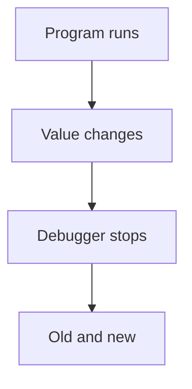

# 3.8 Using an integrated debugger: Watching variables

[Lessons 3.6](06-using-an-integrated-debugger-stepping.md) and [3.7](07-using-an-integrated-debugger-running-and-breakpoints.md) taught you to stop a program where you want. Stopping is only half of the job, because a paused program is useful only if you can look at what it holds. This lesson shows how to read the values of variables, how to keep a few of them in view while you step, and how to make the debugger stop at the moment a value changes.

## Look at a variable

Variables are the evidence in most bugs, and a debugger shows them without a single `std::cout`. There are two ways to look, and both work only while the program is paused.

You can ask about one variable by name, or you can show all the variables of the current function at once. The values you see belong to the **current line**: they are the values the program holds right now, before that line runs.

The program for this lesson changes one variable several times, so it is a good subject for watching:

```cpp title="watching.cpp"
{{#include ../../examples/ch03/08-watching.cpp}}
```

```text title="Output"
{{#include ../../examples/ch03/08-watching.out}}
```

Pick your toolchain for the steps:

{{#tabs}}
{{#tab Visual Studio}}

**Inspect:** hold the mouse over a variable in the editor, and a small window called a DataTip shows its value. The **Locals** window (**Debug > Windows > Locals**) lists the variables of the current function, and **Autos** lists the ones used near the current line.

**Watch:** open **Debug > Windows > Watch > Watch 1** and type a name in an empty row. The window keeps the value in view for as long as the debugging session lasts.

**Stop on change:** while the program is paused, right-click the variable in the **Locals**, **Autos** or **Watch** window and choose **Break when value changes**.

{{#endtab}}
{{#tab VS Code}}

**Inspect:** hover over a variable in the editor, or look in the **VARIABLES** section of the **Run and Debug** view.

**Watch:** in the **WATCH** section, select the plus button and type an expression such as `balance`.

**Stop on change:** right-click a variable in the **VARIABLES** section and pick one of the **Break on** actions, if the list offers one. The documentation says that the available actions depend on the debugger, so you may not see one.

{{#endtab}}
{{#tab Command line}}

**Inspect:** in GDB, `print balance` shows one variable and `info locals` shows all the variables of the current function. In LLDB, `frame variable balance` shows one, `frame variable` alone shows all of them, and `p balance` evaluates an expression.

**Watch:** in GDB, `display balance` shows the value again after every stop. In LLDB, run `frame variable balance` after each step.

**Stop on change:** `watch balance` in GDB, and `watchpoint set variable balance` in LLDB.

{{#endtab}}
{{#endtabs}}

## Keep an eye on a value

Looking once is not enough when a value changes as you step. A **watch** is an expression that the debugger evaluates and shows again at every stop. You add `balance` to the watch list once, and from then on every step shows its current value next to the other watches. You can watch a calculation too, such as `balance * 2`, and the debugger computes it each time.

Stepping shows you every change, but only if you are looking at the right moment. If the program has a long way to go before the value changes, you step a hundred times and still might miss it. That is the problem the next idea solves.

## Stop when a value changes

A **watchpoint**, which Visual Studio calls a **data breakpoint**, tells the debugger to stop the program at the moment a variable's value changes, wherever in the program that happens. You do not have to know which line changes the value. The diagram shows the idea.



Think of a tripwire on one variable instead of a guard at one door. A breakpoint guards a line, and a watchpoint guards a value, so it catches every line that touches the variable, including the lines you forgot about.

Here are the checked GDB commands for `watching.cpp`. They stop at the start of `main`, step over the definition of `balance`, show the variable in three ways with `info locals`, `print` and `display`, set a watchpoint, and continue three times:

```text title="Commands for GDB"
{{#include ../../examples/ch03/08-watching.gdb}}
```

The book's checks confirm what GDB reports. `info locals` shows `balance = 100` and `print balance` shows `$1 = 100`. Then each `continue` stops at a change and reports the old and the new value: 100 and 150, then 150 and 120, then 120 and 240. These are the three assignments in the program.

Look at where each stop happens. GDB pauses after the statement that changed the value has run, so the current line shown is the line *after* the assignment. If a watchpoint stops on a line that does nothing to the variable, look one line up for the culprit.

> [!KEY-INSIGHT]
> A breakpoint answers "what is the program doing here?" A watchpoint answers "who changed this?" When a variable holds a wrong value and you do not know which line put it there, the watchpoint is the faster tool.

## What watchpoints cost

A watchpoint can be hardware or software. A **hardware watchpoint** uses a feature of the processor that watches a piece of memory, so it costs almost nothing. A **software watchpoint**, used when the hardware cannot do it, makes the debugger run the program one instruction at a time and compare the value after each one, which is much slower. A processor has only a few hardware slots: Visual Studio documents a limit of four on x86 and x64.

Three more limits apply:

- GDB deletes a watchpoint on a local variable when its function returns, because the variable stops existing. In Visual Studio, delete the data breakpoint before the function ends, because its behavior afterwards is unpredictable.
- Visual Studio switches a data breakpoint off when the debugging session ends, so you set it again in the next session.
- A watchpoint reports a change of the value, so a write that stores the same value that is already there does not stop the program.

## Variables that are not there

In a release build, a variable may be missing from the debugger. The optimizer, which [lesson 0.9](../ch00-getting-started/09-build-configurations.md) described, can keep a value in a processor register, replace the variable with a constant, or remove it entirely when nothing uses it. The debugger then says that the variable is optimized out, or it shows a value that seems stale. 

This is not a bug in the debugger. It is a reason to debug a program that is built with `-g -O0`, as [lesson 3.6](06-using-an-integrated-debugger-stepping.md) recommends.

<details>
<summary>Check your understanding</summary>

**Question 1.** A variable holds a wrong value at the end of a long program, and you do not know which line wrote it. Which tool do you use, a breakpoint or a watchpoint, and why?

<details>
<summary>Answer</summary>

A watchpoint. It stops the program at every change of the variable, whichever line makes it, so the first wrong value shows you the line that caused the problem. A breakpoint needs you to name the line in advance.

</details>

**Question 2.** The program is paused at a line `balance = balance - 30;` and the watch window shows `balance` as 150. You step over the line. What does the window show, and why?

<details>
<summary>Answer</summary>

It shows 120. The line ran when you stepped over it, so the new value is 150 minus 30. Before the step, the value is the one from before the line ran.

</details>

**Question 3.** A watchpoint on a local variable stops the program when the function that owns the variable returns, and reports that it was deleted. Why?

<details>
<summary>Answer</summary>

The variable ceases to exist when the function returns, so there is nothing left to watch. The debugger removes the watchpoint, and you set a new one in the next call if you need it.

</details>

</details>

## Summary

- A paused program can be inspected: the debugger shows the values that the variables hold before the current line runs.
- Hovering, a locals window and commands such as `print` and `info locals` show values, and a watch keeps chosen expressions in view at every stop.
- A watchpoint, or data breakpoint, stops the program when a value changes, and it reports the old and new value.
- The stop comes after the changing statement, so the current line is the one after it.
- Watchpoints cost little in hardware but a lot in software, and variables of a release build may be optimized out.

## Further reading

- [Using breakpoints, including data breakpoints (Visual Studio)](https://learn.microsoft.com/en-us/visualstudio/debugger/using-breakpoints)
- [Look at data in the Autos and Locals windows (Visual Studio)](https://learn.microsoft.com/en-us/visualstudio/debugger/autos-and-locals-windows)
- [Setting watchpoints (GDB manual)](https://sourceware.org/gdb/current/onlinedocs/gdb.html/Set-Watchpoints.html)
- [The LLDB tutorial](https://lldb.llvm.org/use/tutorial.html)
