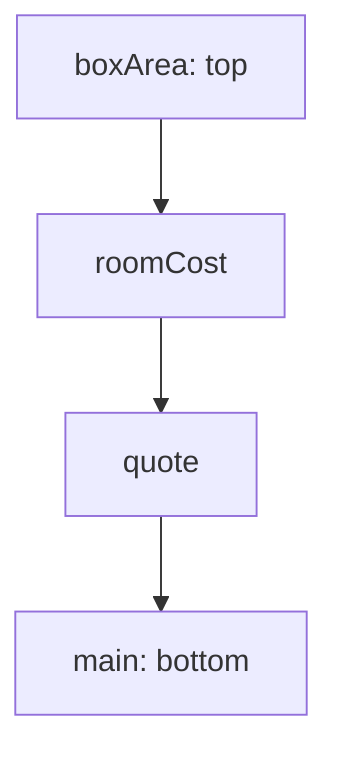

# 3.9 Using an integrated debugger: The call stack

When a program stops inside a function, one question comes up again and again: how did the program get here? The function may have received a wrong argument, and the mistake is in whoever called it. The debugger answers with the call stack, and this lesson shows how to read it and how to look at the variables of the functions above you.

## Frames and the stack

Every time a function is called, the program sets aside a small block of memory for that call. It holds the function's parameters, its local variables, and the place to return to when the function ends. The block is a **stack frame**, or a **frame**. A function that is running has a frame, and a function that has finished does not.

The **call stack** is the list of all frames that exist right now, one for each active call. Think of a pile of sticky notes. Every note says "come back here when you are done", and every new call puts a note on top of the pile. When a function returns, its note comes off, and the one below it tells the program where to continue.

The program below has a chain of calls: `main` calls `quote`, which calls `roomCost`, which calls `boxArea`.

```cpp title="call-stack.cpp"
{{#include ../../examples/ch03/09-call-stack.cpp}}
```

```text title="Output"
{{#include ../../examples/ch03/09-call-stack.out}}
```

If you stop the program inside `boxArea`, four calls are active. The diagram lists them from the top of the stack down: the current function first, and then each caller, down to `main` at the bottom.



Each arrow reads "was called by". The top frame is the **current frame**, the one that holds the current line. The frames below it are paused, waiting for the call above them to finish.

## Look at the stack

Every debugger shows the stack with one entry per frame, and every entry shows the function and the arguments it was called with. That alone often solves a bug: you see the value that was passed, without looking at any code.

{{#tabs}}
{{#tab Visual Studio}}

**Show the stack:** open **Debug > Windows > Call Stack** (<kbd>Ctrl</kbd>+<kbd>Alt</kbd>+<kbd>C</kbd>). The window is available only while the program is being debugged.

**Move to a caller:** double-click a frame in the window. The editor shows the line of that call, and **Locals** shows the variables of that frame.

**Back to the top:** double-click the top frame.

{{#endtab}}
{{#tab VS Code}}

**Show the stack:** look at the **CALL STACK** section of the **Run and Debug** view.

**Move to a caller:** select a frame. The editor shows the source location, and the **VARIABLES** section shows the variables of that frame.

**Back to the top:** select the top frame.

{{#endtab}}
{{#tab Command line}}

**Show the stack:** `backtrace` in GDB (short form `bt`), and `thread backtrace` in LLDB (also `bt`).

**Move to a caller:** `up` in both debuggers, or `frame 1` in GDB and `frame select 1` in LLDB. The number is the position in the list, with 0 for the top frame.

**Back to the top:** `down` in both debuggers, or `frame 0` in GDB and `frame select 0` in LLDB.

{{#endtab}}
{{#endtabs}}

## Look at a caller's variables

Moving to a frame changes what you can see: the variables shown are the ones of that call. That lets you inspect a caller while the program is paused deep inside the functions it called.

Here are the checked GDB commands for `call-stack.cpp`. They set a breakpoint in `boxArea`, run, list the stack, go up twice while printing a variable of each frame, and come back down:

```text title="Commands for GDB"
{{#include ../../examples/ch03/09-call-stack.gdb}}
```

The book's checks confirm what GDB prints. The list shows the frames in order: `boxArea (width=5, height=4)` on top, then `roomCost (length=5, width=4, rate=3)`, then `quote (length=5, width=4)`, and `main` at the bottom.

After the first `up`, `print rate` gives `$1 = 3`, which is a parameter of `roomCost`. After the second `up`, `print extra` gives `$2 = 20`, a local variable of `quote` that `boxArea` cannot see at all. After the last `down`, `info args` is back in `boxArea` and shows `width = 5` and `height = 4`.

> [!WARNING]
> Moving to another frame changes only what you look at. The program is still paused in the top frame, and the next step or continue starts from there. In the call stack window or the debugger's source view, the highlighted line may belong to a caller, but it is not the line that will run next.

## Reading a stack to find a bug

Use the stack in three situations:

- **A function received a bad argument.** Look at the frame of the caller to see where the argument came from. Its variables tell you how the value was computed.
- **You stopped in code you did not write.** When a breakpoint or a crash lands you in an unfamiliar function, the frames below it show which part of your own code made the call.
- **You want to know how deep you are.** A long list of calls shows that the program is several layers into a task, which helps when a function can be reached from more than one place.

The skill is to read the stack from the bottom up, as a story: `main` asked `quote`, `quote` asked `roomCost`, and `roomCost` asked `boxArea`. When something is wrong with the answer, the wrong value entered the story at some frame, and the arguments in each entry show you which one.

<details>
<summary>Check your understanding</summary>

**Question 1.** A program is paused in `boxArea`. `main` called `quote`, `quote` called `roomCost`, and `roomCost` called `boxArea`. Which function is the top of the stack, and which is the bottom?

<details>
<summary>Answer</summary>

`boxArea` is the top of the stack, because it is the function that is running now. `main` is the bottom, because it made the first call and is waiting for all the others.

</details>

**Question 2.** You use `up` once in GDB and then `print rate`. Which frame does the value come from, and what does the next `next` do?

<details>
<summary>Answer</summary>

The value comes from the frame one level above the top, `roomCost`. The `next` command still works on the top frame, because moving to another frame changes only what you look at, not where the program is paused.

</details>

**Question 3.** Why can the call stack reveal the cause of a wrong result without reading any code?

<details>
<summary>Answer</summary>

Each entry shows the arguments that its function was called with. If a function received a value that is already wrong, the mistake happened in the frame below it, and you look at that caller next.

</details>

</details>

## Summary

- A stack frame holds the parameters, the local variables and the return place of one active call.
- The call stack is the list of all active calls, with the current function on top and `main` at the bottom.
- The debugger shows each frame with the arguments of its call, in a window, a panel or with `backtrace`.
- Moving to another frame shows that frame's variables, but the program stays paused in the top frame.
- Read the stack from the bottom up to see where a wrong value entered the program.

## Further reading

- [Use the Call Stack window (Visual Studio)](https://learn.microsoft.com/en-us/visualstudio/debugger/how-to-use-the-call-stack-window)
- [Examining the stack (GDB manual)](https://sourceware.org/gdb/current/onlinedocs/gdb.html/Stack.html)
- [The LLDB tutorial](https://lldb.llvm.org/use/tutorial.html)
