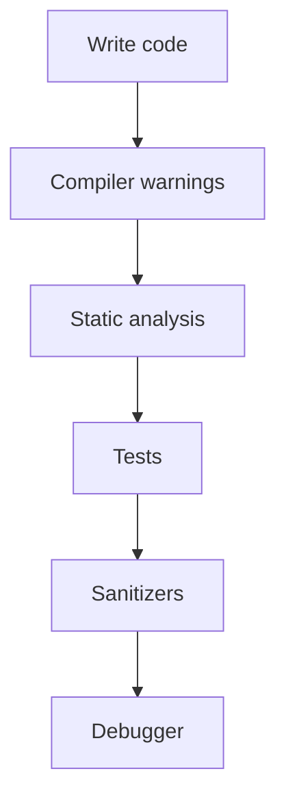

# 3.10 Finding issues before they become problems

The best bug is one that never reaches the debugger. Everything in this chapter so far helps after a bug has shown itself, and this lesson looks the other way: the habits and the tools that catch mistakes while you write, while you build, and the first time the code runs. None of them replaces the others, so the lesson ends with a map of how they fit together.

## Layers of defence

A single net never catches every fish, so careful programmers use several, each with a different mesh. The diagram shows the layers in the order in which they meet your code, from the cheapest to the most expensive.



A bug that slips through one layer is often caught by the next. The debugger is last on purpose: finding a bug there costs the most time, and a bug found by the compiler costs seconds.

## Habits that prevent bugs

Some of the best tools are habits, and they cost nothing:

- **Write small functions.** A function that does one thing is easy to read, and a mistake in it is easy to see. [Lesson 2.6](../ch02-functions-and-files/06-why-functions-are-useful-and-how-to-use-them-effectively.md) gave the reasons and the guidelines, and they matter even more when you hunt a bug.
- **Build and run often.** After every small change, build and run the program. If something breaks, the cause is in the last few lines you wrote, and the search by halves from [lesson 3.3](03-a-strategy-for-debugging.md) is already done for you.
- **Fix every warning.** The options from [lesson 0.11](../ch00-getting-started/11-warning-and-error-levels.md) turn warnings into errors for this reason. A warning that you ignore today hides the next one.
- **Refactor when code is hard to read.** To **refactor** is to rewrite code so that it is clearer, without changing what it does. Moving repeated statements into a well-named function, as the "before and after" example in lesson 2.6 did, removes places where bugs hide.

## Defensive programming

**Defensive programming** is writing code that assumes something may go wrong, and prepares for it. A function that receives a number can check that the number makes sense before it uses it, and a program that reads a value can check that the read succeeded.

The checks need a decision, and C++ makes decisions with `if` statements, which arrive in [lesson 4.10](../ch04-fundamental-data-types/10-introduction-to-if-statements.md). Chapter 4 therefore shows the first of these checks, and a later chapter covers error handling properly. For now it is enough to keep the idea: every value that comes from outside the function is a guess until the code checks it.

## Test small pieces

A **test** is a small program that calls a function with inputs whose right answer you already know, and compares the result. Finding a bug with a test is cheap, because you know exactly which function and which input fail.

Here is the box volume function from [lesson 3.4](04-basic-debugging-tactics.md), in its repaired form, with three tests. Each line prints the call, the answer that is expected, and the answer that the function gave. The third case is an edge case: a box with a side of zero has no volume, and edge cases are where functions break.

```cpp title="small-tests.cpp"
{{#include ../../examples/ch03/10-small-tests.cpp}}
```

```text title="Output"
{{#include ../../examples/ch03/10-small-tests.out}}
```

You compare the two numbers on each line with your own eyes. Once you know `if`, the program can compare them itself and report only the failures. Real projects use a **test framework**, a library that runs hundreds of such tests and summarizes the result. A later chapter covers testing in depth, and this lesson only shows why it pays: run the tests after every change, and a bug you introduce is caught in seconds.

## Static analysis

Your compiler is the first analyzer that you have, and the warnings that it prints are its findings. A **static analyzer** goes further: it reads your code without running it and looks for patterns that are legal but suspicious. Well-known ones are **clang-tidy** and **cppcheck**, which you install separately, and Microsoft's compiler has a code analysis mode that you switch on with `/analyze`.

Here is a program that builds without a single warning under the book's strict options and still contains a slip:

```cpp title="dead-store.cpp"
{{#include ../../examples/ch03/10-dead-store.cpp}}
```

```text title="Output"
{{#include ../../examples/ch03/10-dead-store.out}}
```

The last assignment gives `tickets` a new value that nothing ever reads. The program is valid, the compiler is silent, and the output is correct, but the line is almost certainly a mistake: perhaps the author meant to update the cost, or this line belongs to code that was deleted. The Clang static analyzer, whose checks clang-tidy offers in its `clang-analyzer-` group, reports exactly this: a value stored and never read.

Run the tools from the command line. The compiler options go after the double dash:

```bash
clang-tidy dead-store.cpp -- -std=c++20
```

```bash
cppcheck --enable=style --std=c++20 dead-store.cpp
```

```powershell
cl /analyze /std:c++20 dead-store.cpp
```

Each tool has its own list of checks, so they find different things, and the book does not show their output because it differs between tools and versions. Treat a report as a question rather than a verdict. An analyzer can be wrong about correct code, and it can miss real bugs, but a flagged line is worth reading twice.

## Sanitizers

A **sanitizer** is a set of checks that the compiler builds into your program. The checks run along with the program and report a problem at the moment it happens, with the file and the line. Two sanitizers matter at this stage of the book:

- **AddressSanitizer** finds memory errors, such as reading past the end of an array or using memory after it was freed.
- **UndefinedBehaviorSanitizer** finds some kinds of undefined behavior, such as a signed integer overflow or a division by zero.

Neither of them finds a read of an uninitialized variable, as [lesson 1.6](../ch01-cpp-basics/06-uninitialized-variables-and-undefined-behavior.md) said. They slow the program down, AddressSanitizer by about a factor of two, and they use more memory, so you switch them on while you develop and test, and not in the finished program.

{{#tabs}}
{{#tab Visual Studio}}

**Turn on:** open the project's **Property Pages**, go to **Configuration Properties > C/C++ > General**, and set **Enable AddressSanitizer**. It needs Visual Studio 2019 version 16.9 or later, and a program for x86 or x64.

**Keep in mind:** Microsoft's compiler has no UndefinedBehaviorSanitizer, so only the memory checks are available.

{{#endtab}}
{{#tab VS Code}}

**Turn on:** add `-fsanitize=address,undefined` to the `args` of your build task when you use GCC or Clang, and `/fsanitize=address` when you use Microsoft's compiler.

**Keep in mind:** keep `-g` in the arguments too, so that a report names the file and the line.

{{#endtab}}
{{#tab Command line}}

**Turn on:** add `-fsanitize=address,undefined` to the GCC or Clang command, together with `-g`. With Microsoft's compiler, add `/fsanitize=address`.

```bash
g++ -std=c++20 -g -fsanitize=address,undefined program.cpp -o program
```

```powershell
cl /std:c++20 /fsanitize=address program.cpp
```

**Keep in mind:** the two sanitizers work together, and you can leave out the one you do not need.

{{#endtab}}
{{#endtabs}}

Every complete program in this book is built and run with exactly these two sanitizers, and a program that shows undefined behavior on purpose is run only with them, so that the report proves the problem is real. You will meet the first such program in [lesson 4.4](../ch04-fundamental-data-types/04-signed-integers.md).

> [!BEST-PRACTICE]
> Build and test with warnings as errors and the sanitizers switched on. Each layer takes seconds to enable, and each one catches a different kind of mistake before a user does.

<details>
<summary>Check your understanding</summary>

**Question 1.** A function is called with `0` as an argument, and it divides by that argument. Which layer is most likely to catch the problem on the first run of the program, assuming that the program was built with the sanitizers on?

<details>
<summary>Answer</summary>

The UndefinedBehaviorSanitizer. An integer division by zero is undefined behavior, and the sanitizer reports it with the file and the line as soon as the division runs. A test with the argument `0` would also run into it.

</details>

**Question 2.** Why does the program in `dead-store.cpp` build without a warning, and what kind of tool finds the slip?

<details>
<summary>Answer</summary>

The code is valid C++ and the compiler's warnings do not cover a value that is stored and never read. A static analyzer such as clang-tidy reads the code without running it and looks for suspicious patterns of this kind.

</details>

**Question 3.** Why are the three test lines in `small-tests.cpp` more useful than one test with the typical input alone?

<details>
<summary>Answer</summary>

Each line tests a different case, and the edge case with a zero side is where a function is most likely to break. One typical input can pass by luck, while a set of inputs that includes edge cases catches more mistakes.

</details>

</details>

## Summary

- Several layers catch mistakes: the compiler's warnings, static analysis, tests, sanitizers, and finally the debugger, which is the most expensive.
- Small functions, frequent builds, fixed warnings and refactoring prevent many bugs without any tool.
- Defensive programming checks what comes from outside a function, and the checks need `if`, which [lesson 4.10](../ch04-fundamental-data-types/10-introduction-to-if-statements.md) introduces.
- A test calls a function with known inputs, including edge cases, and compares the result with the expected answer.
- Static analyzers such as clang-tidy and cppcheck read code without running it, and the sanitizers report memory errors and undefined behavior while the program runs.

## Further reading

- [clang-tidy documentation](https://clang.llvm.org/extra/clang-tidy/)
- [The cppcheck manual](https://cppcheck.sourceforge.io/manual.html)
- [Code analysis for C and C++ (Microsoft)](https://learn.microsoft.com/en-us/cpp/code-quality/code-analysis-for-c-cpp-overview)
- [AddressSanitizer (Clang documentation)](https://clang.llvm.org/docs/AddressSanitizer.html)
- [UndefinedBehaviorSanitizer (Clang documentation)](https://clang.llvm.org/docs/UndefinedBehaviorSanitizer.html)
- [Using AddressSanitizer in Microsoft's compiler](https://learn.microsoft.com/en-us/cpp/sanitizers/asan)
