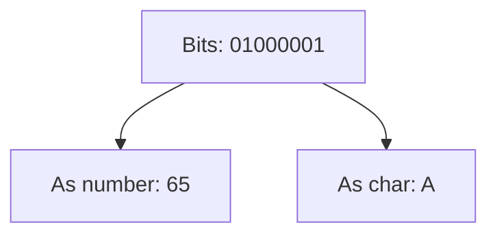

# 4.1 Introduction to fundamental data types

Until now, almost every variable in this book has been an `int`. That is enough for counting seats and shelves, but programs also work with prices, temperatures, yes-or-no answers and letters, and each of these needs its own kind of storage.

This lesson is the map of the chapter. It explains what a type is at the level of the computer's memory, names the fundamental types, and prints values of several of them. The lessons after it take the types one at a time.

## Bits, bytes and addresses

[Lesson 0.2](../ch00-getting-started/02-programs-and-programming-languages.md) explained that a computer stores everything as ones and zeros. A single one or zero is a **bit**, and bits are grouped into **bytes**. A byte has eight bits on every mainstream computer, although the language standard only promises at least eight.

[Lesson 1.3](../ch01-cpp-basics/03-introduction-to-objects-and-variables.md) pictured memory as a long row of numbered boxes. Each box is a byte, and its number is its **address**, which is how the computer finds it again. An object that needs more than one byte takes several boxes in a row.

Memory holds nothing but bits. It has no idea whether the eight bits `01000001` are a small number, a letter, or a piece of a picture.

## A type says how to read the bits

The diagram shows one pattern of bits read in two ways: as a number, and as a character.



Read as a whole number, `01000001` is 65. Read as a character in ASCII, the code that most computers use for basic characters, the same bits are the letter `A`. Nothing in the bits says which reading is right, so the program has to say it, and that is the job of a **data type**, or just a **type**. A type tells the compiler how many bits an object uses and how to interpret them.

> [!KEY-INSIGHT]
> The bits of an object carry no label. The type, which the compiler knows from your source code, is what turns the bits into a number, a letter or a yes-or-no answer.

Because the compiler knows the type of every variable, it can refuse code that mixes types in a way that makes no sense. This is one reason why C++ catches so many mistakes before a program runs.

## The fundamental types

C++ has a set of types that are built into the language, and they are the **fundamental types**. You may also see them called **built-in types**. Everything else, from `std::string` to the types that you will define yourself, is made out of them. Types that are made by combining other types, such as arrays and classes, are **compound types**, and later chapters introduce them.

The table groups the fundamental types by the kind of value that they hold.

| Category | Types | Example values |
| --- | --- | --- |
| Integer | `int`, `long` | `42`, `-7` |
| Floating point | `double`, `float` | `21.5`, `-0.25` |
| Boolean | `bool` | `true`, `false` |
| Character | `char` | `'B'`, `'7'` |
| No value | `void` | none |

Each row has more types than the table shows, and the next lessons introduce them:

- **Integer types** hold whole numbers. Besides `int` there are `short`, `long` and `long long`, and an unsigned form of each. Lessons 4.3 to 4.6 cover them.
- **Floating point types** hold numbers that can have a fractional part. They are `float`, `double` and `long double`, and lessons 4.7 and 4.8 cover them.
- **`bool`** holds one of two values, `true` or `false`. Lesson 4.9 covers it.
- **`char`** holds one character. Lesson 4.11 covers it.
- **`void`** means that there is no value at all. Lesson 4.2 covers it.

There is one more fundamental type, `std::nullptr_t`. It is the type of the keyword `nullptr`, which only makes sense together with pointers, so it waits for a later chapter.

## Integral and integer

The language standard has a name for every type whose values are whole numbers stored as bits: **integral type**. The integer types are integral, and so are `bool` and `char`, because a `bool` is stored as a 0 or a 1 and a `char` is stored as a code. The standard also uses the phrase "integer type" for the same group, which can be confusing.

This book keeps the two words apart in the way that most programmers do. It says **integer** for the types and the values that you use to count and measure in whole numbers, such as `int` and `42`, and it says **integral** when `bool` and `char` are included.
## The `_t` suffix

Some type names in the standard library end in `_t`, such as `std::size_t`, `std::int32_t` and `std::nullptr_t`. The letter stands for "type", and the suffix is a convention that the library took over from C. It tells you at a glance that the name is a type and not a variable or a function. Lesson 4.6 introduces `std::size_t` and `std::int32_t`.

## Print values of several types

This program defines one variable of each of four types, and prints them. A greenhouse keeps 48 seedlings at 21.5 degrees, with the lamp on and a quality grade of B:

```cpp title="fundamental-types.cpp"
{{#include ../../examples/ch04/01-fundamental-types.cpp}}
```

```text title="Output"
{{#include ../../examples/ch04/01-fundamental-types.out}}
```

The value in the braces decides which type fits. `48` is a whole number, so `seedlings` is an `int`. `21.5` has a fractional part, so `temperature` is a `double`, which is the floating point type that the book uses until lesson 4.8. The keyword `true` is a `bool` value, and `'B'` in single quotes is a `char`.

Two lines of the output deserve a second look. The lamp prints as `1`, because `std::cout` prints a `bool` as a number until you tell it otherwise, and lesson 4.9 shows how. The grade prints as the letter `B` and not as its code, because `std::cout` knows from the type that the bits are a character.

<details>
<summary>Check your understanding</summary>

**Question 1.** Which category from the table does each value belong to: `-3`, `0.75`, `'q'`, `false`?

<details>
<summary>Answer</summary>

`-3` is an integer, `0.75` is a floating point number, `'q'` is a character, and `false` is a boolean.

</details>

**Question 2.** What does this program print?

```cpp
bool doorOpen{true};
std::cout << "Open: " << doorOpen << "\n";
```

<details>
<summary>Answer</summary>

It prints `Open: 1`. A `bool` is printed as 1 for `true` and as 0 for `false`, unless the stream is told to print words.

</details>

**Question 3.** The eight bits `01000001` can print as 65 or as `A`. What decides which one the program prints?

<details>
<summary>Answer</summary>

The type of the object. The bits are the same in both cases, and the compiler uses the type to decide how to read them: an integer type gives 65, and `char` gives `A`.

</details>

</details>

## Summary

- A computer stores everything as bits, grouped into bytes, and every byte has an address.
- A type tells the compiler how many bits an object uses and how to interpret them.
- The fundamental types are built into the language: integer, floating point, boolean, character and `void`, plus `std::nullptr_t`.
- The standard calls the types whose values are whole numbers stored as bits integral, and that group includes `bool` and `char`.
- A name that ends in `_t`, such as `std::size_t`, is a type.

## Further reading

- [Fundamental types (cppreference)](https://en.cppreference.com/w/cpp/language/types)
- [Fundamental types in the C++ working draft](https://eel.is/c++draft/basic.fundamental)
