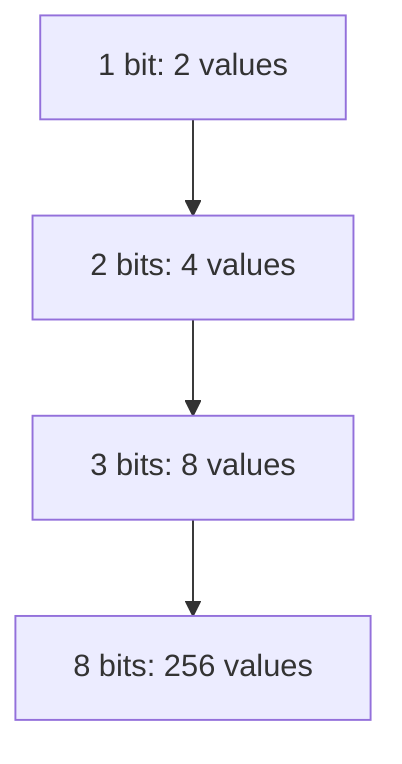

# 4.3 Object sizes and the sizeof operator

How much room does an `int` take, and how large a number can it hold? The two questions are one question in disguise, because the amount of memory an object has decides how many different values it can store. This lesson connects the size of a type to its range of values, shows what the language standard promises about sizes, and introduces the operator that asks the compiler for a size.

## Bits and the number of values

A single bit has two possible states, so one bit can tell two things apart. Every extra bit doubles the number of patterns: two bits can be `00`, `01`, `10` or `11`, which is four patterns, and three bits make eight. The diagram shows the first steps, and each arrow doubles the count.



The rule is that a group of n bits has 2 multiplied by itself n times different patterns. Eight bits give 256 patterns, sixteen bits give 65,536, and thirty-two bits give 4,294,967,296. Each pattern can stand for one value, so the number of bits sets an upper limit on how many different values an object can hold.

## Size limits what a type can store

A type with more bits can hold more values, and a type with fewer bits can hold fewer. The program below asks a `short` to hold the number 40000. On every mainstream computer a `short` has 16 bits, which is 65,536 patterns, but those patterns must cover negative numbers as well as positive ones, as lesson 4.4 explains. The largest value of a `short` there is 32767.

```cpp title="too-big.cpp"
{{#include ../../examples/ch04/03-too-big.fail.cpp}}
```

The compiler refuses to build the program. As [lesson 1.4](../ch01-cpp-basics/04-variable-assignment-and-initialization.md) explained, the braces reject a narrowing conversion, and storing 40000 in a `short` would change the value. The compiler's message says that 40000 cannot be narrowed to a `short`. The cure is a type with more bits, such as `int`.

## What the standard promises

The standard does not fix the size of most types. It sets a minimum size for each one and lets every platform choose a size at least that large. The table shows the minimum and the size that you find on mainstream computers.

| Type | Minimum size | Typical size |
| --- | --- | --- |
| `char` | 1 byte | 1 byte |
| `short` | 2 bytes | 2 bytes |
| `int` | 2 bytes | 4 bytes |
| `long` | 4 bytes | 4 or 8 bytes |
| `long long` | 8 bytes | 8 bytes |

The standard states the minimums in bits (8, 16, 16, 32 and 64), and the table converts them to bytes of eight bits. Only one size is exact: `sizeof(char)` is 1 by definition, and the other sizes are counted in units of a `char`.

Two things in the table deserve attention. The minimum size of an `int` is only 2 bytes, yet the typical size is 4, so a program that needs the larger range cannot count on it from the minimum alone. And the typical size of `long` depends on the platform: it has 4 bytes on 64-bit Windows and 8 bytes on 64-bit macOS and Linux. A program that uses `long` can therefore behave differently on two computers, and lesson 4.6 shows the types that avoid the problem.

## The sizeof operator

The **`sizeof` operator** tells you how many bytes a type or an object takes. You write `sizeof` and put either a type or an expression in parentheses:

```cpp
sizeof(int)
sizeof(count)
```

The first form asks about a type, and the second asks about the type of a variable. The book always writes the parentheses. The compiler works out the answer while it builds the program, so `sizeof` never runs the expression inside it.

The result is an unsigned whole number of the type `std::size_t`, which lesson 4.6 explains. This program prints the sizes of seven types, and of a variable:

```cpp title="sizes.cpp"
{{#include ../../examples/ch04/03-sizes.cpp}}
```

```text title="Output"
{{#include ../../examples/ch04/03-sizes.out}}
```

The last line is the size of an `int` variable, so it matches the line for `int`. The sizes shown are the ones on all the mainstream 64-bit platforms that this book targets, namely Windows, macOS and Linux. They are not guarantees of the language: only the size of `char` is. The program leaves out `long` on purpose, because its size is the one that differs between those platforms.

## Size and speed

It is tempting to pick the smallest type that holds the values, in the hope of saving memory and time. For a handful of variables the saving is a few bytes, which no one will notice, and it comes with a cost: a small type has a small range, and a value that does not fit is a bug that is hard to find.

> [!BEST-PRACTICE]
> Use `int` for ordinary whole numbers, and choose another type only when you have a reason, such as a value that does not fit in an `int`. Pick the type that is right for the data, and measure before you try to save space.

<details>
<summary>Check your understanding</summary>

**Question 1.** How many different values can five bits hold?

<details>
<summary>Answer</summary>

Thirty-two. Each bit doubles the number of patterns, so five bits give 2 × 2 × 2 × 2 × 2, which is 32.

</details>

**Question 2.** After `int count{7};`, what is the relation between `sizeof(count)` and `sizeof(int)`?

<details>
<summary>Answer</summary>

They are equal. `sizeof(count)` gives the size of the type of `count`, which is `int`, and the value 7 has no influence on it.

</details>

**Question 3.** A friend says "a `long` is 8 bytes", and you cannot reproduce it on a Windows computer. Who is right?

<details>
<summary>Answer</summary>

Both observations are correct. The standard only requires a `long` to have at least 32 bits. On 64-bit Linux and macOS it has 8 bytes, and on 64-bit Windows it has 4 bytes.

</details>

</details>

## Summary

- A group of n bits has 2 multiplied by itself n times patterns, so the size of a type limits how many values it can hold.
- A brace initializer rejects a value that does not fit in the type, and the compiler says that it would be narrowed.
- The standard sets only minimum sizes, and `sizeof(char)` is always 1.
- `sizeof` gives the size of a type or an object in bytes, as an unsigned number of the type `std::size_t`.
- Do not choose a small type to save a byte or two: use `int` unless a value needs more or a reason says otherwise.

## Further reading

- [Fundamental types: sizes and data models (cppreference)](https://en.cppreference.com/w/cpp/language/types)
- [sizeof operator (cppreference)](https://en.cppreference.com/w/cpp/language/sizeof)
