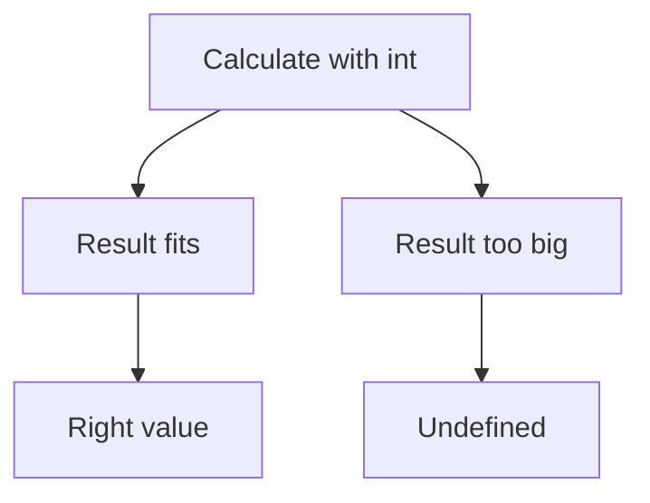

# 4.4 Signed integers

The `int` that you have used since Chapter 1 is a **signed integer**: it can hold negative numbers, zero and positive numbers. It has relatives that are smaller and larger. This lesson names them, shows which values each size can hold, and explains what happens when a calculation produces a number that does not fit.

## The four signed integer types

C++ has four signed integer types: `short`, `int`, `long` and `long long`. Each one is at least as large as the one before it. [Lesson 4.3](03-object-sizes-and-the-sizeof-operator.md) listed their sizes, which are typically 2, 4, 4 or 8, and 8 bytes.

The word signed means that the value may be negative, and it is the default for these types, so the keyword `signed` is implied. The language also allows long spellings, such as `short int`, `long int` and `signed int`, which mean exactly the same thing. This book uses the short spellings `short`, `int`, `long` and `long long`.

## Which values fit

A signed integer shares its patterns of bits between negative and non-negative numbers. With 8 bits there are 256 patterns: 128 of them stand for the negative numbers from -128 to -1, and the other 128 stand for zero and the positive numbers from 1 to 127.

Since C++20, the standard says exactly how the patterns are used. The scheme is called **two's complement**: the pattern of all zeros is 0, counting up gives the positive numbers, and the patterns that begin with a 1 are the negative ones, ending with the all-ones pattern for -1. Earlier standards allowed other schemes, but every mainstream computer already used this one.

The table shows the range for the common numbers of bits. Zero takes one of the non-negative patterns, so the smallest value is one step further from zero than the largest.

| Bits | Smallest | Largest |
| --- | --- | --- |
| 8 | -128 | 127 |
| 16 | -32,768 | 32,767 |
| 32 | -2,147,483,648 | 2,147,483,647 |

With 64 bits the range runs from -9,223,372,036,854,775,808 to 9,223,372,036,854,775,807, which is more than nine billion billion on each side. The range of a type follows from its size: a `short` has 16 bits on every mainstream computer, so it holds the values in the second row, and an `int` has 32 bits, so it holds the values in the third.

## Use the signed types

This program uses three of the types with negative values and with a value larger than an `int` can hold. It also repeats a rule from [lesson 1.9](../ch01-cpp-basics/09-introduction-to-literals-and-operators.md): when both operands of `/` are integers, the result is an integer and the fraction is dropped.

```cpp title="signed-types.cpp"
{{#include ../../examples/ch04/04-signed-types.cpp}}
```

```text title="Output"
{{#include ../../examples/ch04/04-signed-types.out}}
```

The distance of 9,000,000,000 is larger than the biggest `int`, so it needs a `long long`. The division lines show that the dropped fraction is cut off toward zero: `7 / 2` is 3, and `-7 / 2` is -3, not -4.

## When a result does not fit

What happens if a calculation produces a number outside the range of its type? That is an **overflow**, and for signed integers the language gives no answer: the behavior is undefined, which [lesson 1.6](../ch01-cpp-basics/06-uninitialized-variables-and-undefined-behavior.md) introduced. The diagram shows the two cases.



Sometimes the compiler can see the overflow, because every number is known while it builds. In this program the sum of 2147483647 and 1 is a constant that no `int` can hold:

```cpp title="constant-overflow.cpp"
{{#include ../../examples/ch04/04-constant-overflow.fail.cpp}}
```

GCC and Clang both warn about it, and the book's options turn the warning into an error, so the program does not build. The second line of the file names the option: without `-Werror` the program builds with a warning, and it still does not have a meaning that you can rely on.

The dangerous case is a number that arrives while the program runs, because the compiler cannot know it. This program doubles a number that the reader types:

```cpp title="doubling.cpp"
{{#include ../../examples/ch04/04-doubling.ub.cpp}}
```

The program builds without a warning, and it is correct for every number from -1,073,741,824 to 1,073,741,823. When someone types 2000000000, the double is 4,000,000,000, which is more than an `int` can hold, and the behavior is undefined. The program might print a negative number, it might print another wrong number, or it might behave in a way that no one expected, because the compiler is allowed to assume that an overflow never happens.

The book shows no output for this program, because no output would be right. Its checks run the program with that input under sanitizers, which are tools that report mistakes while a program runs, and they report a signed integer overflow. [Lesson 3.10](../ch03-debugging/10-finding-issues-before-they-become-problems.md) introduced them.

> [!WARNING]
> Signed overflow does not wrap around to a negative number in a way that you can rely on. It is undefined behavior, and the same program may behave differently with another compiler or another setting.

You can avoid the problem in two ways. Choose a type with a larger range when the values may be large, such as `long long` for the doubling program. Or check the input before you calculate with it, which needs the `if` statement of [lesson 4.10](10-introduction-to-if-statements.md).

<details>
<summary>Check your understanding</summary>

**Question 1.** What is the range of a signed integer with 8 bits?

<details>
<summary>Answer</summary>

From -128 to 127. There are 256 patterns, 128 for the negative numbers, one for zero and 127 for the positive numbers.

</details>

**Question 2.** What does `std::cout << -9 / 4;` print?

<details>
<summary>Answer</summary>

It prints `-2`. Both operands are integers, so the fraction of -2.25 is dropped, and the result is cut off toward zero.

</details>

**Question 3.** The program that doubles a number works for 5 and misbehaves for 2000000000. Why?

<details>
<summary>Answer</summary>

Twice 5 is 10, which fits in an `int`. Twice 2000000000 is 4,000,000,000, which is larger than the biggest `int`, 2,147,483,647 on the platforms of this book. The overflow makes the behavior undefined.

</details>

</details>

## Summary

- The signed integer types are `short`, `int`, `long` and `long long`, and the book writes these short spellings.
- Since C++20, signed integers use two's complement, which gives half of the patterns to the negative numbers: with 8 bits the range is -128 to 127.
- Dividing two integers drops the fraction and cuts toward zero, so `-7 / 2` is -3.
- A signed overflow is undefined behavior: the compiler may warn about a constant, but it cannot see a value that arrives at run time.
- Choose a larger type when values may be large, or check the input first.

## Further reading

- [Fundamental types: integer types (cppreference)](https://en.cppreference.com/w/cpp/language/types)
- [Arithmetic operators: overflows (cppreference)](https://en.cppreference.com/w/cpp/language/operator_arithmetic)
- [Fundamental types in the C++ working draft](https://eel.is/c++draft/basic.fundamental)
