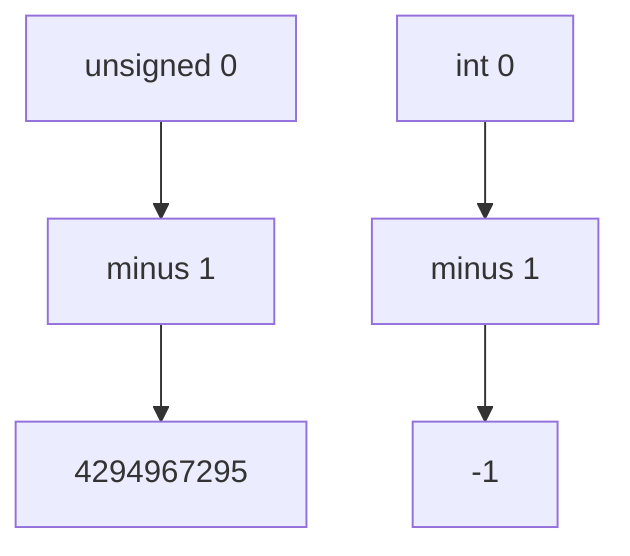

# 4.5 Unsigned integers, and why to avoid them

An **unsigned integer** cannot be negative. That sounds like a perfect fit for a count of seats or a number of copies, and many beginners reach for it for that reason. This lesson shows what unsigned types are and how they behave at their edge, and then explains why this book prefers signed types even for quantities that are never negative.

## The unsigned integer types

Each signed integer type has an unsigned partner with the same size: `unsigned short`, `unsigned int`, `unsigned long` and `unsigned long long`. The partners use all of their patterns for zero and the positive numbers, so a type with n bits holds the values from 0 up to one less than the number of patterns. The table shows the same bit counts as the signed table in [lesson 4.4](04-signed-integers.md).

| Bits | Smallest | Largest |
| --- | --- | --- |
| 8 | 0 | 255 |
| 16 | 0 | 65,535 |
| 32 | 0 | 4,294,967,295 |

With 64 bits the largest value is 18,446,744,073,709,551,615. The largest unsigned value is about twice the largest signed value of the same size, because no pattern is needed for a negative number. The word `unsigned` alone means `unsigned int`, and the book writes `unsigned int` in full.

## Wraparound

What happens when an unsigned calculation leaves the range? Unlike signed overflow, this case is defined. The standard says that arithmetic on an unsigned type is done modulo the number of patterns: the result wraps around, as the dial of a combination lock does. On a four-digit lock, one step down from 0000 lands on 9999, and one step up from 9999 lands on 0000.

The diagram follows the calculation 0 minus 1 for an unsigned integer and for an `int`.



The program below keeps the stock of a shop in an `unsigned int`. It sells one item too many, and then restocks one:

```cpp title="wraparound.cpp"
{{#include ../../examples/ch04/05-wraparound.cpp}}
```

```text title="Output"
{{#include ../../examples/ch04/05-wraparound.out}}
```

An `unsigned int` has 32 bits on every mainstream computer, so 0 minus 1 wraps to the largest value, 4,294,967,295. Nothing went wrong as far as C++ is concerned: the wraparound is defined, so the compiler and the sanitizers stay silent. For the shop, the result is nonsense, and it appears without any warning.

Wraparound is not a flaw of the type. Some calculations want it, such as those that mix up the bits of a number, and for them an unsigned type is exactly right. It is a poor match for counting things.

## Why to avoid unsigned integers

The program above shows the first problem. An unsigned type does not stop a value from going below zero, it only changes what happens: a calculation that should be negative becomes an enormous number. The mistake can travel far through a program before anyone notices, because the number looks like a valid stock.

The compiler does catch the most obvious case: a braced definition such as `unsigned int seats{-1};` is rejected, because storing -1 would be a narrowing conversion. It cannot catch a negative value that appears in the middle of a calculation.

The second problem is mixing. When one operand of an operator is signed and the other is unsigned, the compiler converts the signed value to unsigned before it calculates. A negative number then turns into a large positive one:

```cpp title="mixed-signs.cpp"
{{#include ../../examples/ch04/05-mixed-signs.fail.cpp}}
```

The program adds -15 to 10, and the right answer is -5. The compiler converts -15 to 4,294,967,281, which is the unsigned number that has the same pattern of bits, and the sum wraps to 4,294,967,291. GCC and Clang both warn about the conversion, and the book's options turn the warning into an error. Without `-Werror` the program builds and prints that number.

Lesson 4.12 shows how to convert a value on purpose, so that you can say what you mean.

The third problem is a false sense of safety. Declaring a variable `unsigned` documents that it should not be negative, but the compiler does not enforce it, and the mistakes that the type was meant to prevent happen anyway, without a message.

## Where unsigned integers belong

There are two places where unsigned types are the right tool. The standard library uses them for sizes and counts: the result of `sizeof` is the unsigned type `std::size_t`, which [lesson 4.6](06-fixed-width-integers-and-size-t.md) introduces. And programs that work on individual bits use unsigned types, because wraparound and the absence of a sign are what you want there. A later chapter covers bit manipulation.

> [!BEST-PRACTICE]
> Use signed types for quantities, even for quantities that are never negative, such as a number of seats. A signed type shows a mistake as a negative number that you can see and test for, and the C++ Core Guidelines give the same advice.

<details>
<summary>Check your understanding</summary>

**Question 1.** What are the smallest and the largest value of an `unsigned short` that has 16 bits?

<details>
<summary>Answer</summary>

The smallest is 0 and the largest is 65,535. There are 65,536 patterns, and none of them is needed for a negative number.

</details>

**Question 2.** An `unsigned int` holds 3. What does it hold after a calculation subtracts 5 from it?

<details>
<summary>Answer</summary>

It holds 4,294,967,294, if the type has 32 bits. The result is below zero, so it wraps around to the top of the range: 3 minus 5 is -2, and -2 steps below zero wraps to 4,294,967,296 minus 2.

</details>

**Question 3.** Why is declaring the number of seats as `unsigned int` a poor way to prevent negative values?

<details>
<summary>Answer</summary>

The type does not prevent them. A calculation that goes below zero wraps to a huge positive number, with no error and no warning, and the mistake is harder to see than a plain negative number.

</details>

</details>

## Summary

- The unsigned integer types hold zero and positive numbers only, so n bits give the values from 0 up to one less than the number of patterns.
- Unsigned arithmetic wraps around: 0 minus 1 gives the largest value of the type, and this is defined behavior.
- Mixing signed and unsigned operands converts the signed value to unsigned, and a negative number becomes a large one.
- Unsigned types do not stop a value from becoming negative, they only hide it.
- Use signed types for quantities, and unsigned types for sizes from the library and for bit manipulation.

## Further reading

- [Fundamental types: integer types (cppreference)](https://en.cppreference.com/w/cpp/language/types)
- [Implicit conversions: integral conversions (cppreference)](https://en.cppreference.com/w/cpp/language/implicit_conversion)
- [The C++ Core Guidelines: Expressions and statements](https://isocpp.github.io/CppCoreGuidelines/CppCoreGuidelines#S-expr)
