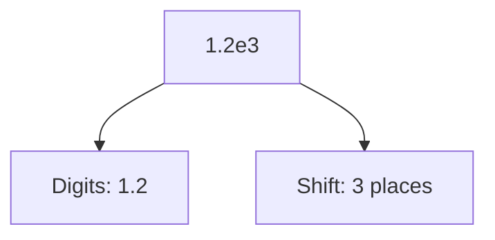

# 4.7 Introduction to scientific notation

The number of messages that a busy service delivers in a year has ten digits, and the length of a bacterium has five zeros after the decimal point. Writing numbers like these in full is slow, and counting the zeros is a good way to make a mistake. **Scientific notation** is a short way to write very large and very small numbers, and C++ has a form of it for literals. This lesson explains the notation, and the next one uses it for floating point numbers.

## Digits and a shift

A number in scientific notation has two parts that are multiplied together: a short run of digits, and a power of ten that says where the decimal point belongs. A service that delivers 7.9 billion messages in a year delivers 7.9 times 10 to the power of 9, which means that the point of 7.9 moves nine places to the right. A bacterium that is 0.000004 meters long is 4 times 10 to the power of -6, which moves the point six places to the left.

The part with the digits is the **significand**, and the power of ten is given by the **exponent**. In 7.9 times 10 to the power of 9, the significand is 7.9 and the exponent is 9. A negative exponent makes the number small, and a positive exponent makes it large.

## The normalized form

The same number can be split in many ways: 79 times 10 to the power of 8 is also 7.9 billion. To avoid the choice, scientists write the significand with exactly one non-zero digit in front of the decimal point. A number written like this is in **normalized form**, so 7.9 times 10 to the power of 9 is normalized and 79 times 10 to the power of 8 is not.

## Significant digits

The digits of the significand are the **significant digits** of the number. They say how precisely the number is known: 7.9 has two significant digits, and 7.900 has four. The zeros at the end of 7.900 are deliberate, because they claim that the value is known to the thousandth. Leading zeros are not significant, so 0.000004 has one significant digit and 4.0 times 10 to the power of -6 has two.

## E-notation in C++

You cannot type a power of ten in a C++ source file, so the language uses the letter `e`. A literal such as `7.9e9` means 7.9 times 10 to the power of 9, and `4e-6` means 4 times 10 to the power of -6. The letter can also be written `E`, and no spaces are allowed. The diagram shows how to read a literal.



The literal `1.2e3` is the number 1200, and the two spellings have exactly the same value. Without a suffix, a literal in E-notation is a `double`, even when its value is a whole number such as `1e3`. A brace initializer does not accept a `double` for an `int`, because in general a `double` can have a fractional part, so the compiler refuses:

```cpp title="exponent-is-double.cpp"
{{#include ../../examples/ch04/07-exponent-is-double.fail.cpp}}
```

If you need 1000 copies, write `1000`. E-notation is for floating point values.

## How std::cout prints large and small numbers

When `std::cout` prints a `double`, it shows up to six significant digits, and it chooses the notation that fits. A number in a middle range is printed in plain decimal form. A number that is very large or very small is printed in E-notation, with at least two digits in the exponent and a plus or minus sign. The program defines the same value in two ways, and prints four others:

```cpp title="large-small.cpp"
{{#include ../../examples/ch04/07-large-small.cpp}}
```

```text title="Output"
{{#include ../../examples/ch04/07-large-small.out}}
```

`1200.0` and `1.2e3` print the same, because they are the same number. The values `2.5e6`, `4e-6` and `7.9e9` are printed in E-notation: `2.5e+06` means 2.5 times 10 to the power of 6. The value 123456 has six digits and still prints in plain form, and a seventh digit would tip it over into E-notation. [Lesson 4.8](08-floating-point-numbers.md) shows how to ask for more digits.

> [!NOTE]
> The output of `std::cout` follows the rules of the `%g` conversion of C's `printf`, which the C++ library uses for floating point values. That is why the exponent always has at least two digits, and why the output is the same with every conforming standard library.

<details>
<summary>Check your understanding</summary>

**Question 1.** Write 5,200,000 in normalized scientific notation, and as a C++ literal.

<details>
<summary>Answer</summary>

It is 5.2 times 10 to the power of 6, and the literal is `5.2e6`. The significand has one non-zero digit before the point, and the point moves six places to the right.

</details>

**Question 2.** How many significant digits do 0.00450 and 4.50e-3 have?

<details>
<summary>Answer</summary>

Both have three: the digits 4, 5 and 0. The zeros in front of the 4 only place the point, so they are not significant, and the zero at the end is deliberate. The two numbers are the same value.

</details>

**Question 3.** Why does `int copies{1e3};` not compile?

<details>
<summary>Answer</summary>

A literal with an exponent is a `double`, and a brace initializer does not allow the conversion from `double` to `int`, even when the value is whole. Write `int copies{1000};` instead.

</details>

</details>

## Summary

- Scientific notation writes a number as a significand and a power of ten, and the exponent says how far the decimal point moves.
- The normalized form has exactly one non-zero digit before the decimal point.
- The significant digits show how precisely a number is known, and a deliberate trailing zero counts.
- In C++, `1.2e3` means 1200, `4e-6` means 0.000004, and a literal with an exponent is a `double` unless it has a suffix.
- By default `std::cout` prints six significant digits, and uses E-notation with at least two exponent digits for very large and very small values.

## Further reading

- [Floating-point literals (cppreference)](https://en.cppreference.com/w/cpp/language/floating_literal)
- [std::num_put: floating point conversion (cppreference)](https://en.cppreference.com/w/cpp/locale/num_put/put)
