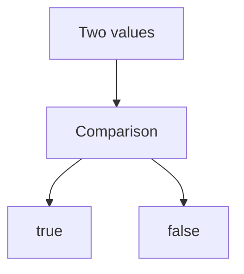

# 4.9 Boolean values

Many questions that a program asks have only two answers: is the lamp on, is the door open, is the balance below zero. C++ has a type for such answers, `bool`, with exactly two values. This lesson shows how to create and print them, how a comparison produces one, and how a function can return one. The next lesson uses them to make decisions.

## Two values

A **Boolean** value is either true or false, named after the mathematician George Boole. The type is `bool`, and its two values are written with the keywords `true` and `false`. You define a `bool` as you define any other variable, and a good name for it reads like a statement that is true or false, such as `lampOn`.

By default `std::cout` prints a `bool` as a number: 1 for `true` and 0 for `false`. The manipulator `std::boolalpha` switches to the words, and it stays in effect until `std::noboolalpha` switches back. Both come with `<iostream>`. The program prints the same values in both ways:

```cpp title="print-bool.cpp"
{{#include ../../examples/ch04/09-print-bool.cpp}}
```

```text title="Output"
{{#include ../../examples/ch04/09-print-bool.out}}
```

The first line uses the default and shows numbers. After `std::boolalpha` the same values print as words, and after `std::noboolalpha` the numbers are back.

## Logical NOT

The operator `!` is the **logical NOT** operator. It turns `true` into `false` and `false` into `true`, so `!lampOn` is the opposite of `lampOn`. The program above prints it twice: once with words, where the lamp being on gives `false` for "lamp off", and once with numbers. The operator takes one operand, and the book writes it without a space.

## Comparisons produce Booleans

You will often get a `bool` from a comparison. The six **comparison operators** compare two values and give `true` or `false`:

| Operator | Meaning |
| --- | --- |
| `==` | equal to |
| `!=` | not equal to |
| `<` | less than |
| `>` | greater than |
| `<=` | less than or equal to |
| `>=` | greater than or equal to |

The diagram shows the idea. Two values go in, and a Boolean comes out.



Take care with `==`. A single `=` is the assignment from [lesson 1.4](../ch01-cpp-basics/04-variable-assignment-and-initialization.md), and writing it where you mean a comparison is a classic mistake that lesson 4.10 returns to. This program applies each operator to a pair of numbers:

```cpp title="comparisons.cpp"
{{#include ../../examples/ch04/09-comparisons.cpp}}
```

```text title="Output"
{{#include ../../examples/ch04/09-comparisons.out}}
```

Every comparison is in parentheses, because without them the `<<` of the output statement would be applied first, and the compiler would reject the statement. The last line is the lesson from [lesson 4.8](08-floating-point-numbers.md) in one expression: 0.1 plus 0.2 is not equal to 0.3, because of the rounding error.

## Functions that return a bool

A function that answers a yes-or-no question returns a `bool`. Its name should read like the question, and a prefix such as `is` or `has` does that job:

```cpp title="is-negative.cpp"
{{#include ../../examples/ch04/09-is-negative.cpp}}
```

```text title="Output"
{{#include ../../examples/ch04/09-is-negative.out}}
```

The function returns the result of the comparison `number < 0`, which already is a `bool`. The name makes the call read well wherever it is used: `isNegative(-4)` is a question with the answer `true`.

## From integers to Booleans

A number can be converted to a `bool`: zero becomes `false`, and every other value becomes `true`. A brace initializer is stricter than that. It accepts the values 0 and 1, which fit exactly, and refuses any other constant, because the conversion would change the value:

```cpp title="bool-from-int.cpp"
{{#include ../../examples/ch04/09-bool-from-int.fail.cpp}}
```

An assignment from a variable does follow the rule of zero and non-zero:

```cpp title="int-to-bool.cpp"
{{#include ../../examples/ch04/09-int-to-bool.cpp}}
```

```text title="Output"
{{#include ../../examples/ch04/09-int-to-bool.out}}
```

The variable `cartItems` holds 3, so `hasItems` becomes `true`, and `returns` holds 0, so `hasReturns` becomes `false`. The conversion is legal, but it hides the question that is being asked. Prefer a comparison, such as `cartItems > 0`, when you mean "there is something in the cart".

## Reading a bool

`std::cin` can read a `bool`. By default it accepts the numbers 0 and 1. After `std::boolalpha` has been applied to `std::cin`, it accepts the words `true` and `false` instead. Any other input makes the read fail, in the way that lesson 1.5 showed for numbers. Type `1` and press Enter at the first question, and type `false` and press Enter at the second:

```cpp title="read-bool.cpp"
{{#include ../../examples/ch04/09-read-bool.cpp}}
```

```text title="Example session"
{{#include ../../examples/ch04/09-read-bool.session}}
```

The two settings are independent. `std::boolalpha` on `std::cin` changes how the program reads, and the one on `std::cout` changes how it prints, so the program uses it twice.

<details>
<summary>Check your understanding</summary>

**Question 1.** What does this program print?

```cpp
bool open{false};
std::cout << !open << "\n";
```

<details>
<summary>Answer</summary>

It prints `1`. The operator `!` turns `false` into `true`, and without `std::boolalpha` a `true` prints as 1.

</details>

**Question 2.** Why does the compiler reject `std::cout << seats > 20;`?

<details>
<summary>Answer</summary>

The `<<` is applied before the `>`, so the statement first prints `seats` and then tries to compare the output stream with 20, which has no meaning. Write `std::cout << (seats > 20);`.

</details>

**Question 3.** What is the value of the variable after `bool ready{false}; int count{7}; ready = count;`?

<details>
<summary>Answer</summary>

`ready` is `true`. The conversion from an integer to a `bool` gives `false` only for zero, and 7 is not zero.

</details>

</details>

## Summary

- A `bool` holds `true` or `false`, and `std::cout` prints it as 1 or 0 until `std::boolalpha` asks for words.
- The logical NOT operator `!` turns `true` into `false` and the other way round.
- The comparison operators `==`, `!=`, `<`, `>`, `<=` and `>=` produce a `bool`, and `=` is an assignment, not a comparison.
- A function that answers a question returns a `bool`, and a name such as `isNegative` reads like the question.
- Zero converts to `false` and every other number to `true`, but a brace initializer only accepts 0 and 1.
- `std::cin` reads a `bool` as 0 or 1, or as `true` or `false` after `std::boolalpha`.

## Further reading

- [std::boolalpha (cppreference)](https://en.cppreference.com/w/cpp/io/manip/boolalpha)
- [Comparison operators (cppreference)](https://en.cppreference.com/w/cpp/language/operator_comparison)
- [Logical operators (cppreference)](https://en.cppreference.com/w/cpp/language/operator_logical)
