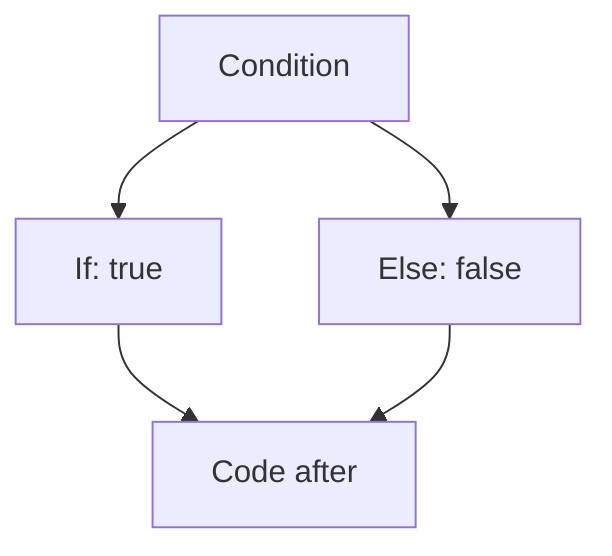

# 4.10 Introduction to if statements

Every program in this book so far has run its statements from top to bottom, the same way every time. Real programs decide: they print a warning only when a value is too low, or charge a different price depending on a customer's age. The tool for that is the `if` statement, and the Boolean values and comparisons of [lesson 4.9](09-boolean-values.md) are what it needs.

## Running code only when something is true

A statement that runs only when a condition holds is a **conditional statement**, and the most common one is the **`if` statement**. It has a **condition** in parentheses, followed by a block in braces:

```cpp
if (condition)
{
    statement;
}
```

The condition is an expression with a `bool` value, such as a comparison. When the value is `true`, the statements in the block run, and when it is `false`, the computer skips the block and continues after it. The book indents each block by four spaces so that the structure is visible, although the compiler ignores the indentation, as [lesson 1.8](../ch01-cpp-basics/08-whitespace-and-basic-formatting.md) explained. It always writes the braces, even for a single statement, because a second statement that you add later is not part of the `if` unless the braces are already there.

A block is also a scope, as [lesson 2.5](../ch02-functions-and-files/05-introduction-to-local-scope.md) described. A variable that is defined inside the braces exists only there, and it is gone after the closing brace:

```cpp
if (seatsLeft > 0)
{
    int price{12};
}
```

The name `price` cannot be used after this statement. Define the variable before the `if` when later code needs it.

## if and else

An `if` can have an **`else`** part that runs when the condition is `false`. Exactly one of the two blocks runs, and then the program continues after both. The diagram shows the two paths, one for each value of the condition, and the place where they join.



This program asks how many seats are left, and answers differently when there are none. Type `0` and press Enter:

```cpp title="if-else.cpp"
{{#include ../../examples/ch04/10-if-else.cpp}}
```

```text title="Example session"
{{#include ../../examples/ch04/10-if-else.session}}
```

The condition `seatsLeft > 0` is false for 0, so the `else` block runs and the program prints `Sold out`. If you type 12, the condition is true and the program prints `Tickets are available` instead. In both cases the last statement runs, because it is after the whole `if` statement and not inside either block.

## Choosing between several cases

When there are more than two cases, chain the conditions with **`else if`**. The computer tests the conditions from the top, runs the block of the first one that is true, and skips all the rest.

A final `else` catches everything that no condition matched. A chain can have as many `else if` parts as you need, and the `else` is optional: without it, nothing runs when no condition is true. [Lesson 0.13](../ch00-getting-started/13-what-language-standard-is-my-compiler-using.md) used a chain like this one to pick the name of the language standard, and now you can read it.

```cpp title="sign.cpp"
{{#include ../../examples/ch04/10-sign.cpp}}
```

Type `-7` and press Enter:

```text title="Example session"
{{#include ../../examples/ch04/10-sign.session}}
```

The first condition, `number < 0`, is true, so the program prints that the number is negative, and it never tests the other conditions. For 0, the first condition is false and the second one, `number == 0`, is true. For 12, both are false, and the `else` block runs.

Because the first true condition wins, the order of a chain matters. If you test `age < 65` before `age < 13`, a child of ten matches the first test and the second one never gets a chance. Put the most specific condition first.

## Leaving a function early

A `return` statement inside an `if` ends the function at once, as [lesson 2.2](../ch02-functions-and-files/02-function-return-values.md) described. This lets a function handle each case and leave, without an `else`:

```cpp title="ticket-price.cpp"
{{#include ../../examples/ch04/10-ticket-price.cpp}}
```

```text title="Output"
{{#include ../../examples/ch04/10-ticket-price.out}}
```

A child under 13 pays 5, and the function returns at once. Someone aged 13 to 64 skips the first block, meets the second condition and pays 12. Everyone else reaches the last `return`, and pays 8. A function that must return a value always needs a `return` that every path can reach, which is why the last statement is not inside an `if`.

## Conditions that are not Booleans

The condition of an `if` does not have to be a `bool`. The compiler converts any value that it can, using the rule from [lesson 4.9](09-boolean-values.md): zero is `false`, and everything else is `true`. The two statements below behave the same:

```cpp
if (messages > 0)
if (messages)
```

The first one says what you mean, and the book prefers it. The second one makes the reader remember what a number does as a condition.

## A classic mistake: = instead of ==

A single `=` assigns, and `==` compares. Writing the first where you meant the second is legal C++, and it is one of the most common mistakes of beginners:

```cpp title="assignment-in-condition.cpp"
{{#include ../../examples/ch04/10-assignment-in-condition.fail.cpp}}
```

The condition `level = 5` does not compare anything. It stores 5 in `level`, and the value of the whole expression is 5, which counts as `true`.

The block would therefore always run, and the variable would be changed on the way. GCC and Clang both warn about an assignment that is used as a condition, and the book's options turn the warning into an error. Without `-Werror`, the program builds and prints `Level five`.

> [!WARNING]
> A semicolon right after the closing parenthesis, as in `if (level > 5);`, ends the `if` with an empty statement, and the block below it always runs. GCC and Clang warn about it, which is another reason to keep every warning switched on.

<details>
<summary>Check your understanding</summary>

**Question 1.** What does `ticketPrice(13)` return in the program above?

<details>
<summary>Answer</summary>

It returns 12. The first condition, `age < 13`, is false for 13, and the second condition, `age < 65`, is true, so the function returns 12.

</details>

**Question 2.** The program asks for seats, and you type 3. Which lines does the program from this lesson print?

<details>
<summary>Answer</summary>

`Tickets are available` and then `Thank you for asking`. The condition `seatsLeft > 0` is true for 3, so the `if` block runs, and the last statement runs for every input.

</details>

**Question 3.** In a chain that starts with `if (age < 65)` and continues with `else if (age < 13)`, the second block never runs. Why?

<details>
<summary>Answer</summary>

Every age that is below 13 is also below 65, so the first condition is already true, and the chain stops at the first true condition. Test `age < 13` first.

</details>

</details>

## Summary

- An `if` statement runs its block only when its condition is `true`, and an `else` block runs when it is `false`.
- Chain the cases with `else if`: the computer runs the first block whose condition is true and skips the rest, so the order matters.
- A `return` inside an `if` leaves the function early, and a function that returns a value needs a `return` that every path can reach.
- A condition that is not a `bool` is converted to one, with zero as `false`, but a comparison says more clearly what you mean.
- `if (level = 5)` assigns instead of comparing, and the compiler's warnings catch it.

## Further reading

- [if statement (cppreference)](https://en.cppreference.com/w/cpp/language/if)
- [Comparison operators (cppreference)](https://en.cppreference.com/w/cpp/language/operator_comparison)
