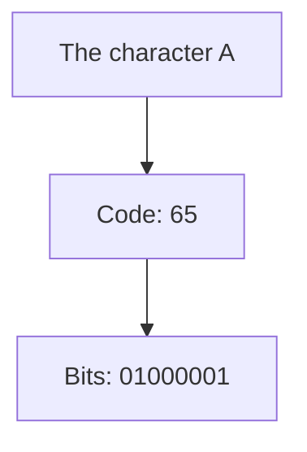

# 4.11 Chars

Programs handle text as well as numbers: names, answers, grades, a letter typed at the keyboard. The smallest unit of text is a single character, and C++ has a type for one, `char`. This lesson explains how a computer stores a character, how to print and read one, how to write characters that you cannot type on a line, and why some arithmetic with characters needs care.

## A character is a code

A computer can only store numbers, so it stores a character as a number, which is called its **code**.

A table that assigns a code to each character is a **character set**. The most widely used one for basic characters is **ASCII**. It gives the letter `A` the code 65, `B` the code 66, `a` the code 97, and the digit character `0` the code 48. The C++ standard does not require ASCII, but every mainstream compiler uses a code that agrees with it for the letters, digits and punctuation that this book uses.

The diagram follows a character down to its bits. It is the picture from [lesson 4.1](01-introduction-to-fundamental-data-types.md), with the character in front.



The type `char` holds one character. A **character literal** is one character between single quotes, such as `'A'`, `'7'` or `'?'`, and its type is `char`. Note that `'7'` is the character seven, with code 55, and not the number 7.

## Print a character and its code

`std::cout` knows from the type that a `char` is a character, so it prints the letter and not the code. To see the code, copy the `char` into an `int`: a `char` always fits in an `int`, so a brace initializer accepts this. The program also adds 1:

```cpp title="codes.cpp"
{{#include ../../examples/ch04/11-codes.cpp}}
```

```text title="Output"
{{#include ../../examples/ch04/11-codes.out}}
```

The first line is the letter, and the second is its code. Arithmetic on a `char` works on its code, and the result of `letter + 1` is an `int`, which is why the last line prints 66 and not `B`. The result is a number, because `std::cout` prints an `int` as a number.

An `int` does not go back into a `char` as easily. The next program tries to store `letter + 1` in a `char`:

```cpp title="char-plus-one.cpp"
{{#include ../../examples/ch04/11-char-plus-one.fail.cpp}}
```

With the book's options both compilers refuse to build it, because a brace initializer does not accept an `int` that is not a constant for a `char`: the value might not fit. [Lesson 4.12](12-introduction-to-type-conversion-and-static-cast.md) shows how to convert on purpose.

## Read a character

`std::cin >> letter` skips any spaces and line breaks, and then reads exactly one character. The rest of what you typed stays where it is and waits for the next read. This program reads two letters, and it asks for the second one without anything new being typed. Type `xyz` and press Enter:

```cpp title="read-chars.cpp"
{{#include ../../examples/ch04/11-read-chars.cpp}}
```

```text title="Example session"
{{#include ../../examples/ch04/11-read-chars.session}}
```

The first read takes `x`. The second read finds `y` already waiting, so the program does not pause for input, and the letter `z` stays unread. This is why a program that expects one letter can behave in a surprising way when someone types a whole word.

## Escape sequences

Some characters cannot be typed inside a literal. A new line would end the line of code, and a double quote would end a string. C++ writes such a character with an **escape sequence**: a backslash followed by a letter or symbol. The backslash tells the compiler that the next character has a special meaning.

| Escape | Meaning | Example |
| --- | --- | --- |
| `\n` | new line | `"a\nb"` |
| `\t` | tab | `"a\tb"` |
| `\'` | single quote | `'\''` |
| `\"` | double quote | `"\"hi\""` |
| `\\` | backslash | `"C:\\temp"` |

You have written `\n` since the first lesson. The sequence `\'` is needed inside a character literal, where an unescaped quote would end it, and `\"` is needed inside a string literal for the same reason. The backslash is special too, so a real backslash is written twice. This program prints each of them:

```cpp title="escapes.cpp"
{{#include ../../examples/ch04/11-escapes.cpp}}
```

```text title="Output"
{{#include ../../examples/ch04/11-escapes.out}}
```

A tab moves the next text to the next tab stop, so the space that it leaves depends on the window in which you run the program.

## Single quotes and double quotes

The two kinds of quotes mean different things. `'A'` is one character, of the type `char`.

`"A"` is a string literal, which is text, and its type is not `char`. [Lesson 5.7](../ch05-constants-and-strings/07-introduction-to-std-string.md) introduces the type that holds text. A beginner who writes `'hello'` with single quotes does not get text, but a multicharacter literal, which is described next.

A literal with several characters between single quotes is a **multicharacter literal**. It has the type `int`, and the value that it has is up to the compiler, so a program that uses one may change its behavior on another platform:

```cpp title="multichar.cpp"
{{#include ../../examples/ch04/11-multichar.fail.cpp}}
```

GCC and Clang both warn about it, and the book's options turn the warning into an error. Without `-Werror` the program builds, but the value of `'ab'` is not something you can count on.

## What the standard leaves open

Whether a plain `char` is signed or unsigned depends on the platform: some computers treat it as a number from -128 to 127, and others from 0 to 255. The ASCII characters have codes from 0 to 127, so both choices agree for everything in this book. Never rely on the sign of a `char`. The types `signed char` and `unsigned char` exist when you need to say which one you mean.

C++ has more character types for text that does not fit in ASCII: `char8_t`, `char16_t`, `char32_t` and `wchar_t`. The first three hold the code units of the Unicode formats UTF-8, UTF-16 and UTF-32, and `wchar_t` has 2 bytes on Windows and 4 bytes on Linux and macOS. The book only names them.

<details>
<summary>Check your understanding</summary>

**Question 1.** What does this program print?

```cpp
char c{'C'};
std::cout << c << " " << c + 1 << "\n";
```

<details>
<summary>Answer</summary>

It prints `C 68`. The letter C has the code 67, and `c + 1` is an `int` with the value 68, which `std::cout` prints as a number.

</details>

**Question 2.** Why is the character literal `'0'` not the same as the number 0?

<details>
<summary>Answer</summary>

`'0'` is the character zero, and its code in ASCII is 48. The number 0 is a value of an integer type. They look alike in the source code, but they are different values of different types.

</details>

**Question 3.** A program runs `std::cin >> first >> second;` for two `char` variables, and you type `hi` and press Enter. What do the variables hold?

<details>
<summary>Answer</summary>

`first` holds `h` and `second` holds `i`. Each read takes one character and skips spaces, so both are filled from the one line that you typed.

</details>

</details>

## Summary

- A `char` holds one character as a small number, its code, and ASCII is the common code for basic characters.
- A character literal is one character in single quotes, and `std::cout` prints a `char` as a character.
- Arithmetic on a `char` gives an `int`, and an `int` does not fit back into a `char` without a conversion.
- `std::cin >> letter` skips whitespace and reads one character, and the rest of the line waits for the next read.
- An escape sequence such as `\n`, `\t`, `\'`, `\"` or `\\` writes a character that cannot be typed directly.
- Single quotes make a `char` and double quotes make text, and whether a plain `char` is signed depends on the platform.

## Further reading

- [Character literals (cppreference)](https://en.cppreference.com/w/cpp/language/character_literal)
- [Escape sequences (cppreference)](https://en.cppreference.com/w/cpp/language/escape)
