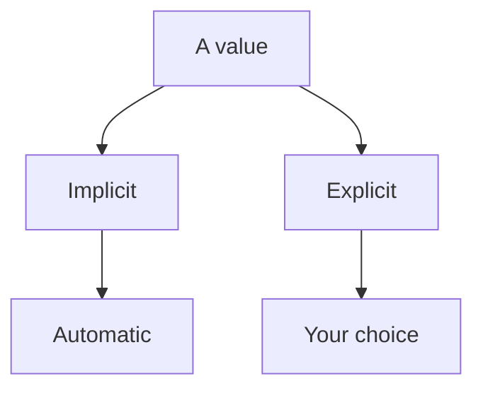

# 4.12 Introduction to type conversion and static_cast

Lessons [4.4](04-signed-integers.md) to [4.11](11-chars.md) left a few loose ends. A `char` plus 1 is an `int` that will not go back into a `char`, a `std::int8_t` prints as a letter, and a sum of an unsigned and a signed number came out wrong. All of them have the same cause, a value of one type being turned into another, and all of them have the same cure.

This lesson introduces that cure. It explains when the compiler converts a value by itself, why the book's options reject the risky cases, and how to convert a value on purpose.

## Implicit conversion

The compiler converts a value from one type to another whenever a type is expected and another one is given. This is an **implicit conversion**, and you never write it. It happens when you assign a value, when you pass an argument to a function, and when an operator mixes two types. The diagram shows the two ways in which a value can change type: the compiler does it by itself, or you ask for it.



This program converts an `int` to a `double` twice, once in an assignment and once in a call:

```cpp title="implicit.cpp"
{{#include ../../examples/ch04/12-implicit.cpp}}
```

```text title="Output"
{{#include ../../examples/ch04/12-implicit.out}}
```

The value 3 becomes 3.0 each time, and nothing is lost. Conversions that always keep the value are safe, and conversions that can change it are not. The table sorts some common ones.

| Conversion | Result |
| --- | --- |
| `int` to `long long` | keeps the value |
| `int` to `double` | keeps the value |
| `double` to `int` | loses the fraction |
| `long long` to `short` | may lose digits |
| `int` to `unsigned int` | negatives wrap around |

## What the book's options reject

The options from [lesson 0.11](../ch00-getting-started/11-warning-and-error-levels.md) turn many risky conversions into errors, so that they never pass unnoticed. Here is one of them:

```cpp title="lossy-conversion.cpp"
{{#include ../../examples/ch04/12-lossy-conversion.fail.cpp}}
```

The assignment `whole = price` would store 4 and throw away the .75. GCC and Clang warn about it, and the book's options make the warning an error. Without `-Werror` the program builds, and the lost fraction is the kind of mistake that is hard to see.

Brace initialization is stricter still. It refuses a conversion that might change the value, even when the value would survive, if the compiler cannot prove it at build time:

```cpp title="int-to-double.cpp"
{{#include ../../examples/ch04/12-int-to-double.fail.cpp}}
```

An `int` fits in a `double` on mainstream computers, but the language still treats it as narrowing when the value is not a constant. Clang rejects the program outright, and GCC warns, which the book's options turn into an error. These errors are a gift. They mark every place where the program changes a value, and they let you decide what you really want.

## Explicit conversion with static_cast

When you do want a conversion, you say so with **`static_cast`**. You write the target type in angle brackets and the value in parentheses:

```cpp
static_cast<int>(price)
```

The expression is a value of the target type, made from the value in the parentheses. The compiler no longer needs to warn, because you have said what you mean, and anyone who reads the code can find the conversions by searching for `static_cast`. The program below uses it in the places where the earlier lessons got stuck:

```cpp title="static-cast.cpp"
{{#include ../../examples/ch04/12-static-cast.cpp}}
```

```text title="Output"
{{#include ../../examples/ch04/12-static-cast.out}}
```

Each line is one use:

- **`double` to `int`:** `static_cast<int>(price)` drops the fraction, so 4.75 becomes 4. It cuts toward zero and does not round.
- **`int` to `double`:** `static_cast<double>(total) / groups` makes the division a floating point division, so 7 divided by 2 is 3.5, where [lesson 4.8](08-floating-point-numbers.md) showed that two integers give 3. The cast applies to `total` only, and the `int` that is left is converted by the division.
- **`int` to `char`:** `static_cast<char>(letter + 1)` turns the `int` back into a character, which finishes the job that [lesson 4.11](11-chars.md) started.
- **`char` to `int`:** `static_cast<int>(letter)` shows the code of the letter.
- **A small integer type to `int`:** `static_cast<int>(level)` prints a `std::int8_t` as a number, which [lesson 4.6](06-fixed-width-integers-and-size-t.md) promised.

## Signed and unsigned

The mixed sum of [lesson 4.5](05-unsigned-integers-and-why-to-avoid-them.md) can now be written so that it says what it means. Convert the unsigned value to `int` before the addition, and both operands are signed:

```cpp title="signs-fixed.cpp"
{{#include ../../examples/ch04/12-signs-fixed.cpp}}
```

```text title="Output"
{{#include ../../examples/ch04/12-signs-fixed.out}}
```

The first result is the -5 that the earlier program should have printed. The second line converts -15 to `unsigned int` on purpose, and the wraparound that [lesson 4.5](05-unsigned-integers-and-why-to-avoid-them.md) explained gives 4,294,967,281. Converting an integer to an unsigned type always follows that rule. Since C++20, converting a value that is too large for a signed type is defined as well: the result is the value reduced by the same rule, and earlier standards left it to the compiler.

> [!WARNING]
> A cast tells the compiler to trust you, so it does not make a wrong conversion right. Converting a `double` that is too large for an `int` is undefined behavior, and a cast around it does not change that. Use a cast only where you know that the value is in range.

## C-style casts

C++ has an older way to write a conversion, inherited from C: `(int)price`, with the type in parentheses before the value. It works, but it can perform several different kinds of conversion, and it is hard to find in a program, so mistakes hide in it.

The C++ Core Guidelines say to avoid casts where you can, to use a named cast when you must, and to flag every C-style cast, and so does this book. Always write `static_cast`. Chapter 10 covers conversions in depth, with the other named casts.

<details>
<summary>Check your understanding</summary>

**Question 1.** What does `static_cast<int>(7.9)` give, and what does `static_cast<double>(7) / 2` give?

<details>
<summary>Answer</summary>

The first gives 7, because the cast drops the fraction instead of rounding. The second gives 3.5, because the cast makes the left operand a `double`, so the division is a floating point division.

</details>

**Question 2.** The book's options reject `int whole{4.5};`, `whole = price;` and `unsigned int total{copies + returned};` for different reasons. What do they have in common?

<details>
<summary>Answer</summary>

Each one converts a value to a type that might not hold it: the fraction is lost, or the sign is changed. The compiler stops at each of them, and a `static_cast` is how you say that you want the conversion.

</details>

**Question 3.** A `char` variable `letter` holds `'C'`. How do you store the next letter in a `char` variable?

<details>
<summary>Answer</summary>

Write `char next{static_cast<char>(letter + 1)};`. The sum is an `int`, and the cast converts it back into a `char`, which holds `'D'`.

</details>

</details>

## Summary

- An implicit conversion happens when a type is expected and another one is given, and the compiler chooses what to do.
- Conversions that can change the value, such as `double` to `int` or `int` to `char`, are rejected by the book's options or by a brace initializer.
- `static_cast<type>(value)` converts on purpose, so the compiler and the reader both know that the conversion is intended.
- Converting a `double` to an `int` cuts off the fraction, and converting an integer to an unsigned type wraps around.
- A cast does not make an out-of-range conversion safe, and the old C-style cast is avoided.

## Further reading

- [static_cast (cppreference)](https://en.cppreference.com/w/cpp/language/static_cast)
- [Implicit conversions (cppreference)](https://en.cppreference.com/w/cpp/language/implicit_conversion)
- [The C++ Core Guidelines: if you must use a cast, use a named cast](https://isocpp.github.io/CppCoreGuidelines/CppCoreGuidelines#es49-if-you-must-use-a-cast-use-a-named-cast)
