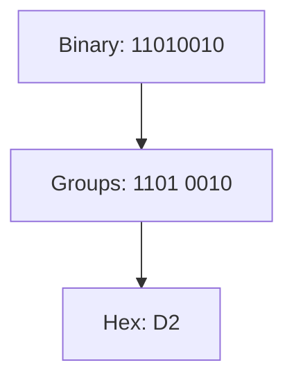

# 5.3 Numeral systems (decimal, binary, hexadecimal, and octal)

The numbers in your programs have been written in the way that people write them, with ten digits. The computer stores them with two, and programmers often write them with sixteen or eight. This lesson explains the four numeral systems that you will meet in C++, how to convert small numbers between them by hand, and how to write and print a number in each.

## Counting with different digits

A **numeral system** is a way to write numbers with a fixed set of digits. In every system that C++ uses, the value of a digit depends on its position, and each position is worth a multiple of the one to its right. The number of digits in a system is its **base**.

- **Decimal** has base 10 and the digits 0 to 9. In 305, the 3 is worth three hundreds, the 0 is worth no tens, and the 5 is worth five ones.
- **Binary** has base 2 and the digits 0 and 1. It is the system of the hardware, where one digit is one bit.
- **Hexadecimal** has base 16 and the digits 0 to 9 followed by the letters A to F, which stand for 10 to 15.
- **Octal** has base 8 and the digits 0 to 7.

Hexadecimal is popular because of a lucky fit: one hexadecimal digit stands for exactly four bits, so a byte is two digits. Octal fits three bits to a digit and is rare today, but it is part of the language. The table lists the first numbers in three of the systems.

| Decimal | Binary | Hexadecimal |
| --- | --- | --- |
| 0 | 0 | 0 |
| 1 | 1 | 1 |
| 2 | 10 | 2 |
| 3 | 11 | 3 |
| 4 | 100 | 4 |
| 5 | 101 | 5 |
| 6 | 110 | 6 |
| 7 | 111 | 7 |
| 8 | 1000 | 8 |
| 9 | 1001 | 9 |
| 10 | 1010 | A |
| 11 | 1011 | B |
| 12 | 1100 | C |
| 13 | 1101 | D |
| 14 | 1110 | E |
| 15 | 1111 | F |
| 16 | 10000 | 10 |

## Converting by hand

To convert a binary number to decimal, add up the value of each position that holds a 1. The positions are worth 1, 2, 4, 8, 16 and so on, counting from the right. The binary number 1101 has a 1 in the positions worth 8, 4 and 1, so it is 8 + 4 + 1, which is 13.

To go the other way, take the largest position that fits, subtract it, and repeat. The number 200 contains 128, and what remains is 72, which contains 64, and what remains is 8. The positions worth 128, 64 and 8 are the ones that hold a 1, so 200 is 11001000.

Hexadecimal needs less work, because of the four-bit rule. Split the binary number into groups of four bits from the right, and convert each group on its own. The diagram shows the idea for a byte.



The group 1101 is 13, which is the digit D, and the group 0010 is 2, so the whole byte is D2. Reading a long binary number in groups of four is much less error-prone than reading it as one run of digits.

## Literals in other systems

C++ lets you write a number in the system that suits it. The prefix tells the compiler which one:

- `0b` starts a binary literal, such as `0b1101`. This form has existed since C++14.
- `0x` starts a hexadecimal literal, such as `0x1F`. The letters can be upper or lower case.
- A leading `0` starts an octal literal, such as `017`.

A long literal is hard to read, so since C++14 you may put single quotes between the digits, as in `1'000'000` or `0b1101'0010`. The quotes are only for the reader, and the compiler ignores them. This program writes six literals and prints their values in decimal:

```cpp title="literals.cpp"
{{#include ../../examples/ch05/03-literals.cpp}}
```

```text title="Output"
{{#include ../../examples/ch05/03-literals.out}}
```

The line for `010` is the trap of octal. A leading zero changes the meaning of the number, so `010` is not ten, it is 8: one eight and no ones. Never write a decimal number with a leading zero, and this includes the values that you would like to line up in a column.

## Printing in other systems

By default, `std::cout` prints integers in decimal. The manipulators `std::hex`, `std::oct` and `std::dec` switch the base for the integers that follow, and like `std::setprecision`, they stay in effect until you switch again. There is no manipulator for binary, so the header `<bitset>` provides `std::bitset`, which prints a number as a row of bits. The number in the angle brackets is the count of bits to show, and templates are a topic for a later chapter.

```cpp title="print-bases.cpp"
{{#include ../../examples/ch05/03-print-bases.cpp}}
```

```text title="Output"
{{#include ../../examples/ch05/03-print-bases.out}}
```

The value 200 prints as `c8` in hexadecimal, because the letters come out in lower case, and as `310` in octal. The program switches back with `std::dec` before the next line. Without it, the next integer would still print in octal, which is a common source of confusing output.

> [!ADVANCED]
> C++20 has another way to print a number in binary, the `b` presentation type of `std::format`. This book does not use `std::format`, so the examples use `std::bitset`.

<details>
<summary>Check your understanding</summary>

**Question 1.** What is the decimal value of the binary number 10110, and of the hexadecimal number 2A?

<details>
<summary>Answer</summary>

The binary number 10110 is 16 + 4 + 2, which is 22. The hexadecimal number 2A is 2 times 16 plus 10, which is 42.

</details>

**Question 2.** What does `std::cout << 010;` print?

<details>
<summary>Answer</summary>

It prints `8`. The leading zero makes `010` an octal literal, and the value is one eight and no ones.

</details>

**Question 3.** The program prints `std::hex << 255`, and then a variable of 31 with plain `std::cout`. What does the second line show?

<details>
<summary>Answer</summary>

It shows `1f`, which is 31 in hexadecimal, because `std::hex` stays in effect until `std::dec` is used. The fix is to switch back with `std::cout << std::dec`.

</details>

</details>

## Summary

- A numeral system writes numbers with a base's worth of digits: decimal has 10, binary 2, octal 8 and hexadecimal 16.
- One hexadecimal digit stands for four bits, so a byte is two hexadecimal digits.
- To convert from binary, add the values of the positions that hold a 1, and to convert to hexadecimal, convert each group of four bits.
- `0b` starts a binary literal, `0x` a hexadecimal one and a leading `0` an octal one, so `010` is 8, and single quotes may separate digits.
- `std::hex`, `std::oct` and `std::dec` stay in effect until changed, and `std::bitset` from `<bitset>` prints binary.

## Further reading

- [Integer literals (cppreference)](https://en.cppreference.com/w/cpp/language/integer_literal)
- [std::hex, std::oct, std::dec (cppreference)](https://en.cppreference.com/w/cpp/io/manip/hex)
- [std::bitset (cppreference)](https://en.cppreference.com/w/cpp/utility/bitset)
- [Format specification of std::format (cppreference)](https://en.cppreference.com/w/cpp/utility/format/spec)
