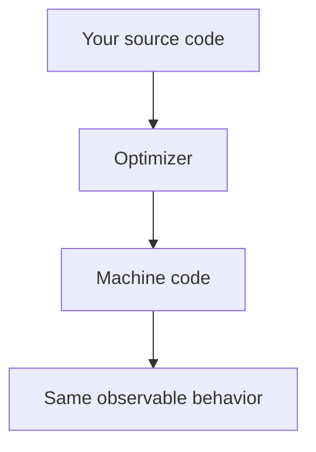

# 5.4 The as-if rule and compile-time optimization

The program that the computer runs is not always the program that you wrote. The compiler translates your code, and a good compiler also improves it, so that the result runs faster or takes less memory. This lesson explains how much freedom the compiler has, the rule that limits it, and why that freedom leads to the question of constants that the next two lessons answer.

## What an optimizer does

**Optimization** is the work that the compiler does to make a program faster or smaller without changing what it does. The part of the compiler that does it is the **optimizer**. The diagram shows where it sits: it takes your code, rearranges it, and the result becomes machine code.



The last box is the important one. The optimizer is not allowed to make a program do something else. It is allowed to find a different way to do the same thing.

## The as-if rule

The language standard states the limit in a single sentence, which is called the **as-if rule**. The compiler may change a program in any way, as long as the **observable behavior** is the same as if the program ran exactly as you wrote it. Observable behavior is what happens outside the program: the text that it writes, the files that it changes, the input that it reads, and the accesses to a few special variables that the book does not use.

Everything else is open to change. The compiler may calculate a value in a different order, keep it somewhere other than memory, or decide that it is not needed. This program multiplies two numbers and prints the result:

```cpp title="same-output.cpp"
{{#include ../../examples/ch05/04-same-output.cpp}}
```

```text title="Output"
{{#include ../../examples/ch05/04-same-output.out}}
```

A compiler may do exactly what the code says: store 3 and 4, multiply them while the program runs, store 12 in `area`, and print it. It may also see that 3 times 4 is always 12, replace the whole calculation with the number 12, and never create `area` at all. Both programs print `Area: 12`, and nothing outside the program can tell them apart, so the as-if rule allows both.

## What compilers do in practice

Four changes show up again and again:

- **Constant folding** means that the compiler does a calculation while it builds the program, when every value in it is known. The expression `3 * 4` becomes 12.
- **Removing unused work** means that a calculation whose result is never used can disappear, together with a variable that is never read.
- **Keeping a value in a register**, one of the tiny storage places inside the processor from [lesson 0.2](../ch00-getting-started/02-programs-and-programming-languages.md), is faster than reading it from memory each time, and the value may never be stored in memory at all.
- **Inlining** means that the compiler copies the body of a small function into the place where it is called, which saves the cost of the call.

None of them changes the text that the program prints, so all of them are allowed.

## Debug and release builds

The optimizer is the difference between the two build configurations of [lesson 0.9](../ch00-getting-started/09-build-configurations.md). A debug build switches most optimization off, so that the program does what each line says and a debugger can stop on every line and show every variable. A release build switches optimization on, and the program that results is faster and harder to follow.

This is what you saw in [lesson 3.8](../ch03-debugging/08-using-an-integrated-debugger-watching-variables.md), where a variable can show as optimized out in a release build: the compiler decided that the variable did not need to exist. It is also why you debug a debug build. The as-if rule keeps the output the same, and it does not keep the steps the same.

## Compile time is not guaranteed

The compiler may calculate `3 * 4` while it builds the program, and it usually does when it optimizes. Nothing in the language promises it, though. A debug build may skip it, and a different compiler may make a different choice, because the as-if rule lets all of them do as they like.

Sometimes you need a promise. The size of a `std::bitset` has to be known while the program is built, and a value that you want to treat as fixed should not depend on how hard the optimizer worked. The language therefore has a separate idea, the constant expression, which is a calculation that must be done at build time. [Lesson 5.5](05-constant-expressions.md) introduces it.

## Undefined behavior and the optimizer

The as-if rule applies to a program that has no undefined behavior. A compiler is allowed to assume that your program never does anything undefined, such as the signed overflow of [lesson 4.4](../ch04-fundamental-data-types/04-signed-integers.md), and it may optimize on that assumption. If the assumption is wrong, the optimized program does not print a wrapped number: it may do something that no line of your code seems to explain.

> [!WARNING]
> A program with undefined behavior may seem to work in a debug build and fail in a release build, or the other way round. The fix is never to build in a different way, but to remove the undefined behavior, which [lesson 1.6](../ch01-cpp-basics/06-uninitialized-variables-and-undefined-behavior.md) and the sanitizers of [lesson 3.10](../ch03-debugging/10-finding-issues-before-they-become-problems.md) help to find.

## Looking at the result

If you are curious what a compiler makes of your code, the website [Compiler Explorer](https://godbolt.org/) shows the assembly language that a compiler produces for code that you type in the browser. You can choose the compiler and its optimization options, and compare the output of a debug and a release setting. It is optional for this book, and it is a good way to see the as-if rule at work.

<details>
<summary>Check your understanding</summary>

**Question 1.** What counts as observable behavior?

<details>
<summary>Answer</summary>

The text that the program writes, the files that it changes, the input that it reads, and the accesses to volatile variables, which the book does not use. A change that none of these can reveal is not observable.

</details>

**Question 2.** Can the compiler remove a statement that prints a line of text, because the program would still compile without it?

<details>
<summary>Answer</summary>

No. Printing is observable behavior, so the program would no longer behave as if it ran as written. The compiler may remove a calculation whose result is never used, but not an output.

</details>

**Question 3.** A program that works in a debug build prints something strange in a release build. Why is undefined behavior a suspect?

<details>
<summary>Answer</summary>

The compiler may optimize on the assumption that no undefined behavior happens. With optimization switched off, the same code may do something harmless, and with it switched on, the code may change in a way that exposes the problem.

</details>

</details>

## Summary

- Optimization changes a program to make it faster or smaller, and it must not change the observable behavior.
- The as-if rule lets the compiler do anything that cannot be seen from outside: constant folding, removing unused work, using registers and inlining.
- Debug builds keep most optimization off so that the program follows the code, and release builds switch it on.
- The compiler may calculate `3 * 4` at build time, but the language does not promise it, which is why constant expressions exist.
- The compiler may assume that a program has no undefined behavior, so a program that has it can behave differently from one build to the next.

## Further reading

- [The as-if rule (cppreference)](https://en.cppreference.com/w/cpp/language/as_if)
- [Program execution in the C++ working draft](https://eel.is/c++draft/intro.abstract)
- [Compiler Explorer](https://godbolt.org/)
