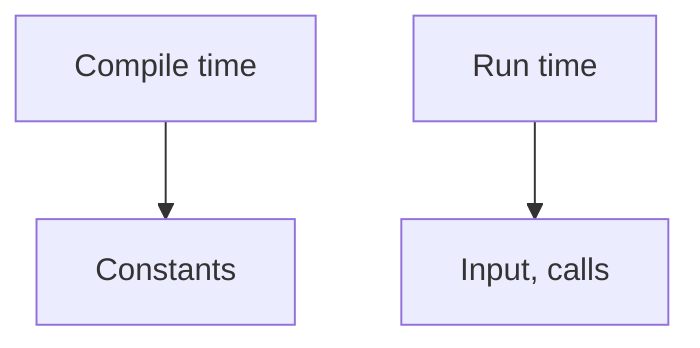

# 5.5 Constant expressions

[Lesson 5.4](04-the-as-if-rule-and-compile-time-optimization.md) ended with a gap: a compiler may calculate `3 * 4` while it builds the program, but the language does not promise it. Some parts of C++ cannot work without that promise, because they need a value before the program exists. This lesson explains when a value is known, what the language calls an expression that is certain to be known in time, and where such an expression is required.

## Compile time and run time

Two moments matter in the life of a program. **Compile time** is when the compiler builds the program, and **run time** is when the finished program runs. A value that the compiler can work out from the code alone is known at compile time. A value that depends on something that only happens while the program runs, such as a number that the reader types, is known at run time only.

The diagram sorts a few examples into the two groups: constants are known at compile time, and input and function calls happen at run time.



## What a constant expression is

A **constant expression** is an expression that the compiler can evaluate while it builds the program, and that the compiler must evaluate wherever the language requires a constant expression. Elsewhere it may still be calculated at run time. The full rules are long, so here is a simplified version that covers this book. These are constant expressions:

- a literal, such as `8` or `3.5`,
- an operator applied to constant expressions, such as `3 * 4` or `2 + 5 * 2`,
- a `const` variable of an integer type that was initialized with a constant expression, such as `columns` in the next program.

These are not constant expressions: a call to an ordinary function, which is a run-time event even when the function always returns the same number, and a variable whose value comes from input. [Lesson 5.6](06-constexpr-variables.md) adds the `constexpr` variable and a later chapter adds `constexpr` functions, which are the ways to extend the list.

This program uses two constants to compute a size at compile time:

```cpp title="grid.cpp"
{{#include ../../examples/ch05/05-grid.cpp}}
```

```text title="Output"
{{#include ../../examples/ch05/05-grid.out}}
```

The program uses `std::bitset` from [lesson 5.3](03-numeral-systems.md), which holds a fixed number of bits. The number of bits is written in the angle brackets, and the compiler must know it, because the size of the object is decided while the program is built. The expression `columns * rows` is a constant expression: both operands are `const int` variables that were initialized with literals, so the compiler works out the 8, and the bitset prints eight bits.

## Where a constant expression is required

The angle brackets of `std::bitset` are one place where the language demands a constant expression. If you give it something else, the program does not build. The first example makes a `const` variable from a value that the reader types:

```cpp title="runtime-size.cpp"
{{#include ../../examples/ch05/05-runtime-size.fail.cpp}}
```

The variable `bits` is `const`, but that only means that it cannot change after it is set. It is set from input, so its value is known at run time only, and the compiler reports that the template argument is not a constant expression. The compiler calls the number in the angle brackets a template argument, and templates are a topic for a later chapter. A `const` variable is not automatically a compile-time value.

The second example calls an ordinary function that always returns 8:

```cpp title="function-call.cpp"
{{#include ../../examples/ch05/05-function-call.fail.cpp}}
```

The compiler refuses to call the function while it builds, because it is not allowed to: the function is a run-time thing. GCC reports a call to a non-`constexpr` function, and the word `constexpr` is the one that [lesson 5.6](06-constexpr-variables.md) explains.

The third example is the surprise. A `const` variable of the type `double` is not usable in a constant expression, even when it is initialized with a literal:

```cpp title="const-double.cpp"
{{#include ../../examples/ch05/05-const-double.fail.cpp}}
```

The rule for `const` variables covers integer types only, and the value 8.0 does not help. Both compilers reject the program. The same problem would exist for any other floating point constant, which is one reason to learn the tool of the next lesson.

> [!NOTE]
> The three failures have different causes, and the compilers describe them in different words. When you see a message about a constant expression, ask whether the value could really be known before the program runs.

## A promise and a favor

The two lessons fit together. In `int area{3 * 4};`, the compiler may fold the multiplication into the number 12, as [lesson 5.4](04-the-as-if-rule-and-compile-time-optimization.md) explained, but it does not have to. In `std::bitset<3 * 4>`, the same expression must be evaluated while the program is built, because the language requires a constant expression there. Folding is a favor that the compiler may do you, and a constant expression is a promise that it has to keep.

## Why it matters

A value that is known at compile time costs nothing while the program runs, and a mistake in it, such as a size that is too large, is found at build time instead of in front of a user. The language also requires it in some places, such as the size of a `std::bitset`, and later chapters add array sizes to the list.

<details>
<summary>Check your understanding</summary>

**Question 1.** Which of these are constant expressions: `3 + 4`, `a * 2` after `const int a{5};`, `b * 2` after `int b{5};`, and `c * 2` after `const double c{1.5};`?

<details>
<summary>Answer</summary>

The first two are. `3 + 4` uses literals, and `a` is a `const` integer that was initialized with a literal. The third is not, because `b` can change, and the fourth is not, because a `const double` is not usable in a constant expression.

</details>

**Question 2.** The program reads a number into `typed`, and then defines `const int size{typed};`. Why can `size` not be used as the size of a `std::bitset`?

<details>
<summary>Answer</summary>

The value of `size` comes from input, so it is not known until the program runs. A `std::bitset` needs its size while the program is built, and `const` does not change when a value is known.

</details>

**Question 3.** Why is a call to `columnCount()` not a constant expression, even though it always returns 8?

<details>
<summary>Answer</summary>

An ordinary function is a run-time thing, and the compiler is not allowed to treat its result as a compile-time value. Only functions that are written for compile time can be called in a constant expression, and that is a topic for a later chapter.

</details>

</details>

## Summary

- Compile time is when the program is built, and run time is when it runs, and a value that depends on input is known at run time only.
- A constant expression is an expression that the compiler must evaluate at compile time wherever the language requires one.
- Literals, operators on constant expressions and `const` integer variables initialized with constant expressions are constant expressions.
- A call to an ordinary function, a value from input and a `const` variable of a floating point type are not.
- Some places, such as the size of a `std::bitset`, require a constant expression.

## Further reading

- [Constant expressions (cppreference)](https://en.cppreference.com/w/cpp/language/constant_expression)
- [std::bitset (cppreference)](https://en.cppreference.com/w/cpp/utility/bitset)
