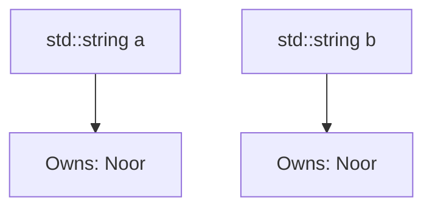

# 5.7 Introduction to std::string

Programs work with text as much as with numbers: names, addresses, messages, the answers that a reader types. So far, the only text that you have met is the string literal, which cannot grow, cannot be read from the keyboard and cannot be changed. This lesson introduces `std::string`, the standard library's type for text, and shows how to store, read and join it.

## A type for text

A **string** is a sequence of characters that is used as text. The type `std::string` lives in the header `<string>`, and a variable of this type holds text of any length. It grows and shrinks as needed, so you never have to say in advance how much text it will hold. You define one with the same braces as any other variable, and you assign a new text to it with `=`:

```cpp title="string-basics.cpp"
{{#include ../../examples/ch05/07-string-basics.cpp}}
```

```text title="Output"
{{#include ../../examples/ch05/07-string-basics.out}}
```

The program defines two strings and joins them with `+` and a space between, which gives `Noor Haddad`. The member function `length()` tells how many characters the text has, and the null terminator of [lesson 5.2](02-literals.md) is not part of the count. After the assignment, `first` holds a new text, and `last` is unchanged.

A `std::string` is not a fundamental type. It is a class from the standard library, built out of the types that you already know. The `std::` in front of its name is the namespace from [lesson 2.9](../ch02-functions-and-files/09-naming-collisions-and-an-introduction-to-namespaces.md).

A string can also be empty. `std::string empty{};` holds no characters, and its `length()` is 0. An empty string is a normal value, and it is what a string holds until you give it text.

Why not keep text in the C-style strings of [lesson 5.2](02-literals.md)? Those are fixed arrays of characters. You would have to choose a size in advance, count the characters yourself, and make sure that the null terminator is always there. A `std::string` does all of this for you, which is why you should prefer it for every text that you build or read.

## Strings own their characters

A `std::string` is an **owner**: the characters belong to it, and it keeps them for as long as it lives. When you initialize one string from another, it receives its own copy, and the two are independent afterwards. The diagram shows two strings with the same text.



Changing `b` leaves `a` alone, which keeps strings independent of each other. The price is the copy, which is the topic of a later section.

## The length of a string

The function `length()` returns an unsigned integer type, the one that the library calls `std::string::size_type`. It is the same type as `std::size_t`, from [lesson 4.6](../ch04-fundamental-data-types/06-fixed-width-integers-and-size-t.md), which is why the program above stores the result in a `std::size_t` variable. When you need the length as an `int`, convert it on purpose with `static_cast<int>(text.length())`, as [lesson 4.12](../ch04-fundamental-data-types/12-introduction-to-type-conversion-and-static-cast.md) showed. C++20 also has `std::ssize(text)`, from the header `<iterator>`, which gives the length as a signed number, and the book mentions it only so that you recognize it.

## Reading a word

The `>>` operator reads text into a string, but it follows the rule that it follows for numbers: it skips leading whitespace and stops at the next whitespace. This program asks for a name, and the reader types two words. Type `Noor Haddad` and press Enter:

```cpp title="read-word.cpp"
{{#include ../../examples/ch05/07-read-word.cpp}}
```

```text title="Example session"
{{#include ../../examples/ch05/07-read-word.session}}
```

Only `Noor` is stored. The space ends the word, and `Haddad` stays in the input, where the next read would find it. This is the same behavior as reading a `char` in [lesson 4.11](../ch04-fundamental-data-types/11-chars.md), and it is not what you want for a name or an address.

## Reading a whole line

The function `std::getline` reads everything up to the end of the line, spaces included, and removes the line break. You pass it the input stream and the string to fill. There is a trap when a line follows a number, and the next program falls into it. It reads an age and then a full name. The reader types 30 and presses Enter:

```cpp title="getline-bug.cpp"
{{#include ../../examples/ch05/07-getline-bug.cpp}}
```

```text title="Example session"
{{#include ../../examples/ch05/07-getline-bug.session}}
```

The program did not wait for the name. When the reader pressed Enter after the 30, the line break stayed in the input, because `>>` stops before whitespace. The call to `std::getline` found that line break at once, read an empty line, and the name stayed empty. The program is valid and it runs, and its result is wrong.

The cure is the manipulator `std::ws`, which discards whitespace in front of the text. Write `std::getline(std::cin >> std::ws, name)`, and the leftover line break is skipped before the line is read. Type 30 and press Enter, and then type `Noor Haddad` and press Enter:

```cpp title="getline-ws.cpp"
{{#include ../../examples/ch05/07-getline-ws.cpp}}
```

```text title="Example session"
{{#include ../../examples/ch05/07-getline-ws.session}}
```

> [!BEST-PRACTICE]
> When a program reads a whole line after a number, put `std::cin >> std::ws` in front of the string in the `std::getline` call, so that a leftover line break cannot hide the line.

The manipulator also discards any spaces that the reader typed in front of the line, which is usually what you want. If the leading spaces matter, as in text that is indented on purpose, a different approach is needed, and the book does not need one.

## Joining text

The `+` operator joins two strings into a new one, and it also joins a string and a literal. At least one of the two sides has to be a `std::string`. Two string literals are not strings, they are C-style arrays, and the compiler refuses to add them:

```cpp title="join-literals.cpp"
{{#include ../../examples/ch05/07-join-literals.fail.cpp}}
```

The compiler reports that the two operands, an array of 8 `char` and an array of 6 `char`, are invalid for `+`. To make one side a `std::string`, add the suffix `s` to a literal, as in `"Hello, "s`. The suffix needs a using-directive for the namespace that holds it:

```cpp title="literal-suffix.cpp"
{{#include ../../examples/ch05/07-literal-suffix.cpp}}
```

```text title="Output"
{{#include ../../examples/ch05/07-literal-suffix.out}}
```

[Lesson 2.9](../ch02-functions-and-files/09-naming-collisions-and-an-introduction-to-namespaces.md) warned against `using namespace std;`, because it pulls every name of the library into your program. This directive is different in two ways. It names a small namespace, `std::string_literals`, that only holds suffixes, and it sits inside a function, so it affects nothing outside it. That is why the book accepts it.

## The cost of copies

Because a `std::string` owns its characters, a copy of it copies all of them. Initializing a string from another one, and passing a string to a function by value, both make a full copy.

For a short name it does not matter, and for a long text that is read many times, it adds up. [Lesson 5.8](08-introduction-to-std-string-view.md) introduces a type that avoids the copy when a function only needs to read a string, and a later chapter adds references, which avoid it in more cases. Strings also cannot be `constexpr`, as [lesson 5.6](06-constexpr-variables.md) explained.

<details>
<summary>Check your understanding</summary>

**Question 1.** What does this program print?

```cpp
std::string a{"ab"};
std::string b{a + "cd"};
std::cout << b.length();
```

<details>
<summary>Answer</summary>

It prints `4`. The text of `b` is `abcd`, which has four characters, and `length()` does not count a terminator.

</details>

**Question 2.** The reader types `Noor Haddad`, and the program runs `std::cin >> name;`. What does `name` hold, and where is the rest?

<details>
<summary>Answer</summary>

It holds `Noor`. The space ends the word, and `Haddad` stays unread in the input until the next read.

</details>

**Question 3.** A program reads an age with `std::cin >> age`, and then a name with `std::getline(std::cin, name)`. The name is always empty. Why, and how do you fix it?

<details>
<summary>Answer</summary>

The line break that the reader typed after the age is still in the input, so `std::getline` reads it as an empty line. Use `std::getline(std::cin >> std::ws, name)`, so that the whitespace is discarded first.

</details>

</details>

## Summary

- `std::string` from `<string>` holds text of any length, it owns its characters, and `length()` returns the count as an unsigned number.
- `std::cin >> text` stops at whitespace, and `std::getline` reads a whole line, spaces included.
- After a number, use `std::getline(std::cin >> std::ws, text)`, so that the leftover line break does not end the read.
- `+` joins strings, and at least one operand must be a `std::string`, which the `s` suffix on a literal can provide.
- Copying a string copies its characters, and a `std::string` cannot be `constexpr`.

## Further reading

- [std::basic_string (cppreference)](https://en.cppreference.com/w/cpp/string/basic_string)
- [std::getline (cppreference)](https://en.cppreference.com/w/cpp/string/basic_string/getline)
- [std::ws (cppreference)](https://en.cppreference.com/w/cpp/io/manip/ws)
