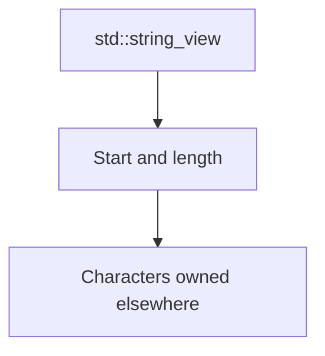

# 5.8 Introduction to std::string_view

[Lesson 5.7](07-introduction-to-std-string.md) ended with a cost: every time a `std::string` is copied, all of its characters are copied too. A function that only wants to read some text should not have to pay for that. C++17 added a type for this job, `std::string_view`, and this lesson shows what it is, how to create one, and the rule of thumb that makes it the usual choice for a read-only text parameter.

## The cost of passing text

Suppose a function prints a label, and its parameter is a `std::string`. Each call copies the text of the argument into the parameter. It is like making a photocopy of a whole book each time that someone asks you to read out one title. If the argument is a string literal, the call also has to build a `std::string` out of it first, which is another copy.

The function does not change the text. It only reads it, so the copy buys nothing. What the function needs is a way to look at the characters that are already there.

## A view of text

A **`std::string_view`**, from the header `<string_view>`, is a read-only look at text that belongs to someone else. It does not own the characters. It remembers only where the text starts and how many characters it has, as the diagram shows.



Because a view holds two small values, it is cheap to copy, so you pass it to a function by value, and no characters are copied. It is read-only: you can look at the characters and ask for the length, and you cannot change the text through the view.

## Creating a view

You can create a view from a string literal, from a `std::string`, and from another view, and the conversion from a `std::string` happens by itself. The function in this program takes a view, and the program calls it with all three:

```cpp title="print-view.cpp"
{{#include ../../examples/ch05/08-print-view.cpp}}
```

```text title="Output"
{{#include ../../examples/ch05/08-print-view.out}}
```

The first call passes a literal, and the parameter becomes a view of the literal's characters. The second call passes a `std::string`, and the parameter becomes a view of the string's characters. The third call passes a view that already looks at the same string. In none of the calls were the characters copied, and the function treats all three the same way.

Its parameter does the work of three versions of the function.

What each kind of argument costs depends on the type of the parameter that receives it:

- **A literal:** a `std::string` parameter copies it into a new string, and a `std::string_view` parameter views it.
- **A `std::string`:** a `std::string` parameter copies it, and a `std::string_view` parameter views it.
- **A view:** a `std::string` parameter does not build, and a `std::string_view` parameter views the same text.

The last case is the surprise. A function that takes a `std::string` cannot be called with a view at all, because the conversion would copy, and the language asks you to say so.

## What a view can tell you

A view knows its length, which `length()` returns, and whether it is empty, which `empty()` answers with a `bool`. It can be printed with `std::cout`, compared and passed on to another function. Everything that it does is a way of reading the text, which is why a function with a view parameter cannot damage its caller's string.

The literal case deserves a closer look. A string literal exists for the whole run of the program, so a view of a literal can never outlive its text. A view of a `std::string` is different, because the string can be destroyed while the view is still around, and the next lesson shows what that does.

## From a view back to a string

Going the other way is not automatic. A `std::string` owns its characters, so making one from a view means making a copy, and the language makes you ask for the copy:

```cpp title="view-to-string.cpp"
{{#include ../../examples/ch05/08-view-to-string.fail.cpp}}
```

The compiler refuses to convert the view when the string is created with `=`. The message says that there is no viable conversion from `std::string_view` to `std::string`. Create the string with braces instead, as in `std::string copy{view};`, which asks for the conversion explicitly. The explicit request is the point: a reader can see where a copy happens.

## Constants and the sv suffix

A `std::string_view` can be `constexpr`, which a `std::string` cannot, as [lesson 5.6](06-constexpr-variables.md) mentioned. A string literal also has a suffix of its own, `sv`, that gives it the type `std::string_view`. Like the `s` suffix of the last lesson, it needs a using-directive, here for `std::string_view_literals`, and the book writes it inside the function:

```cpp title="constexpr-view.cpp"
{{#include ../../examples/ch05/08-constexpr-view.cpp}}
```

```text title="Output"
{{#include ../../examples/ch05/08-constexpr-view.out}}
```

The first view is made from a plain literal, and the second one from a literal with the `sv` suffix. Both are known when the program is built. The `length()` function returns the number of characters, as it does for a `std::string`.

> [!BEST-PRACTICE]
> Use `std::string_view` for a function parameter that only reads text. The function then accepts literals, strings and views without a copy.

If the function needs to keep the text after it returns, the parameter should be a `std::string`, so that the function owns what it keeps. The reason is the subject of the next lesson.

A view is also not the right choice when the function must change the text. It cannot, because a view is read-only, and a function that builds or edits text works with a `std::string`.

<details>
<summary>Check your understanding</summary>

**Question 1.** What does the call `printLabel("Tent")` do differently from a call to a function with a `std::string` parameter?

<details>
<summary>Answer</summary>

With a `std::string_view` parameter, the function looks at the characters of the literal, and nothing is copied. With a `std::string` parameter, the call builds a new string and copies the characters into it.

</details>

**Question 2.** Why does `std::string copy = view;` not build, and what is the fix?

<details>
<summary>Answer</summary>

A view does not convert to a `std::string` by itself, because that conversion copies the characters. Write `std::string copy{view};`, which makes the copy explicit.

</details>

**Question 3.** Can a function that takes a `std::string_view` change the characters of its argument?

<details>
<summary>Answer</summary>

No. A view is read-only. The function can read the characters and the length, and the text stays the way its owner made it.

</details>

</details>

## Summary

- A `std::string_view` from `<string_view>` is a read-only view of text that someone else owns, made of a start and a length.
- It is cheap to copy, so a function takes it by value, and the call copies no characters.
- A view can be made from a literal, a `std::string` or another view, and a `std::string` made from a view needs an explicit request.
- A view can be `constexpr`, and the suffix `sv` with `std::string_view_literals` makes a literal a view.
- Use `std::string_view` for a read-only text parameter, and a `std::string` for text that must be kept.

## Further reading

- [std::basic_string_view (cppreference)](https://en.cppreference.com/w/cpp/string/basic_string_view)
- [operator""sv (cppreference)](https://en.cppreference.com/w/cpp/string/basic_string_view/operator%22%22sv)
