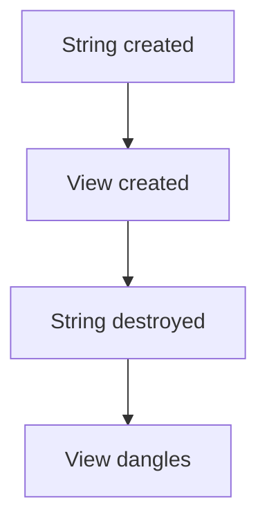

# 5.9 std::string_view (part 2)

A `std::string_view` is cheap because it owns nothing, and that is also the source of its one big danger. A view is only as good as the text it looks at, and the language does not stop you from keeping a view after the text is gone. This lesson explains who owns what, shows the mistakes that create a view with nothing behind it, and finishes with what a view can safely change.

## Owners and viewers

A `std::string` is like a sheet that is pinned to a corkboard, and a `std::string_view` is like a sticky note that says "third line, first 17 letters". The note is small, so you can copy it and hand it around freely. But the note does not keep the sheet on the board. If the sheet is taken down, or swapped for a longer one, the note still gives the old position, and you read whatever hangs there now.

The rule that follows is simple: **the owner must outlive every viewer**. The diagram shows the order of events when the rule is broken.



A view that looks at characters that no longer exist is a **dangling view**. Using it is undefined behavior, as [lesson 1.6](../ch01-cpp-basics/06-uninitialized-variables-and-undefined-behavior.md) defined it, and the program may print the old text, print garbage, or crash.

## A view of a temporary

The first mistake is to create a view of a temporary string. A **temporary** is a value that exists only until the end of the statement that created it, such as the result of a function that you do not store. A function that returns a `std::string` by value produces such a temporary. A view that is made from it outlives it:

```cpp title="temporary-string.cpp"
{{#include ../../examples/ch05/09-temporary-string.ub.cpp}}
```

The view `label` is created from the result of `makeLabel()`. At the end of that statement the temporary string is destroyed, and its characters are released. The next statement uses the view, which now looks at memory that is gone. The program builds, and it may even seem to work, because freed memory often still holds the old text for a while.

The book shows no output for it, because no output would be right. Its checks run the program under the sanitizers of [lesson 3.10](../ch03-debugging/10-finding-issues-before-they-become-problems.md), and they report that the program uses memory after it was freed.

## A view of a local string

The second mistake is the classic one: a function creates a string, and returns a view of it. The string is a local variable, which [lesson 2.5](../ch02-functions-and-files/05-introduction-to-local-scope.md) explained, so it is destroyed when the function ends, and the view that was returned has nothing to look at:

```cpp title="returned-view.cpp"
{{#include ../../examples/ch05/09-returned-view.ub.cpp}}
```

Some compilers warn about this one, and some do not, so you cannot rely on a warning. The sanitizers report it, in the same way as before.

> [!WARNING]
> Never return a `std::string_view` of a local `std::string`. Return the `std::string` itself, so that the caller receives its own copy of the text.

## A view of a string that changes

A string can also be alive and still invalidate its views. A view remembers where the characters are. If the owner changes in a way that moves its characters, the view points to the old place:

```cpp title="changed-string.cpp"
{{#include ../../examples/ch05/09-changed-string.ub.cpp}}
```

The second text is longer than the first, so the string may have to allocate new memory and release the old, and the view then looks at the released memory. The library's rules treat a view as invalid after a change like this, whether or not the characters happen to move. The safe habit is to finish using a view before you change the string that it looks at.

## Changing the view, not the string

A view can change what it looks at without any harm to the text. The functions `remove_prefix` and `remove_suffix` shrink the view from the front and from the back. They move the view's start or its end, and they do not touch the characters:

```cpp title="remove-affixes.cpp"
{{#include ../../examples/ch05/09-remove-affixes.cpp}}
```

```text title="Output"
{{#include ../../examples/ch05/09-remove-affixes.out}}
```

The view starts as the whole line. Removing seven characters from the front takes off `[note] `, and removing one from the back takes off the semicolon, so the view shows `remember the milk`. The string still holds the whole line, 25 characters, and the view has 17. Nothing was copied and nothing was changed.

## The end of a view

One more fact will matter later. A `std::string` keeps a null character after its text, which `length()` does not count, but a view is not guaranteed to have one after its text.

A view that was shortened with `remove_suffix` ends in the middle of the text, and what follows it is not part of the view. A view may even contain null characters of its own, because it knows its length and does not look for a terminator. A function that expects a null-terminated string, such as many functions from the C language, cannot be given a view's characters without care.

## Fixing the mistakes

Both dangling programs have the same cure: make sure that something owns the text for as long as the text is used. For a temporary, define a `std::string` variable first, and make the view from the variable, so that the string lives to the end of the block. For a function that builds text, return a `std::string` and not a view. The caller then receives an owner, and it can make a view of it, or keep the string, as it likes.

## String or string view

| You need to | Use |
| --- | --- |
| read text that a function receives | `std::string_view` |
| keep text after a function returns | `std::string` |
| build or change text | `std::string` |
| name a text constant | `constexpr std::string_view` |
| store text that the reader typed | `std::string` |

<details>
<summary>Check your understanding</summary>

**Question 1.** Why is the view in these two lines dangerous?

```cpp
std::string_view view{std::string{"a temporary string"}};
std::cout << view;
```

<details>
<summary>Answer</summary>

The temporary string is destroyed at the end of the first statement, so the view dangles, and printing it is undefined behavior. Keep the string in a variable that lives as long as the view.

</details>

**Question 2.** State the rule about owners and viewers in one sentence.

<details>
<summary>Answer</summary>

The owner of the text must outlive every view of it, and it must not be modified while a view of it is in use.

</details>

**Question 3.** What happens to a `std::string` when you call `remove_prefix` on a view of it?

<details>
<summary>Answer</summary>

Nothing. The function moves the start of the view, and the string keeps all of its characters.

</details>

</details>

## Summary

- A `std::string` owns its characters, and a `std::string_view` only looks at them, so the owner must outlive every view.
- A view of a temporary string, or of a local string that a function returns, dangles, and using it is undefined behavior.
- Changing the string may invalidate a view of it, so finish with the view first.
- `remove_prefix` and `remove_suffix` change what the view shows, and never the string.
- A view is not guaranteed to be null-terminated, and it may contain null characters.

## Further reading

- [std::basic_string_view (cppreference)](https://en.cppreference.com/w/cpp/string/basic_string_view)
- [std::basic_string_view::data (cppreference)](https://en.cppreference.com/w/cpp/string/basic_string_view/data)
- [AddressSanitizer (Clang documentation)](https://clang.llvm.org/docs/AddressSanitizer.html)
