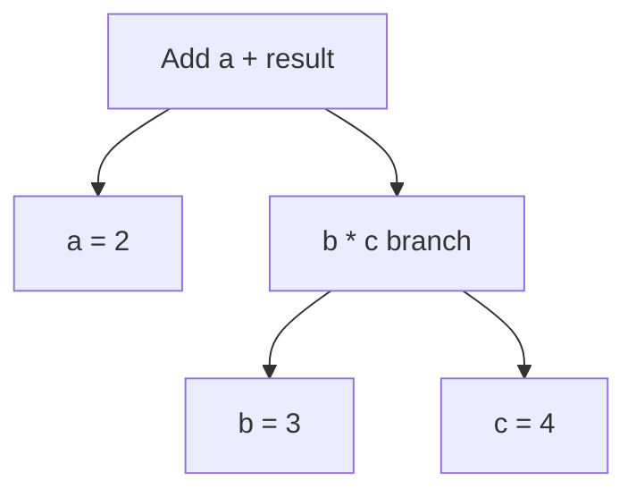
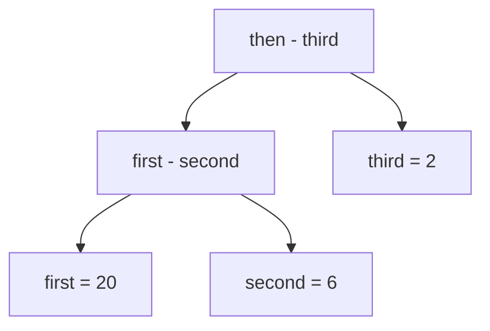
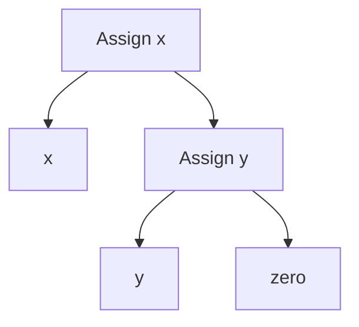

# 6.1 Operator precedence and associativity

A line such as `a + b * c` contains two operators that both want an operand in the middle. Before the program can calculate anything, the compiler must settle which operation owns `b`. C++ answers that structural question with precedence and associativity, and a reader needs the same answer to predict the expression.

## An expression is a tree

Think of an expression as a tree rather than a row of symbols. Each operator is a branch whose children are its operands; the values are the leaves. The root is the last operation needed to produce the expression's value.

This tree shows the structure that C++ gives `a + b * c`.



Notice that `b * c` is one complete branch below the addition, so its value becomes the right operand of `+`.

**Operator precedence** decides the shape when the operators have different strengths. Multiplication has higher precedence than addition, so `*` takes `b` and `c` before `+` takes the multiplication's result. Precedence does not make a number larger or an operation more important; it is a grammar rule that assigns operands.

You can write the grouping explicitly as `a + (b * c)`. **Grouping parentheses** make the expression inside them one unit, so `(a + b) * c` builds a different tree. These parentheses are not the function-call operator `()` from the precedence table: their job is to state the structure directly.

> [!BEST-PRACTICE]
> Add grouping parentheses when they make the intended tree faster to see. A reader should not need to recall a distant table to understand an important calculation.

## Equal precedence needs a direction

Precedence cannot choose between two uses of the same operator. **Associativity** supplies a grouping direction for adjacent operators at the same precedence level. Addition, subtraction, multiplication, and division associate from left to right.

The tree for `first - second - third` groups the first subtraction inside the second one.



Notice that the tree means `(first - second) - third`, which is 12; `first - (second - third)` would be 16.

Assignment is different: it associates from right to left. In `x = y = 0`, the inner assignment stores 0 in `y` and produces that assigned value; the outer assignment then stores it in `x`.

This tree shows the right-hand assignment nested inside the left-hand one.



Notice that associativity describes the tree, not a rule that every operation runs by sweeping across the source line.

## The levels used so far

The complete C++ precedence table is long, so this table keeps only the operators encountered by this point or introduced immediately in this lesson pair. A smaller level number means tighter binding; gaps are levels for operators that arrive later.

| Level | Operators | Groups |
| --- | --- | --- |
| 1 | `::` | left |
| 2 | function call `()` | left |
| 3 | unary `+`, unary `-`, `!`, `sizeof` | right |
| 5 | `*`, `/` | left |
| 6 | binary `+`, binary `-` | left |
| 7 | `<<`, `>>` | left |
| 9 | `<`, `<=`, `>`, `>=` | left |
| 10 | `==`, `!=` | left |
| 16 | `=` | right |

Here “left” means left to right and “right” means right to left. Notice that the stream operators `<<` and `>>` keep their language precedence when the standard library gives them the meanings “print” and “read.” This is why `std::cout << a + b` groups as `std::cout << (a + b)`: addition at level 6 binds more tightly than `<<` at level 7.

Do not try to memorize every level at once. Learn the common arithmetic relationships, use parentheses for a grouping that a reader might miss, and consult the table when operators from distant levels meet.

## Checking the trees with values

The following program gives the leaves small values and prints the results of the natural and parenthesized groupings.

```cpp title="grouping.cpp"
{{#include ../../examples/ch06/01-grouping.cpp}}
```

```text title="Output"
{{#include ../../examples/ch06/01-grouping.out}}
```

The first two lines are equal because both use the first tree. Moving the parentheses changes the root and produces 20. The two subtraction lines then show that associativity matters when an operator such as `-` is not interchangeable with a regrouped version of itself.

The final assignment has the right-to-left tree shown above, so both variables become 0. Parentheses could spell it `x = (y = 0)`, but two separate assignment statements are often clearer when the shared value is not the point of the code.

## Grouping is not evaluation order

A tree says which results become operands of other operations. It does not generally say which independent operand the program evaluates first. For example, the left and right operands of built-in `+` do not gain a left-to-right run-time order merely because `+` associates from left to right.

C++ specifies an order for some operations, which later lessons call out when it matters, but the order of many operands is unspecified. A compiler may choose either allowed order, and it may choose differently on another build. [Lesson 2.4](../ch02-functions-and-files/04-introduction-to-function-parameters-and-arguments.md) already used the safe habit: calculate order-sensitive values in separate statements before passing or combining them.

<details>
<summary>Check your understanding</summary>

**Question 1.** In the first tree, which node would become the root if the expression changed to `(a + b) * c`?

<details>
<summary>Answer</summary>

The multiplication would be the root. Its left child would be an addition with leaves `a` and `b`, and its right child would be `c`.

</details>

**Question 2.** Without calculating it, add parentheses that show the grouping of `total / count * scale`.

<details>
<summary>Answer</summary>

`(total / count) * scale`. Division and multiplication have the same precedence and associate from left to right.

</details>

**Question 3.** Does the left-to-right associativity of `+` promise that a function on its left runs before a function on its right?

<details>
<summary>Answer</summary>

No. Associativity determines grouping. It does not generally determine the order in which operands are evaluated.

</details>

</details>

## Summary

- An expression has a tree: operators are branches, operands are children, and the root produces the final value.
- Precedence decides grouping between different operators, and associativity settles adjacent operators at the same level.
- Arithmetic operators associate from left to right, while assignment associates from right to left.
- Grouping parentheses state the intended tree directly and can override the usual precedence.
- Grouping does not generally specify operand evaluation order; separate order-sensitive work into statements.

## Further reading

- [Operator precedence (cppreference)](https://en.cppreference.com/w/cpp/language/operator_precedence)
- [Order of evaluation (cppreference)](https://en.cppreference.com/w/cpp/language/eval_order)
- [Expressions in the C++ working draft](https://eel.is/c++draft/expr)
