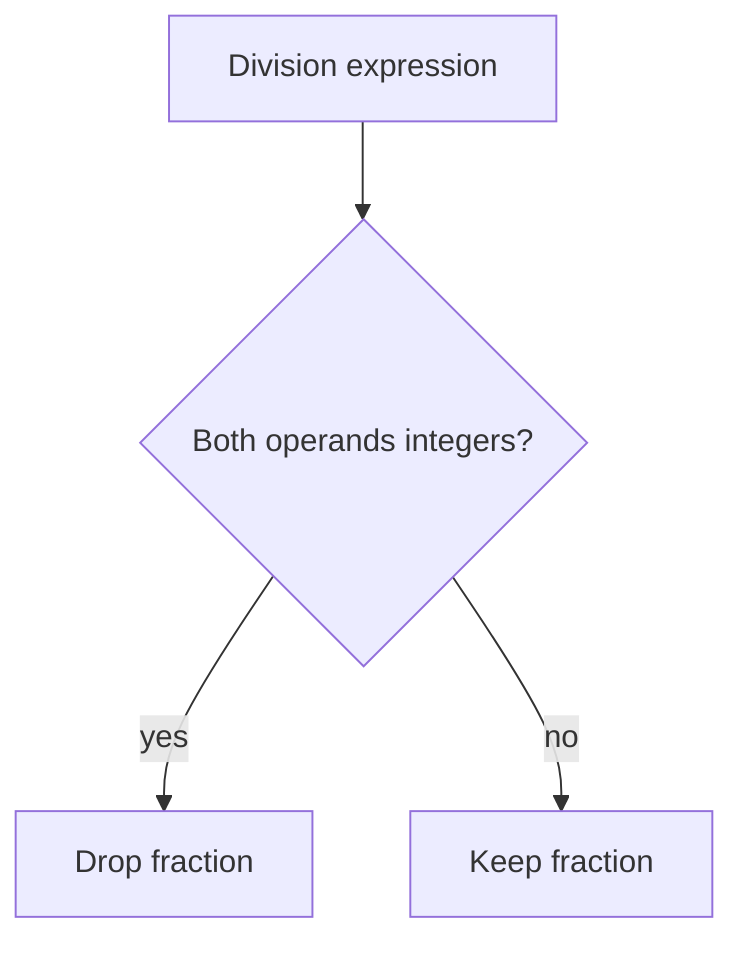
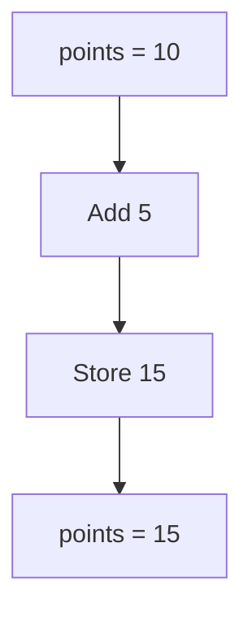

# 6.2 Arithmetic operators

The symbol `/` does not carry enough information to predict a result by itself. Dividing seven whole tickets among four people and dividing 7.0 liters among four bottles are different calculations, even though both use `/`. C++ looks at the operand types to choose the kind of arithmetic.

## Types choose the division path

Before following the syntax, picture division as a fork controlled by the two operand types. Whole-number operands take one path; a floating-point operand takes the other.

This path shows the choice made for an ordinary division expression.



Notice that the result is chosen from the types written into the expression, not from whether the mathematical answer happens to be a whole number.

When both operands have an integer type, `/` performs **integer division**. It discards the fractional part by truncating toward zero: `7 / 4` is 1 and `-7 / 4` is -1. Truncation toward zero is why a negative result becomes less negative than the exact quotient; it is not rounding to the nearest integer and not rounding down.

When at least one operand is a floating-point value, the usual arithmetic conversions make the calculation floating-point. Writing `4.0` gives that literal type `double`, so `7 / 4.0` produces 1.75. Changing the type after integer division is too late: converting the already-calculated result of `7 / 4` gives 1.0, not 1.75.

The checked rows below put the two paths beside each other for positive and negative inputs.

{{#table ../../examples/ch06/02-division-table.out header="n | n / 4 | n / 4.0"}}

Notice that the floating path retains `.75`, while the integer path moves both 1.75 and -1.75 toward zero.

<details>
<summary>The program behind this table</summary>

The program prints each input and the two divisions. It calls the function four times because loops arrive in Chapter 8.

```cpp title="division-table.cpp"
{{#include ../../examples/ch06/02-division-table.cpp}}
```

</details>

## Unary and binary arithmetic

An operator can reuse a symbol while taking a different number of operands. Binary `+` adds its left and right operands, while **unary plus** has one operand and, for an `int`, produces the same value. Unary `-` produces the value with the opposite sign.

C++ has five binary arithmetic operators: `+` for addition, `-` for subtraction, `*` for multiplication, `/` for division, and `%` for remainder. Lesson 6.3 introduces `%`, including its behavior with negative values. This lesson uses the first four.

The program below exercises unary signs and those four binary calculations with an `int`.

```cpp title="arithmetic.cpp"
{{#include ../../examples/ch06/02-arithmetic.cpp}}
```

```text title="Output"
{{#include ../../examples/ch06/02-arithmetic.out}}
```

Unary plus can make an intended positive sign explicit beside a negative alternative, but `+balance` and `balance` have the same value here. Unary minus does not change `balance`; the expression produces -12 while the variable still holds 12.

## Updating a variable

Programs often calculate a new value from a variable's old value and then store the result back in that variable. A **compound assignment operator** writes that pattern once. For an ordinary `int` variable, `points += 5` has the same effect as `points = points + 5`.

This tree follows the value through a compound addition.



Notice that one object appears at both ends: compound assignment changes the variable, so it has a side effect as well as producing a value.

The forms are `+=`, `-=`, `*=`, `/=`, and `%=`. The output of `arithmetic.cpp` traces the first four: 10 becomes 15, then 30, then 24, then 6. The remainder form belongs with `%` in the next lesson.

Keep the operator together without spaces between its two characters: write `points += 5`, not `points + = 5`. Spaces around the complete operator still separate it from its operands, following the book's formatting style.

## Division by zero

An integer zero divisor does not produce a special value. It makes the program's behavior undefined. The dangerous value often arrives through input, so the compiler cannot reject every case.

This program reads a divisor and then uses it. The book's test supplies 0:

```cpp title="divide-by-zero.cpp"
{{#include ../../examples/ch06/02-divide-by-zero.ub.cpp}}
```

No output is shown because undefined behavior has no correct output. The example checker runs this program only with its undefined-behavior sanitizers, which report the integer division by zero. A real program must test the divisor before evaluating `/`; handling failed or invalid input in full arrives in Chapter 9.

Floating-point zero needs a separate rule. On an implementation whose floating-point type supports IEC 60559 arithmetic, a nonzero finite value divided by positive or negative zero produces a signed infinity, while zero divided by zero produces a NaN, and the floating-point environment records an exception. Those special values are not a portable substitute for validating a divisor, and integer division never follows that path.

<details>
<summary>Check your understanding</summary>

**Question 1.** Follow the division path for `-9 / 4` and for `-9 / 4.0`. What result does each branch produce?

<details>
<summary>Answer</summary>

Both operands of `-9 / 4` are integers, so the fraction is discarded toward zero and the result is -2. The `4.0` in `-9 / 4.0` is a `double`, so floating-point division produces -2.25.

</details>

**Question 2.** After `int score{18}; score /= 4;`, what value does `score` hold?

<details>
<summary>Answer</summary>

It holds 4. Both operands are integers, so `18 / 4` discards the fractional part before the result is stored.

</details>

**Question 3.** Why does changing `7 / 4` to `static_cast<double>(7 / 4)` not recover 1.75?

<details>
<summary>Answer</summary>

The expression inside the cast performs integer division first and produces 1. The cast then converts that result to 1.0. Make an operand floating-point before the division instead.

</details>

</details>

## Summary

- The operand types select integer or floating-point division; the symbol `/` alone does not.
- Integer division discards the fractional part toward zero, while a floating-point operand keeps the fraction.
- Unary `+` and `-` take one operand; binary `+`, `-`, `*`, and `/` combine two operands.
- Compound assignment calculates from a variable's old value and stores the result back into it.
- Integer division by zero is undefined behavior and must be prevented before the expression is evaluated.

## Further reading

- [Arithmetic operators (cppreference)](https://en.cppreference.com/w/cpp/language/operator_arithmetic)
- [Multiplicative operators in the C++ working draft](https://eel.is/c++draft/expr.mul)
