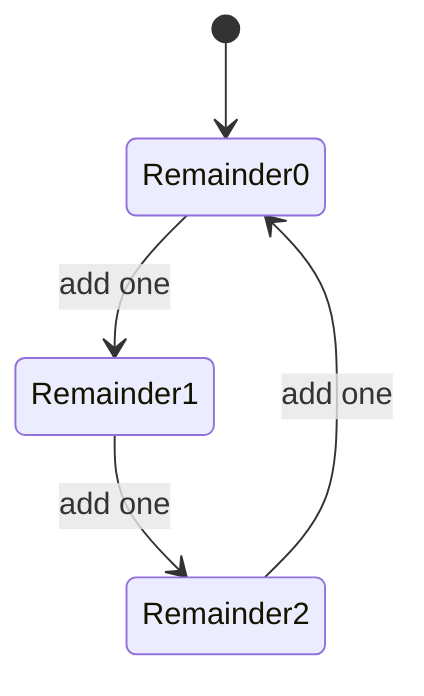

# 6.3 Remainder and Exponentiation

Division can answer two different questions: how many complete groups fit, and what is left after making those groups. Exponents ask a different question about repeated multiplication, but C++ does not give that question its own operator. Reading these calculations correctly starts with the pattern in their values, not with punctuation.

## What remains after division

For whole numbers, the remainder is the part that integer division did not put into a complete group. Because integer division truncates toward zero, negative inputs make a pattern that meets zero and then repeats on either side.

This line traces the remainder after division by 3 for inputs from -5 through 5.

{{#chart line ../../examples/ch06/03-remainder-chart.out x="n" y="n % 3" caption="Remainder pattern"}}

Notice that the values on the left are zero or negative, while those on the right are zero or positive: a nonzero remainder follows the sign of the number being divided.

The repeating part can also be seen as three states. Each increase moves to the next state, and after 2 the cycle returns to 0.

This state diagram follows the nonnegative remainder cycle as the input grows by one.



Notice that the state is the remainder, not the original number; many different inputs visit the same state.

The binary **remainder operator** is `%`. For integer operands, `left % right` gives the remainder paired with `left / right`. When the quotient is representable and the divisor is not zero, C++ keeps this relationship true:

```cpp
(left / right) * right + left % right == left
```

For `-8 / 3`, truncation toward zero gives -2. The remainder must therefore be -2 because `(-2 * 3) + -2` reconstructs -8. Changing the divisor's sign does not change the remainder's sign: `8 % -3` is 2, while `-8 % -3` is -2.

Another way to read the relationship is to separate complete groups from the leftover. The quotient chooses how many groups of the divisor fit on the path from zero toward the left operand. The remainder covers the final distance from those complete groups to the left operand, so it points in the left operand's direction. This picture explains the sign rule without treating a negative divisor as a special case.

Both operands of `%` must have integer types. A zero divisor gives undefined behavior, like integer division by zero in Lesson 6.2. Floating-point remainders use library functions with different rules and are outside this lesson.

## Cycles and parity

A remainder is useful whenever work repeats every fixed number of steps. Clock positions, alternating turns, and evenly spaced events all have a small set of states even when their input keeps growing. The remainder maps the growing input back into those states.

A number is even when its remainder after division by 2 is zero. A portable oddness test is therefore `value % 2 != 0`. Testing `value % 2 == 1` misses negative odd values, because `-7 % 2` is -1 rather than 1.

The following program checks the negative cases, the parity rule, and the two different meanings people may mistakenly give `^`.

```cpp title="remainders.cpp"
{{#include ../../examples/ch06/03-remainders.cpp}}
```

```text title="Output"
{{#include ../../examples/ch06/03-remainders.out}}
```

The named `base` and `exponent` put the last two calculations into a direct comparison. The expression `base ^ exponent` produces 1 because `^` is a bitwise exclusive-or operator, not exponentiation; the optional bit-manipulation chapter explains that operation. It should never be substituted for a power.

<details>
<summary>The program behind the remainder chart</summary>

This program calls a small printing function repeatedly because loops arrive in Chapter 8.

```cpp title="remainder-chart.cpp"
{{#include ../../examples/ch06/03-remainder-chart.cpp}}
```

</details>

## Powers are library calculations

An exponent tells how often a base participates in multiplication: two to the third power is `2 * 2 * 2`. C++ has multiplication, but no built-in exponent operator. The standard library provides `std::pow` in the `<cmath>` header.

With two `int` arguments in C++20, `std::pow(base, exponent)` calculates through a `double` overload and returns a `double`. The examples use `static_cast<int>` because the expected results are small exact whole numbers and the strict conversion warnings require the choice to be visible. That cast is not a general integer-power algorithm: sufficiently large or non-whole results can be rounded, outside the range of `int`, or otherwise unsuitable for conversion.

The function also handles exponents that would not make sense as repeated integer multiplication, such as a negative or fractional exponent. That range is one reason its result is floating-point. For this lesson's whole-number examples, the cast says that the program deliberately wants to return to an `int`; it does not make every possible `std::pow` result safe for an `int`.

Powers grow far faster than their exponents. This chart starts at one and uses checked integer multiplication to produce powers of two from exponent 0 through 10.

{{#chart bar ../../examples/ch06/03-power-chart.out x="Exponent" y="Power of two" caption="Powers of two"}}

Notice that equal steps along the horizontal axis produce bars whose heights double, so a fixed-width integer eventually runs out of range even though the exponent still looks small.

[Lesson 4.4](../ch04-fundamental-data-types/04-signed-integers.md) explains why signed overflow is undefined behavior. When an exact integer power is needed, a loop can multiply with explicit range checks; Lesson 8.10 will build that loop after `for` statements are available.

<details>
<summary>The program behind the power chart</summary>

The program prints the exponent and exact integer result as two fields for each bar. It spells out the repeated doubling because loops are not available yet.

```cpp title="power-chart.cpp"
{{#include ../../examples/ch06/03-power-chart.cpp}}
```

</details>

> [!BEST-PRACTICE]
> Use `%` for integer cycles and `std::pow` for general powers. Do not assign an invented exponent meaning to `^`.

<details>
<summary>Check your understanding</summary>

**Question 1.** Extend the remainder chart one step to the left. What is `-6 % 3`, and where would its point sit?

<details>
<summary>Answer</summary>

It is 0, so the point for -6 would sit on the horizontal zero line. Dividing -6 by 3 leaves no remainder.

</details>

**Question 2.** Why is `value % 2 != 0` a better oddness test than `value % 2 == 1`?

<details>
<summary>Answer</summary>

A negative odd value has a negative remainder. For example, `-7 % 2` is -1, which is nonzero but is not 1.

</details>

**Question 3.** Which bar follows exponent 10 in the power chart, and what value would it have?

<details>
<summary>Answer</summary>

Exponent 11 follows it, and its value would be 2048 because each bar doubles the previous one.

</details>

</details>

## Summary

- `%` gives the remainder from integer division, and a nonzero result has the left operand's sign.
- Remainders turn a growing sequence into a repeating set of states.
- Test oddness with `value % 2 != 0` so negative odd values are included.
- C++ has no exponent operator; `^` means bitwise exclusive-or.
- `std::pow` performs exponentiation and returns a floating-point result for the integer arguments used here.

## Further reading

- [Arithmetic operators (cppreference)](https://en.cppreference.com/w/cpp/language/operator_arithmetic)
- [`std::pow` (cppreference)](https://en.cppreference.com/w/cpp/numeric/math/pow)
- [Multiplicative operators in the C++ working draft](https://eel.is/c++draft/expr.mul)
