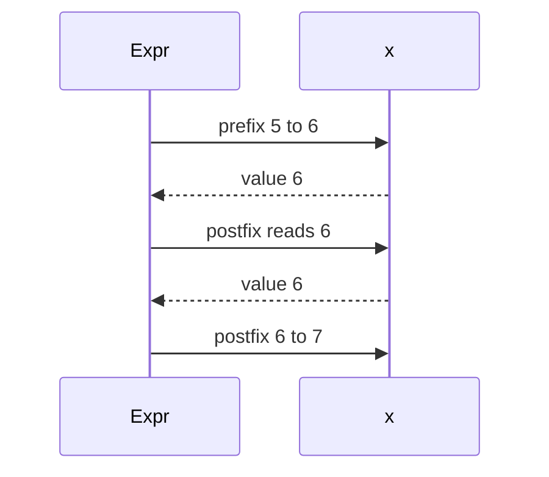

# 6.4 Increment/decrement operators, and side effects

Counting often needs two results at once: change a variable by one, and perhaps use a value from that change. C++ provides compact operators for the job, but their position decides which value the surrounding expression receives. The safe way to read them is as an ordered exchange rather than as decoration around a name.

## Change and hand over

An increment or decrement has a **side effect** because it changes the stored value of its operand. It also has an expression value that another operation can receive. Prefix and postfix forms perform the same change but hand over different values.

Keep those two outcomes separate in your mental model. The stored value answers “what will a later statement read?”, while the expression value answers “what does the surrounding initializer or operator receive now?” When an increment stands alone as a statement, only the first question matters. When it sits inside another expression, both questions must have unambiguous answers.

This call diagram follows one prefix increment and then one postfix increment from the checked trace below.



Notice that both forms change `x`, but the postfix copy leaves before the change, while the prefix value leaves after it.

The operators are `++` for adding one and `--` for subtracting one. Put the operator before the variable for the **prefix form**, as in `++x` or `--x`. Put it after the variable for the **postfix form**, as in `x++` or `x--`.

For built-in integer operands, prefix increment behaves like `x += 1`, including producing the updated value. Postfix increment first computes the value that `x` had, then changes `x` as prefix increment would. Decrement follows the same ordering while subtracting one.

## Following the trace

The checked table starts with `x` equal to 5. Each row records the statement's form, the stored value after the complete statement, and the value that the increment or decrement expression handed to `expressionValue`.

{{#table ../../examples/ch06/04-increment-trace.out header="form | x after | result"}}

Notice that each prefix row has matching value columns, while each postfix row differs by one because it hands over the earlier value.

<details>
<summary>The program behind this table</summary>

Each operator appears in its own statement so that its side effect is complete before the next row is printed.

```cpp title="increment-trace.cpp"
{{#include ../../examples/ch06/04-increment-trace.cpp}}
```

</details>

The first row evaluates `++value`: 5 becomes 6, and 6 initializes `expressionValue`. The second row evaluates `value++`: the expression hands over 6, and the stored value becomes 7 by the end of the statement. The decrement rows mirror those steps in the other direction.

When the expression value is not needed, prefix states the essential job directly: `++count` means to advance `count`. For fundamental integer types, a compiler can generate equally efficient code for unused prefix and postfix results. Prefix remains the book's default because it avoids asking for an old-value result that the statement does not use, and the same habit also suits types you will meet later.

## Keep side effects apart

A full statement finishes before the next full statement begins. Splitting changes across statements therefore creates a visible sequence:

```cpp
int left{x++};
int right{x++};
int total{left + right};
```

Putting both changes into the operands of one `+` removes that sequence. The two operand evaluations are unsequenced, and changing the same scalar object twice without sequencing gives undefined behavior. A program cannot rely on one compiler choosing a convenient order.

The following rejected example contains that bug. Both of the book's compilers diagnose it under the strict flags, and `-Werror` turns the warning into a build failure.

```cpp title="unsequenced.cpp"
{{#include ../../examples/ch06/04-unsequenced.fail.cpp}}
```

This file is intentionally not run and has no output. A diagnostic is helpful, but the language rule matters even if another compiler misses the warning: undefined behavior never becomes a valid technique.

Sequencing is separate from precedence. Precedence gives `x++ + x++` one clear tree with `+` at its root, but the tree does not order its two branches. Lesson 6.1's distinction between grouping and evaluation order is what exposes the problem.

> [!BEST-PRACTICE]
> Give a variable at most one side effect in a statement. Prefer prefix when the previous value is not part of the calculation.

Increment and decrement require a modifiable operand. Applying `++` to a literal or a `const` variable is ill-formed because there is no writable stored value to change. The operator also needs the change to stay within the type's valid range; incrementing a signed integer past its maximum has the same undefined overflow discussed in Lesson 4.4.

<details>
<summary>Check your understanding</summary>

**Question 1.** In the call diagram, which arrow would move if the postfix operation were changed to prefix increment?

<details>
<summary>Answer</summary>

The `postfix 6 to 7` arrow would move before the value is handed back. The expression would then hand over 7 rather than 6.

</details>

**Question 2.** Starting with `int tickets{8};`, what are `tickets` and `used` after `int used{tickets--};`?

<details>
<summary>Answer</summary>

`used` is 8 because postfix hands over the old value. `tickets` is 7 after the statement completes.

</details>

**Question 3.** Rewrite `int result{x++ + x++};` so that the order and both handed-over values are explicit.

<details>
<summary>Answer</summary>

One clear version is `int left{x++};`, then `int right{x++};`, then `int result{left + right};`. Each modification finishes in its own statement.

</details>

</details>

## Summary

- Increment and decrement change a modifiable operand by one, so each has a side effect.
- Prefix changes the object before producing its expression value.
- Postfix produces the old value before changing the object.
- Separate side effects into statements; two unsequenced changes to one scalar object give undefined behavior.
- Prefer prefix when the old value is not needed.

## Further reading

- [Increment and decrement operators (cppreference)](https://en.cppreference.com/w/cpp/language/operator_incdec)
- [Order of evaluation (cppreference)](https://en.cppreference.com/w/cpp/language/eval_order)
- [Increment and decrement in the C++ working draft](https://eel.is/c++draft/expr.post.incr)
