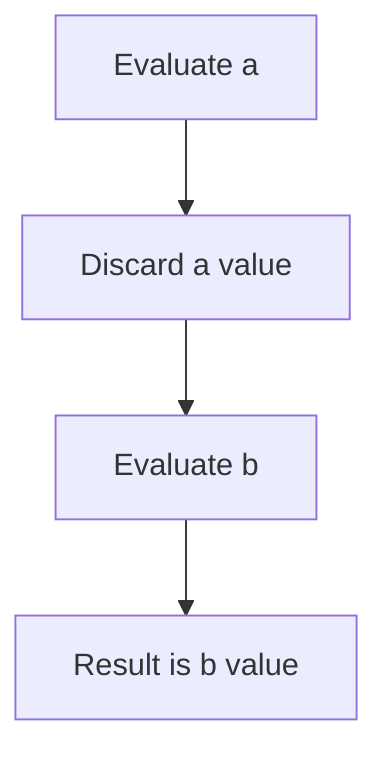

# 6.5 The comma operator

A single expression sometimes needs to perform one action and then produce the value of another. C++ has an operator for that sequence, but its punctuation is also used to separate unrelated pieces of syntax. The distinction matters because a misplaced pair of parentheses can silently change which value an assignment receives.

## One path through two expressions

The **comma operator** makes a two-step path. It evaluates its left operand and completes that operand's side effects, discards the left value, then evaluates its right operand and makes the right value the result of the whole expression.

This path shows how `(a, b)` produces one value.



Notice that the arrow never carries `a`'s value to the result, although a side effect performed by `a` remains in effect when `b` begins.

Write the operator as `left, right`. It has the lowest precedence of the operators met so far, lower even than assignment. Parentheses are therefore usually needed when the complete comma expression is meant to occupy one larger expression.

The program below changes two variables inside one parenthesized comma expression. Its left side adds 3 to `left`; its right side doubles `right` and produces the value 10, which initializes `result`.

```cpp title="comma.cpp"
{{#include ../../examples/ch06/05-comma.cpp}}
```

```text title="Output"
{{#include ../../examples/ch06/05-comma.out}}
```

The first two output lines prove that both side effects occurred. The final line follows the diagram: only the right operand's value becomes the value of `(left += 3, right *= 2)`.

## Operator or separator?

The same character does not always mean the comma operator. The grammar also uses commas to separate function arguments and declarations; separators do not discard a left expression or produce a right expression.

This fact table distinguishes the roles by what the surrounding syntax is organizing.

| Written form | Comma means |
| --- | --- |
| `(a, b)` | one operator |
| `print(a, b)` | two arguments |
| `int a{}, b{};` | two declarations |

Notice that the parentheses around `(a, b)` force one comma expression, while the parentheses in `print(a, b)` belong to the function call and contain two arguments.

## The precedence trap

Consider `result = a, b;`. Because assignment binds more tightly than comma, C++ groups it as `(result = a), b`. The assignment stores `a`, then `b` is evaluated and discarded; it does not store `b` in `result`.

The strict flags reject this spelling because the discarded value of `b` has no effect. That warning catches a likely missing pair of parentheses:

```cpp title="comma-trap.cpp"
{{#include ../../examples/ch06/05-comma-trap.fail.cpp}}
```

The file intentionally fails to build and has no output. If the intended result were `b`, the structural correction would be `result = (a, b);`, but a direct `result = b;` would communicate that intent better when `a` has no useful side effect.

Comma expressions often hide work that separate statements would expose. Lesson 8.10 introduces the common exception: a `for` statement sometimes advances two counters in its step expression. Even there, use a comma only when the two updates naturally belong together.

> [!BEST-PRACTICE]
> Prefer separate statements outside a `for` step. They make each side effect and each discarded value visible.

<details>
<summary>Check your understanding</summary>

**Question 1.** Follow the path diagram for `(score += 2, score * 3)` when `score` starts at 4. What is the expression's result, and what does `score` hold?

<details>
<summary>Answer</summary>

The left operand changes `score` to 6 and discards the value 6. The right operand then produces 18 without changing `score`, so the expression's result is 18 and `score` remains 6.

</details>

**Question 2.** Is the comma in `show(width, height)` an operator or a separator?

<details>
<summary>Answer</summary>

It is a separator between two function arguments. A comma operator used as one argument would need parentheses, such as `show((a, b), height)`.

</details>

</details>

## Summary

- The comma operator evaluates its left operand before its right operand.
- It discards the left value and uses the right value as the complete expression's result.
- Commas in argument lists and declarations are separators, not comma operators.
- Comma has very low precedence, so parentheses often decide whether it is part of an assignment.
- Separate statements are usually clearer; `for` steps are the common narrow use.

## Further reading

- [Built-in comma operator (cppreference)](https://en.cppreference.com/w/cpp/language/operator_other#Built-in_comma_operator)
- [Comma operator in the C++ working draft](https://eel.is/c++draft/expr.comma)
