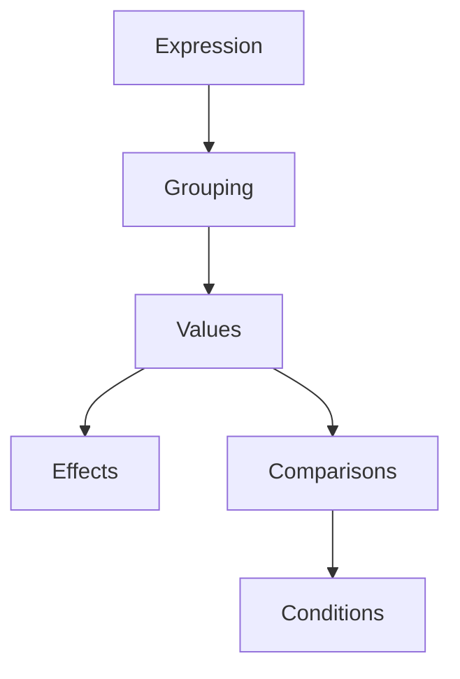

# 6. Operators

An expression can contain several operations, and each operation can produce a value, change an object, choose another expression, or decide whether more work is needed. This chapter builds a way to read those expressions without guessing. You will first see how the compiler groups an expression, then follow arithmetic, side effects, choices, comparisons, and logical conditions through pictures and checked results.

The concept map shows how the chapter moves from the structure of an expression to decisions made from its value.

Notice that grouping comes first: every later result depends on which operands belong to which operator.

## What you will be able to do after this chapter

- Draw the tree that C++ uses to group an expression, using precedence, associativity, and parentheses.
- Predict arithmetic with integer and floating-point operands, including division and remainders.
- Explain when prefix and postfix increment produce different values, and keep side effects separate.
- Use the comma and conditional operators deliberately, while recognizing when a clearer statement is better.
- Compare floating-point values with a tolerance that fits the scale of the numbers.
- Build and simplify conditions with `!`, `&&`, and `||`, including their short-circuit paths.

## Lessons in this chapter

- [6.1 Operator precedence and associativity](01-operator-precedence-and-associativity.md): how an expression becomes a tree, and why grouping is not evaluation order.
- [6.2 Arithmetic operators](02-arithmetic-operators.md): unary signs, arithmetic, compound assignment, and the two kinds of division.
- [6.3 Remainder and Exponentiation](03-remainder-and-exponentiation.md): integer cycles, negative remainders, powers, and why `^` is not exponentiation.
- [6.4 Increment/decrement operators, and side effects](04-increment-decrement-operators-and-side-effects.md): when a changed value is stored and which value an expression receives.
- [6.5 The comma operator](05-the-comma-operator.md): a sequenced pair of expressions, its result, and the precedence trap.
