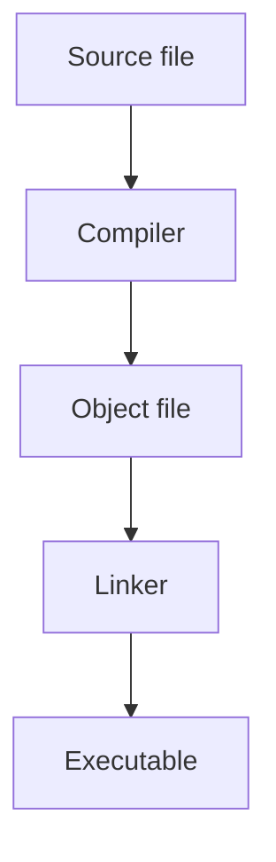

# Conventions used in this book

This page shows every component you will meet while reading the book. Skim it once now, and come back whenever something on a lesson page looks unfamiliar. It is also the page contributors use to check that each component looks right on phones and desktops, in both light and dark mode.

## Code examples

A complete program has a label above it that shows a file name. Type the program into a file with that name, then build and run it as the lessons describe.

```cpp title="hello-world.cpp"
{{#include ../examples/ch00/07-hello-world.cpp}}
```

The block under a program shows exactly what it prints. Output blocks have a rule down the left edge, so you can tell them apart from code at a glance.

```text title="Output"
{{#include ../examples/ch00/07-hello-world.out}}
```

Code blocks never wrap, and they are never cut off. When a line is wider than the page, the block scrolls sideways on its own, as in the next example. On a trackpad you swipe, with a mouse you hold <kbd>Shift</kbd> while turning the wheel, and on a touch screen you drag.

```cpp title="long-line.cpp"
std::cout << "This single line is deliberately much wider than a phone screen, so that you can see a code block scroll sideways instead of stretching the page.\n";
```

Short pieces of code inside a sentence look like `std::cout`. Identifiers, file names and commands always use this style.

## Callouts

A **callout** is a box that sets a piece of information apart from the main text. Each type has its own job, and a lesson uses them sparingly.

A **note** adds context that is useful but not essential.

> [!NOTE]
> Every C++ program starts running at a function called `main`.

A **tip** suggests a handier way to do something.

> [!TIP]
> Type each example yourself instead of pasting it. Your fingers will remember the syntax long after you forget the page.

A **warning** points out a common mistake or a behavior that may surprise you.

> [!WARNING]
> A word processor may replace plain quotation marks with curly ones. The compiler does not accept curly quotes in source code.

A **danger** callout is rare. It is reserved for actions that can lose data or damage your setup.

> [!DANGER]
> Never run a command you do not understand with administrator rights.

A **best practice** is a habit that professional C++ programmers follow, together with the reason for it.

> [!BEST-PRACTICE]
> Turn compiler warnings on, and fix every warning you see.

A **key insight** is the idea that makes the rest of a topic fall into place.

> [!KEY-INSIGHT]
> The compiler translates each source file on its own, and a separate tool then joins the results into one program.

An **advanced** callout is an aside for readers who want more depth. Beginners can skip it and lose nothing.

> [!ADVANCED]
> Compilers are free to rearrange your code as long as the program behaves the same way. That freedom is what lets optimized programs run fast.

A callout never contains a complete program. Programs always get a titled code block of their own.

## Keyboard keys

Keys are drawn like keycaps. When a lesson tells you to press <kbd>Ctrl</kbd>+<kbd>F5</kbd>, hold the first key and tap the last one. A single key looks like <kbd>Enter</kbd> or <kbd>Esc</kbd>.

## Tabs

Some instructions depend on your computer or on the tools you chose. Each **tab** holds one version of the instructions. When you choose a tab, every group of tabs on the site with the same labels switches with it, so you only pick your platform once.

### Operating systems

{{#tabs}}
{{#tab Windows}}

Open **PowerShell** from the Start menu, then print the current folder:

```powershell
Get-Location
```

{{#endtab}}
{{#tab macOS}}

Open the **Terminal** app, then print the current folder:

```bash
pwd
```

{{#endtab}}
{{#tab Linux}}

Open your distribution's terminal app, then print the current folder:

```bash
pwd
```

{{#endtab}}
{{#endtabs}}

### Toolchains

{{#tabs}}
{{#tab Visual Studio}}

**Build:** choose **Build > Build Solution**.

**Run:** press <kbd>Ctrl</kbd>+<kbd>F5</kbd>.

{{#endtab}}
{{#tab VS Code}}

**Build:** run the default build task with <kbd>Ctrl</kbd>+<kbd>Shift</kbd>+<kbd>B</kbd>.

**Run:** start the program from the integrated terminal.

{{#endtab}}
{{#tab Command line}}

**Build:** run the compiler on your source file.

**Run:** start the program by its name.

{{#endtab}}
{{#endtabs}}

## Check your understanding

Many lessons end with a short question. The question is collapsed so you can try to answer it first, and the answer opens inside it.

<details>
<summary>Check your understanding</summary>

Which callout type marks a habit that professional programmers follow?

<details>
<summary>Answer</summary>

The **best practice** callout.

</details>

</details>

## Diagrams

The next diagram shows the path from a source file to a program: the compiler turns the source file into an object file, and the linker turns the object file into an executable.



Diagrams always run from top to bottom so that they fit on a phone. Every diagram has a sentence like the one above it, for readers who use a screen reader.

## Tables

A table that is wider than the page scrolls sideways inside its own frame, and the rest of the page stays still.

| Component | What it looks like in the source | Where you will meet it | Why the book uses it | Notes for contributors |
| --- | --- | --- | --- | --- |
| Labeled code block | A fenced block with a `title` attribute that names the file | Every lesson that shows a complete program | The label tells you what to call the file when you type it | Use short file names in kebab-case |
| Output block | A `text` fence titled Output | Directly after a program | Shows exactly what the program prints | Say so when the output depends on the machine |
| Callout | A block quote that starts with its type | About once every few paragraphs | Separates side information from the main line of the lesson | Never stack two callouts back to back |
| Tabs | Two or more labeled panels | Platform-specific and tool-specific steps | Lets you read only the instructions that apply to you | Use only the two shared sets of labels |

## Links

Links to other sites always use https. A long address never stretches the page, because it wraps. For example, the reference page for value categories is at [https://en.cppreference.com/w/cpp/language/value_category](https://en.cppreference.com/w/cpp/language/value_category), and this sentence keeps going after the link to show that the line still breaks cleanly.

## Summary

- Complete programs have a titled code block, and their output follows in an Output block.
- Callouts set side information apart, and each type has one job.
- Tabs let you read only the instructions for your platform and tools, and your choice carries across the site.
- Keys, diagrams and wide tables are built to work on any screen size, in light and dark mode.
