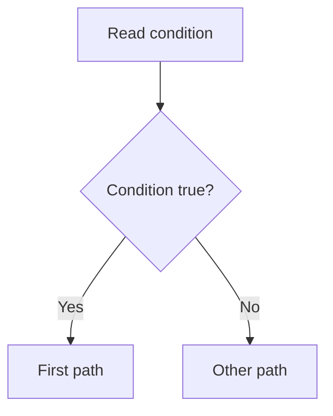
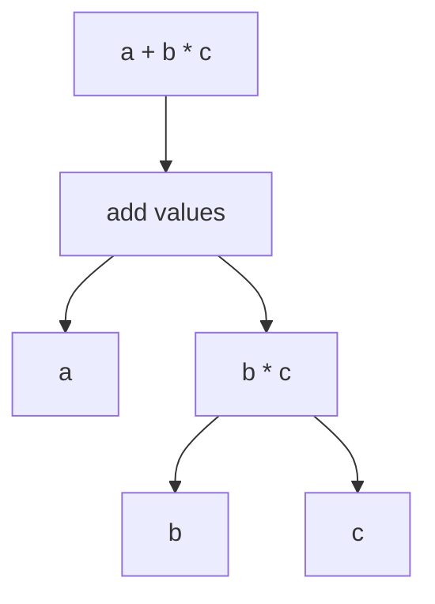
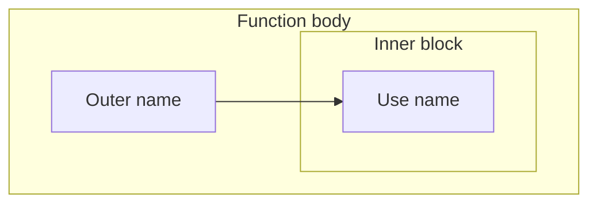
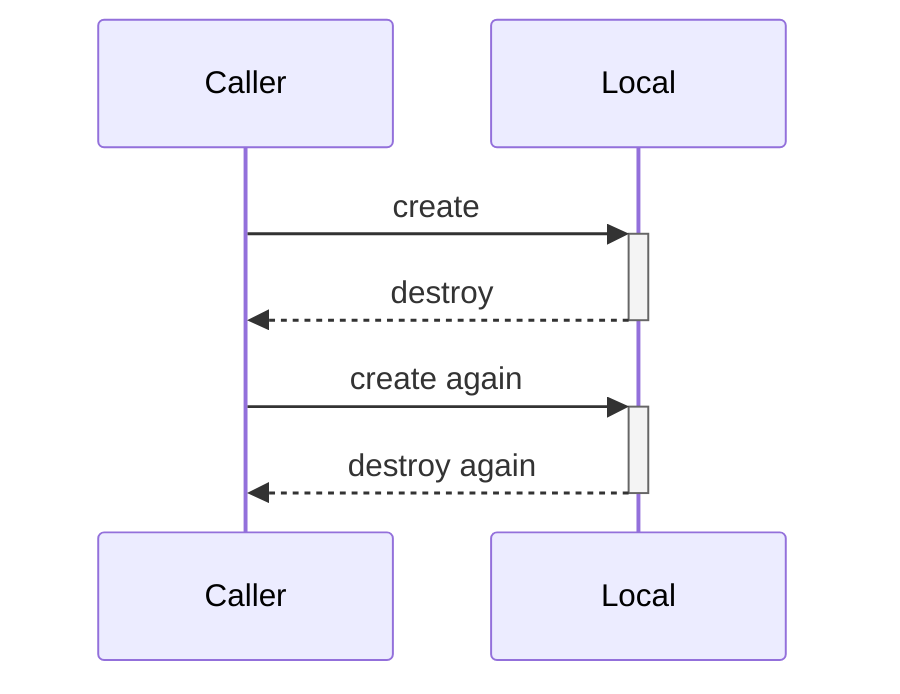
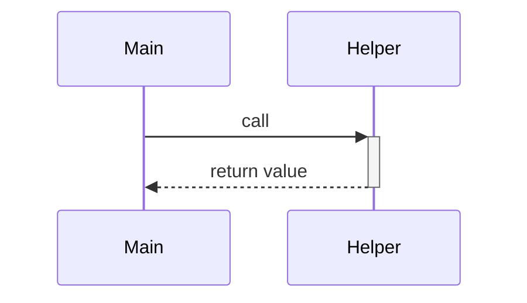
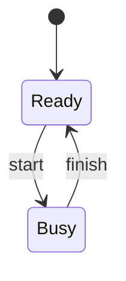
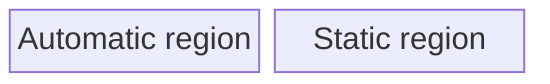

# Conventions used in this book

This page shows every component you will meet while reading the book. Skim it once now, and come back whenever something on a lesson page looks unfamiliar. It is also the page contributors use to check that each component looks right on phones and desktops, in both light and dark mode.

## Code examples

A complete program has a label above it that shows a file name. Type the program into a file with that name, then build and run it as the lessons describe.

```cpp title="hello-world.cpp"
{{#include ../examples/ch00/07-hello-world.cpp}}
```

The block under a program shows exactly what it prints. Output blocks have a rule down the left edge, so you can tell them apart from code at a glance.

```text title="Output"
{{#include ../examples/ch00/07-hello-world.out}}
```

Code blocks never wrap, and they are never cut off. When a line is wider than the page, the block scrolls sideways on its own, as in the next example. On a trackpad you swipe, with a mouse you hold <kbd>Shift</kbd> while turning the wheel, and on a touch screen you drag.

```cpp title="long-line.cpp"
std::cout << "This single line is deliberately much wider than a phone screen, so that you can see a code block scroll sideways instead of stretching the page.\n";
```

Short pieces of code inside a sentence look like `std::cout`. Identifiers, file names and commands always use this style.

## Programs that read input

Some programs wait for you to type something. Their output depends on what you type, so the book shows an **Example session** instead of an Output block: the console as you would see it, with the lines you type included. The text before it says what to type, for example "Type 42 and press <kbd>Enter</kbd>."

```cpp title="read-number.cpp"
{{#include ../examples/ch01/05-read-number.cpp}}
```

```text title="Example session"
{{#include ../examples/ch01/05-read-number.session}}
```

<details>
<summary>Check your understanding</summary>

In the example session above, which part of the text did you type?

<details>
<summary>Answer</summary>

Only the number after the question: the `42` on the first line. The program printed everything else.

</details>

</details>

## Programs that write to the error stream

Some programs print messages to a second output, the error stream, next to their normal output, and Chapter 3 explains it. For such a program the book shows the **console view** in an Output block: the text of both streams, in the order in which a terminal shows it. The text around the block names the lines that came from `std::cerr`. The book's checks run the program twice, once to compare each stream by itself and once to compare the combined view.

```cpp title="print-values.cpp"
{{#include ../examples/ch03/04-print-values.cpp}}
```

```text title="Output"
{{#include ../examples/ch03/04-print-values.out}}
```

<details>
<summary>Check your understanding</summary>

In the output above, which line did `std::cerr` write?

<details>
<summary>Answer</summary>

The first line, the one that starts with `[debug]`. The program printed it with `std::cerr`, and it printed the second line with `std::cout`.

</details>

</details>

## Programs that do not build

Some programs in this book are written to fail, so that you can see the error. The first lines of such a program are comments for the book's own checks, and you can ignore them when you read. The line `// expect-fail:` says why the program does not build, and a line `// passes-without:` names compiler options that, once removed, make the program build, which shows that those options cause the error.

```cpp title="missing-semicolon.cpp"
{{#include ../examples/ch01/01-missing-semicolon.fail.cpp}}
```

## Programs with undefined behavior

A few programs in this book are valid C++, build without a warning and still have **undefined behavior**: the language does not say what they do, so anything may happen. The book shows such a program only when the problem is the point of the lesson, and it never shows output for it, because no output would be right. The first line is a comment for the book's own checks that states the problem. You can read it as the short reason why the program is there.

The book's checks run each of these programs with the input that the lesson names, under **sanitizers**, which are tools that report mistakes while a program runs (lesson 3.10 introduced them), and they require a report. A program like this one is never run without them.

```cpp title="doubling.cpp"
{{#include ../examples/ch04/04-doubling.ub.cpp}}
```

<details>
<summary>Check your understanding</summary>

Why is there no Output block after the program above?

<details>
<summary>Answer</summary>

For a large enough number the behavior is undefined, so any output that the book printed would be a promise that the language does not make. The text describes what might happen instead.

</details>

</details>

## Debugger commands

Lessons about a debugger give the steps for three toolchains in tabs, and the labels in bold are the same in every tab, so you can compare them. The command line tab shows GDB (Linux, and Windows through MSYS2) and LLDB (macOS). A table puts the two debuggers side by side, one action per row.

A block titled **Commands for GDB** holds the exact commands that you type at the `(gdb)` prompt, one per line, with nothing else in it. The book's checks run these commands against the program with GCC and GDB and compare what GDB prints, so a value quoted in the text, such as `$1 = 6`, is what GDB really prints. The LLDB column is taken from the LLDB documentation and is not run automatically. Keys appear like <kbd>F10</kbd>, and windows and menus appear by their names, because the book shows no screenshots of a changing interface.

```text title="Commands for GDB"
{{#include ../examples/ch03/06-stepping.gdb}}
```

| Action | GDB | LLDB |
| --- | --- | --- |
| Over | `next` | `next` |
| Out | `finish` | `finish` |

<details>
<summary>Check your understanding</summary>

In the table above, which command is the same in both debuggers?

<details>
<summary>Answer</summary>

Both rows: `next` and `finish` are spelled the same in GDB and LLDB.

</details>

</details>

## Callouts

A **callout** is a box that sets a piece of information apart from the main text. Each type has its own job, and a lesson uses them sparingly.

A **note** adds context that is useful but not essential.

> [!NOTE]
> Every C++ program starts running at a function called `main`.

A **tip** suggests a handier way to do something.

> [!TIP]
> Type each example yourself instead of pasting it. Your fingers will remember the syntax long after you forget the page.

A **warning** points out a common mistake or a behavior that may surprise you.

> [!WARNING]
> A word processor may replace plain quotation marks with curly ones. The compiler does not accept curly quotes in source code.

A **danger** callout is rare. It is reserved for actions that can lose data or damage your setup.

> [!DANGER]
> Never run a command you do not understand with administrator rights.

A **best practice** is a habit that professional C++ programmers follow, together with the reason for it.

> [!BEST-PRACTICE]
> Turn compiler warnings on, and fix every warning you see.

A **key insight** is the idea that makes the rest of a topic fall into place.

> [!KEY-INSIGHT]
> The compiler translates each source file on its own, and a separate tool then joins the results into one program.

An **advanced** callout is an aside for readers who want more depth. Beginners can skip it and lose nothing.

> [!ADVANCED]
> Compilers are free to rearrange your code as long as the program behaves the same way. That freedom is what lets optimized programs run fast.

A callout never contains a complete program. Programs always get a titled code block of their own.

## Keyboard keys

Keys are drawn like keycaps. When a lesson tells you to press <kbd>Ctrl</kbd>+<kbd>F5</kbd>, hold the first key and tap the last one. A single key looks like <kbd>Enter</kbd> or <kbd>Esc</kbd>.

## Tabs

Some instructions depend on your computer or on the tools you chose. Each **tab** holds one version of the instructions. When you choose a tab, every group of tabs on the site with the same labels switches with it, so you only pick your platform once.

### Operating systems

{{#tabs}}
{{#tab Windows}}

Open **PowerShell** from the Start menu, then print the current folder:

```powershell
Get-Location
```

{{#endtab}}
{{#tab macOS}}

Open the **Terminal** app, then print the current folder:

```bash
pwd
```

{{#endtab}}
{{#tab Linux}}

Open your distribution's terminal app, then print the current folder:

```bash
pwd
```

{{#endtab}}
{{#endtabs}}

### Toolchains

{{#tabs}}
{{#tab Visual Studio}}

**Build:** choose **Build > Build Solution**.

**Run:** press <kbd>Ctrl</kbd>+<kbd>F5</kbd>.

{{#endtab}}
{{#tab VS Code}}

**Build:** run the default build task with <kbd>Ctrl</kbd>+<kbd>Shift</kbd>+<kbd>B</kbd>.

**Run:** start the program from the integrated terminal.

{{#endtab}}
{{#tab Command line}}

**Build:** run the compiler on your source file.

**Run:** start the program by its name.

{{#endtab}}
{{#endtabs}}

## Check your understanding

Many lessons end with a short question. The question is collapsed so you can try to answer it first, and the answer opens inside it.

<details>
<summary>Check your understanding</summary>

Which callout type marks a habit that professional programmers follow?

<details>
<summary>Answer</summary>

The **best practice** callout.

</details>

</details>

## Reading the diagrams and charts

A **path diagram** follows control or work from one step to the next; boxes are actions, a diamond is a choice, and arrows show what happens next.



Notice that only one arrow leaves the choice for a particular result.

An **expression tree** reads from the bottom upward: each parent combines the values directly beneath it.



The branch for `b * c` finishes before its result reaches the addition.

**Nested boxes** show regions inside other regions; a name in an outer box can be visible to an inner box.



The arrow stays inside the function body because both the declaration and its use belong there.

A **lifetime diagram** reads downward as time passes; an activation bar begins when an object exists and ends when it is destroyed.



The two separate bars show that the local object does not survive from one call to the next.

A **call diagram** also reads downward, but its arrows emphasize which function sends each call and return.



Follow the solid call arrow down to the dashed return arrow.

A **state diagram** follows an object between named situations; an arrow label says what causes the change.



The worker can repeat the Ready-to-Busy cycle without inventing a new state.

A **layout diagram** places related regions side by side when their position is the idea to compare.



The neighboring blocks invite a comparison; their colors do not carry the meaning.

Charts use labeled axes and bars or lines to show quantities. Every chart is followed by its numbers in a table, so the values remain available without the picture.

This checked program prints the values used by the chart and data table below.

```cpp title="visual-data.cpp"
{{#include ../examples/ch00/00-visual-data.cpp}}
```

The chart shows the three printed values as bars that share a zero baseline.

{{#chart bar ../examples/ch00/00-visual-data.out x="Stage" y="Checks" caption="Checks completed at each stage"}}

Notice that the height of each bar can be compared because every bar starts at zero.

A generated data table presents fields from the same checked output in rows and columns.

{{#table ../examples/ch00/00-visual-data.out header="Stage | Checks"}}

The table preserves the exact labels and values that the program printed.

## Tables

A table that is wider than the page scrolls sideways inside its own frame, and the rest of the page stays still.

| Component | What it looks like in the source | Where you will meet it | Why the book uses it | Notes for contributors |
| --- | --- | --- | --- | --- |
| Labeled code block | A fenced block with a `title` attribute that names the file | Every lesson that shows a complete program | The label tells you what to call the file when you type it | Use short file names in kebab-case |
| Output block | A `text` fence titled Output | Directly after a program | Shows exactly what the program prints | Say so when the output depends on the machine |
| Callout | A block quote that starts with its type | About once every few paragraphs | Separates side information from the main line of the lesson | Never stack two callouts back to back |
| Tabs | Two or more labeled panels | Platform-specific and tool-specific steps | Lets you read only the instructions that apply to you | Use only the two shared sets of labels |

## Links

Links to other sites always use https. A long address never stretches the page, because it wraps. For example, the reference page for value categories is at [https://en.cppreference.com/w/cpp/language/value_category](https://en.cppreference.com/w/cpp/language/value_category), and this sentence keeps going after the link to show that the line still breaks cleanly.

## Summary

- Complete programs have a titled code block, and their output follows in an Output block.
- A program that reads input shows an Example session, with the lines you type included.
- A program that writes to the error stream shows both streams in one Output block, and the text names the lines that `std::cerr` wrote.
- A program that is meant to fail starts with comment lines for the book's checks, and you can ignore them.
- A debugger lesson shows the steps for three toolchains with the same labels, and its GDB commands are checked against the program.
- Callouts set side information apart, and each type has one job.
- Tabs let you read only the instructions for your platform and tools, and your choice carries across the site.
- Keys, diagrams and wide tables are built to work on any screen size, in light and dark mode.
